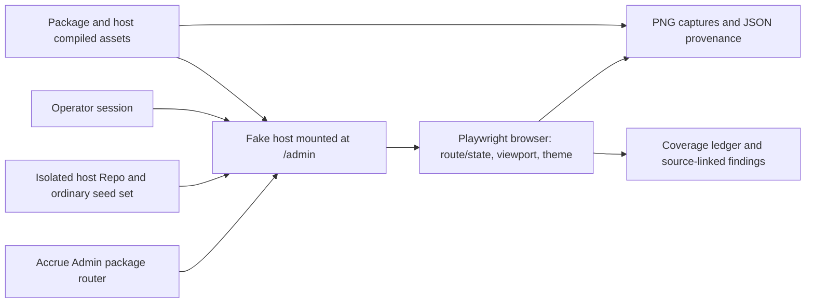

# Phase 245: Rendered Baseline and Realistic Preview - Research

**Researched:** 2026-10-11  
**Domain:** Existing Accrue Admin route/state coverage, rendered browser evidence, Fake-backed host preview data  
**Confidence:** HIGH for repository owners and safe existing commands; MEDIUM for the proposed dataset/capture batch, which planning must settle

<user_constraints>
## User Constraints (from CONTEXT.md)

### Locked Decisions

#### Route/state coverage
- **D-01:** Derive the route inventory from the mounted router and actual host; reconcile prior 21-route records instead of treating them as current coverage. Include list/detail pages and relevant overlays/disclosures/tabs. Every entry is inspected, unavailable or not applicable with reason. Sample distinct roles/scopes when appearance/actions differ.
- **D-02:** Capture real rendered wide/narrow and light/dark exemplars in a bounded batch. Use representative state combinations rather than every Cartesian combination; account explicitly for missing states. Bind captures to revision, served assets, fixture/scenario, route/state, viewport and theme.
- **D-03:** Reuse supplied owner screenshots as defect evidence, not fresh acceptance. Impeccable informs inspection of previously unseen pages and distinct shared compositions. Mechanical detector passes and screenshot existence never establish behavior or visual acceptance. Route screenshots plus source-grounded findings must inform the later fix inventory.
#### Ordinary demo versus test fixtures
- **D-04:** Keep the current feedback-preview DB intact. Use an isolated ordinary preview dataset/stack for data improvements; no implicit destructive reseeding, test-fixture deletion or live processor credentials.
- **D-05:** Ordinary demo names, identifiers, money, dates, relationships and histories should tell plausible consistent billing stories. Separate deliberate Unicode/long-name/failure fixtures into their existing owners or explicit boundary scenarios. Realistic names may include Unicode; only synthetic test narration is removed from ordinary data.
- **D-06:** Check whether missing price, fees, processing histories or mismatched raw/data payloads are deliberate valid states or inconsistent seed fabrication. Retain valid unknown/unavailable states and document why. Do not invent processor outcomes to make the demo look healthy.
#### Efficient downstream direction
- **D-07:** Record accepted findings in one source-linked ledger with shared/page-specific ownership and a phase disposition. Preserve every high-signal owner finding in the canonical brief; this phase gathers evidence, not a second unbounded ideation campaign.
- **D-08:** Reuse existing Fake-host browser, asset identity, screenshot and seed tooling. No dependency or new production UI is indicated. Existing auth/tenant/action boundaries apply to inspection.
### Agent discretion
Choose exact ordinary stories, file layout, representative viewport/state matrix and isolated preview name using existing repository patterns. Escalate only a genuine scope fork, unavailable credential or external publication decision. Owner already approved automatic discuss→plan→execute continuation and local-only tags.

### Deferred Ideas (OUT OF SCOPE)
Filter controls, copy/query repairs, table geometry and search UI: Phase 246. Timestamp convention, detail/replay/payload and analytics semantics: Phase 247. Rich scenario UI remains deferred; minimal host-only reproducibility and integrated proof: Phase 248. No billing/Portal expansion.
</user_constraints>

<phase_requirements>
## Phase Requirements

| ID | Description | Research Support |
|----|-------------|------------------|
| BASE-01 | Operators' existing Admin routes and materially distinct list/detail/overlay states are enumerated in a coverage ledger, with every entry inspected or explicitly accounted for. | The mounted router is the route authority; the existing 240 ledger and route-specific LiveView tests are reconciliation inputs. |
| BASE-02 | Reviewers can inspect representative wide/narrow and light/dark captures with route, state, scenario, revision and served-asset provenance; unseen pages receive bounded Impeccable review before changes are selected. | Reuse the Phase 237 browser capture and manifest pattern; serve real host assets and record their identities alongside each capture. |
| DEMO-01 | Reviewers can evaluate plausible ordinary billing situations without adversarial phase-number/long-name fixtures dominating the feedback preview; money, dates, relationships and processing history are checked for internal consistency. | The ordinary showcase seed and adversarial Phase 191 seed are composed by one seed entrypoint; create an isolated stack and an explicit ordinary seed path, then cross-check its related records and evidence. |
</phase_requirements>

## Summary

Phase 245 should deliver three reviewable artifacts: a route/state ledger derived from the current mounted host, a bounded set of actual browser captures with a per-capture provenance manifest and source-grounded findings, and an isolated ordinary Fake preview with coherent seed stories. The existing 240 ledger describes 21 production LiveView routes, but is explicitly a prior ledger rather than current inspection evidence; reconcile it against the current package router and the `/admin` host mount before marking coverage. `[VERIFIED: .planning/milestones/v1.64-phases/240-shared-system-and-real-billing-exemplar/240-COVERAGE.md:3-7]` Exact prior scope: “21 production LiveView routes in six operator families.”

The strongest implementation precedent is already in the repository: Phase 237 captures mounted host pages, computes source and asset fingerprints, records browser/OS/lockfile and theme override provenance, and attaches a JSON manifest beside screenshots. Its one-run command is suitable as a pattern, but its invoice/subscription exemplars are not exhaustive route coverage. `[VERIFIED: examples/accrue_host/e2e/phase237-admin-billing.spec.js:192,606-673]` Verbatim command: `CI=1 npx playwright test e2e/phase237-admin-billing.spec.js --project=chromium-desktop`; manifest keys include `source_head`, `source_sha`, `sources`, `assets`, `browser_environment`, `theme_provenance`, and `viewport_and_theme`.

For ordinary data, preserve the running Phase 243 preview and bootstrap a second Compose instance. The regular seed entrypoint currently always evaluates both `showcase.exs` and `phase191_flow_states.exs`, so merely changing the instance name does not remove synthetic stress narration. Use the existing skip-seeds startup for the new instance, then an explicit idempotent ordinary-seed path; warm recovery must continue to skip seeds. `[VERIFIED: examples/accrue_host/priv/repo/seeds.exs:100-110; examples/accrue_host/bin/dev-entrypoint.sh:65-75]` Exact seed calls: `Code.eval_file("seeds/showcase.exs", __DIR__)` and `Code.eval_file("seeds/phase191_flow_states.exs", __DIR__)`. This scoped seed path is a planning recommendation, not an existing command.

**Primary recommendation:** Keep inspection on the existing authenticated Fake host and existing Playwright/seed seams; write a route/state ledger and evidence manifest, then create a separately named ordinary preview whose startup and warm recovery cannot touch the Phase 243 database.

## Architectural Responsibility Map

| Capability | Primary Tier | Secondary Tier | Rationale |
|------------|-------------|----------------|-----------|
| Route discovery and applicability | API / Backend | Browser / Client | The package router defines mounted LiveViews while the host router determines the actual mount and dev-route configuration. `[VERIFIED: accrue_admin/lib/accrue_admin/router.ex:68-103; examples/accrue_host/lib/accrue_host_web/router.ex:142-165]` |
| Rendered visual evidence | Browser / Client | Frontend Server (SSR) | Playwright captures the browser-rendered host page; Phoenix and served package assets determine the content and resource identity. `[VERIFIED: examples/accrue_host/e2e/phase237-admin-billing.spec.js:606-673]` |
| Preview dataset | Database / Storage | API / Backend | Seeds write to the host Repo and related billing, event, webhook and organization records. `[VERIFIED: examples/accrue_host/priv/repo/seeds/showcase.exs:1-40; examples/accrue_host/priv/repo/seeds/phase191_flow_states.exs:18-78]` |
| Authenticated inspection | API / Backend | Browser / Client | The host mounts Admin with the host operator session and the package's auth hooks; use existing test credentials only in the local environment. `[VERIFIED: accrue_admin/lib/accrue_admin/router.ex:9-13,68-71; examples/accrue_host/lib/accrue_host_web/router.ex:142-165]` |

## Standard Stack

### Core

| Library/tool | Version | Purpose | Why Standard |
|---------|---------|---------|--------------|
| Accrue Admin Phoenix LiveView | Repo-pinned | Mounted routes and rendered operator pages | Existing package router is the source of route definitions. No package addition is indicated. `[VERIFIED: accrue_admin/lib/accrue_admin/router.ex:68-103]` |
| Playwright Test | 1.59.1 | Authenticated host navigation, viewport/theme capture and evidence manifest | Existing Phase 237/243 browser owners and lockfile use it. `[VERIFIED: examples/accrue_host/package-lock.json:26-34]` Verbatim lock values: `"node_modules/@playwright/test"`, `"version": "1.59.1"`. |
| Phoenix host / Ecto Repo seeds | Repo-pinned | Isolated Fake preview runtime and data | Existing host owns Compose, database, seed execution and login. `[VERIFIED: examples/accrue_host/README.md#feedback-preview-first-bootstrap-and-warm-recovery; examples/accrue_host/priv/repo/seeds.exs:100-110]` |

### Supporting

| Library/tool | Version | Purpose | When to Use |
|---------|---------|---------|-------------|
| Docker Compose | Installed locally: 29.5.2 CLI | Isolated named preview stack, DB volume and web process | Only for the isolated ordinary preview instance. Do not reset the Phase 243 instance. `[VERIFIED: examples/accrue_host/Makefile:3-11,38-42,67-72]` |
| Impeccable review | Existing installed project tool; version not rechecked here | Bounded inspection lens for unseen pages and repeated compositions | Use to structure source/render inspection, not as automatic acceptance. `[CITED: .planning/phases/245-rendered-baseline-and-realistic-preview/245-CONTEXT.md, D-03]` |

**Installation:** None. Phase context explicitly selects existing tooling and no new dependency. `[CITED: .planning/phases/245-rendered-baseline-and-realistic-preview/245-CONTEXT.md, D-08]`

**Package Legitimacy Audit:** Not applicable; this phase installs no packages. `[CITED: .planning/phases/245-rendered-baseline-and-realistic-preview/245-CONTEXT.md, D-08]`

### Alternatives Considered

| Instead of | Could Use | Tradeoff |
|------------|-----------|----------|
| New screenshot framework or visual service | Existing Playwright owner and attached JSON manifest | A second runner creates more custody and provenance surfaces without solving a gap in the current capture pattern. `[VERIFIED: examples/accrue_host/e2e/phase237-admin-billing.spec.js:606-673; CITED: 245-CONTEXT.md, D-08]` |
| Reseeding the existing feedback DB | A second DNS-safe Compose instance and explicit ordinary seed execution | Adds a separate stack to stop/maintain, while preserving operator feedback and allowing auditable seed setup. `[VERIFIED: examples/accrue_host/Makefile:3-11,67-72; CITED: 245-CONTEXT.md, D-04]` |

## Architecture Patterns

### System Architecture Diagram



`/admin` in the example host is the Admin mount; `/billing` is Portal. Treat package-fixture `/billing` as a different context. `[VERIFIED: .planning/milestones/v1.64-phases/240-shared-system-and-real-billing-exemplar/240-COVERAGE.md:56]` Verbatim host distinction: “host `/admin` is Admin; host `/billing` is Portal; package fixture `/billing` is Admin.”

### Recommended Project Structure

Place phase artifacts under `.planning/phases/245-rendered-baseline-and-realistic-preview/`: route/state ledger, capture directory with PNGs and `manifest.json`, and one linked findings/ownership ledger. Keep any ordinary preview seed entrypoint in the existing `examples/accrue_host/priv/repo/seeds/` owner family, and document its startup command in the host README. This layout is a recommendation based on current planning-artifact and seed owners. `[VERIFIED: 245-CONTEXT.md:31-38; examples/accrue_host/priv/repo/seeds.exs:100-110]`

### Pattern 1: Derive routes, then account for state applicability

**What:** Read the package LiveView declarations and the actual host mount, then compare every current route to the old 240/239 ledgers. Keep package assets, legacy redirects, dev-only routes, list/detail records, and material overlays/disclosures distinct. For each route/state pair record one of inspected, unavailable with evidence/recovery, or not applicable with reason; note role/owner scope only where it changes appearance or actions. `[VERIFIED: accrue_admin/lib/accrue_admin/router.ex:51-103; 240-COVERAGE.md:3-7,35-37; CITED: 245-CONTEXT.md, D-01]`

**When to use:** The entire phase. A matching route count or passing suite is not proof each current route/state was mounted; the historical ledger itself distinguishes `exercised`, `source-only`, and `historical`. `[VERIFIED: 240-COVERAGE.md:7,11-37]` Exact evidence labels: “`exercised`”, “`source-only`”, and “`historical`”.

**Example commands:** `cd examples/accrue_host && MIX_ENV=test mix phx.routes` to inspect the compiled host mount; use the route-specific existing LiveView test owner as a state-semantics cross-check. This command is a planning suggestion; no command was run during research.

### Pattern 2: Bounded browser captures with correlated evidence

**What:** Capture representative compositions and state combinations at wide/narrow widths and effective light/dark themes. Record omissions explicitly; include route and query, state/fixture, theme, CSS viewport, capture hash, source/worktree fingerprint, served CSS/JS URLs and hashes, browser/version, OS, Node, lockfile hash, command and capture date. Reuse the existing Phase 237 pattern for media emulation and `data-theme`; identify those as emulated values, not physical-device or stored-preference evidence. `[VERIFIED: examples/accrue_host/e2e/phase237-admin-billing.spec.js:64-66,606-673; 240-COVERAGE.md:60-61]`

**When to use:** Each selected exemplar. Do not create every route × viewport × theme × state combination. For each unseen page, apply bounded Impeccable review and log source-based defect candidates beside the rendered image. Supplied owner screenshots remain defect reports, not newly accepted evidence. `[CITED: 245-CONTEXT.md, D-02-D-03]`

**Example command:** `cd examples/accrue_host && CI=1 npx playwright test e2e/<phase245-capture-owner>.spec.js --project=chromium-desktop --workers=1`. Adapt the project to the existing Playwright config and ensure the run uses the explicitly selected isolated fixture. The existing exemplar command is verified in Phase 237's manifest. `[VERIFIED: examples/accrue_host/e2e/phase237-admin-billing.spec.js:192]`

### Pattern 3: Separate ordinary preview data from stress fixtures

**What:** Keep the current feedback preview DB untouched. Start a second named Compose project, skip automatic seeds at bootstrap, then invoke a clear, idempotent ordinary-preview seed entrypoint. On warm recovery use the same instance with `ACCRUE_HOST_SKIP_SEEDS=1`. A dataset-only name change is insufficient because the current ordinary seed aggregator also runs the Phase 191 boundary seed. `[VERIFIED: examples/accrue_host/Makefile:3-11,38-42,67-72; examples/accrue_host/bin/dev-entrypoint.sh:65-75; examples/accrue_host/priv/repo/seeds.exs:100-110]`

**Example commands:**

```bash
cd examples/accrue_host
ACCRUE_HOST_SKIP_SEEDS=1 make up INSTANCE=accrue-v166-demo
# Execute the phase's explicit ordinary-only seed command against that instance.
ACCRUE_HOST_SKIP_SEEDS=1 make up INSTANCE=accrue-v166-demo
```

The seed command is a Wave 0 planning choice; it does not exist yet. `make up` is long-running and should be backgrounded as documented by the project; verify the instance, Compose volume, database and port before any write. For warm recovery, don't execute the seed command again. `[VERIFIED: examples/accrue_host/README.md#feedback-preview-first-bootstrap-and-warm-recovery; scripts/ci/accrue_host_preview_custody.sh:119-142,153-178]`

### Ordinary story integrity checks

For every seeded story, inspect both foreign-key/relationship correctness and displayed semantics: customer-owner ↔ subscription ↔ invoice/charge links; amount subtotal + tax = total and paid + remaining = due where the schema/story uses those fields; currency/minor-unit conventions; chronological invoice periods/finalization/payment, subscription period/status and event/webhook timestamps; coupon ↔ promotion-code references; audit/dispatch history only when an action actually occurred; and processor raw payload agreement with the normalized projection. These are check dimensions derived from owner requirements, not assertions that every schema has all fields. Retain valid unknown or unavailable fee/price/history states and add a note identifying whether they represent provider capabilities or omitted fixture evidence. `[CITED: 245-CONTEXT.md, D-05-D-06; .planning/REQUIREMENTS.md:13; .planning/notes/2026-10-11-admin-owner-feedback.md]`

## Don't Hand-Roll

| Problem | Don't Build | Use Instead | Why |
|---------|-------------|-------------|-----|
| Browser navigation, effective viewport/theme, screenshot bytes | A new browser driver or screenshot service | Existing Playwright host project and capture-manifest pattern | Existing host owners already capture route, viewport, theme, browser environment, asset hashes and screenshot bytes. `[VERIFIED: examples/accrue_host/e2e/phase237-admin-billing.spec.js:606-673]` |
| Host instance isolation and preservation checks | Ad hoc DB name checks or a reset of the feedback DB | Compose `INSTANCE` isolation and the existing preview custody tool before any proof write | Custody checks compare DB host/name/connection/instance, project, volume, port, processes and build path, then compare authoritative state snapshots. `[VERIFIED: scripts/ci/accrue_host_preview_custody.sh:119-142,153-178]` |
| Query semantics inferred from UI placeholders | New guessed route behavior | Existing `AccrueAdmin.Queries.*` modules and LiveView tests | Context identifies these as the owners of URL/search predicates; use them to label actual state meaning. `[CITED: 245-CONTEXT.md, Existing Code Insights]` |

**Key insight:** Keep evidence layers separate: package source, host-compiled assets, HTTP-served assets, browser response/render, and exercised interaction are distinct observations. Phase 243 handoff documents this separation and notes its own results are revision-bound. `[VERIFIED: .planning/milestones/v1.64-phases/243-integrated-evidence-and-feedback-preview/243-HANDOFF.md, Current evidence; Evidence boundaries]`

## Common Pitfalls

### Pitfall 1: Carrying the old route count forward as complete coverage
**What goes wrong:** A ledger repeats the old 21 routes but silently misses host mount/dev behavior or treats test-owner existence as rendered inspection.  
**How to avoid:** Reconcile package declarations with actual host mount and enumerate route/state applicability. Distinguish current inspection, source-only support, and unavailable/N/A. `[VERIFIED: 240-COVERAGE.md:3-7,35-37; accrue_admin/lib/accrue_admin/router.ex:68-103]`

### Pitfall 2: Screenshot existence presented as acceptance
**What goes wrong:** Images lack state/revision/assets, or a detector pass is used to claim visual or behavioral quality.  
**How to avoid:** Correlate each capture to source revision, served assets, fixture/scenario, route/state, viewport and theme; tie accepted findings to an exercised owner and inspected result. `[CITED: 245-CONTEXT.md, D-02-D-03; VERIFIED: phase237-admin-billing.spec.js:606-673]`

### Pitfall 3: Unintended theme or viewport claims
**What goes wrong:** CSS scaling is called narrow layout, or a DOM theme override is reported as persisted preference/OS behavior.  
**How to avoid:** Record CSS viewport dimensions and theme override method. Identify browser emulation as emulation; actual zoom, physical device and screen-reader speech are separate evidence. `[VERIFIED: 240-COVERAGE.md:60-61]`

### Pitfall 4: Synthetic data leaks into the ordinary preview
**What goes wrong:** A new Compose instance still runs the full seed aggregator and gets phase-number narration, long names, or stress-only high counts.  
**How to avoid:** Use an explicit ordinary-only seed path on the new instance; leave adversarial seed owners available to test suites and explicit boundary scenarios. Verify the current preview snapshot before/after any potentially shared command. `[VERIFIED: seeds.exs:100-110; phase191_flow_states.exs:1-16,80-101; scripts/ci/accrue_host_preview_custody.sh:153-178]`

### Pitfall 5: “Healthy-looking” demo overwrites truthful unknowns
**What goes wrong:** Missing fees, prices, histories or raw payload mismatch gets filled with invented provider outcomes.  
**How to avoid:** Classify each gap against schema/provider behavior and fixture intent; retain unknown/unavailable states when valid and correct only inconsistent seed fabrication. `[CITED: 245-CONTEXT.md, D-06]`

## Code Examples

Verified existing capture pattern:

```js
const collectionShot = await page.screenshot({ fullPage: true });
screenshots["invoice-collection.png"] = { bytes: collectionShot, route: page.url(), viewport: { width: 320, height: 800 }, theme: "light" };
```

This existing example is verbatim. `[VERIFIED: examples/accrue_host/e2e/phase237-admin-billing.spec.js:298-299]` Exact source: `const collectionShot = await page.screenshot({ fullPage: true });` and `screenshots["invoice-collection.png"] = { bytes: collectionShot, route: page.url(), viewport: { width: 320, height: 800 }, theme: "light" };` The broader manifest fields are in `[VERIFIED: examples/accrue_host/e2e/phase237-admin-billing.spec.js:606-673]`.

## State of the Art

| Old Approach | Current Approach | When Changed | Impact |
|--------------|------------------|--------------|--------|
| Use a historical route list or screenshot set as proof of current completeness | Derive from current mounted router and label what was actually inspected or accounted for | Locked for Phase 245 on 2026-10-11 | Makes route/state gaps and evidence age visible. `[CITED: 245-CONTEXT.md, D-01-D-03]` |
| Use a single preview DB for feedback and test stress data | Keep the feedback DB intact and use an isolated ordinary preview dataset | Locked for Phase 245 on 2026-10-11 | Prevents stress fixtures and proof operations from altering feedback state. `[CITED: 245-CONTEXT.md, D-04-D-06]` |

**Deprecated/outdated:** No external technology deprecation is relevant. Historical screenshot and route records remain useful references but are not fresh Phase 245 acceptance. `[VERIFIED: 243-HANDOFF.md, Evidence boundaries; CITED: 245-CONTEXT.md, D-01-D-03]`

## Project Constraints (from AGENTS.md)

No project `AGENTS.md` directives or project skill rules were loaded during this session; no additional directives have been captured for the planner. `[ASSUMED: project-root file/skill discovery]`

Relevant `CLAUDE.md` project constraints for planning: machine-verifiable behavior belongs in automated checks; do not add human-verification checkpoints when an assertion can decide the result; phase closeout requires automated UAT, `human_judgment: false`, passing verification with zero unverified behavior, and executable-UAT contract. Use deterministic fixtures rather than provider-live lanes without credentials/drift need. `[VERIFIED: CLAUDE.md:201-208]`

## Runtime State Inventory

Not a rename/refactor/migration phase; no runtime state inventory is required. The current preview DB is still a protected runtime system and must be preserved under D-04. `[CITED: 245-CONTEXT.md, D-04]`

## Environment Availability

No server or database was started and no seed or test command was run in research. Local tool probes found Node `v22.14.0`, npm `11.1.0`, Docker CLI `29.5.2`, Elixir `1.19.5` on OTP `28`, and Chromium at `/opt/homebrew/bin/chromium`; these are local availability observations only. `[VERIFIED: environment probes in this research session]`

| Dependency | Required By | Available | Version | Fallback |
|------------|-------------|-----------|---------|----------|
| Node/npm | Host Playwright | Yes | Node 22.14.0 / npm 11.1.0 | None needed |
| Docker Compose | Isolated preview | Docker CLI available | 29.5.2 | None identified |
| Elixir/Mix | Host application and seed | Yes | Elixir 1.19.5 / OTP 28 | Repo-managed asdf shims |
| Chromium | Browser capture | Yes | Local executable; browser project version resolved by lockfile | Existing Playwright browser install command if local browser revision differs |
| Current preview credentials | Authenticated preview only | Not checked or disclosed in research | — | Existing README/local secret store; do not copy into phase artifacts |

**Missing dependencies with no fallback:** None found by local probes. Availability of the currently running preview and its credentials was not tested; execution must check the actual instance before use.

## Validation Architecture

`workflow.nyquist_validation` is enabled. `[VERIFIED: .planning/config.json:19]` Verbatim config value: `"nyquist_validation": true`.

### Test Framework

| Property | Value |
|----------|-------|
| Framework | Playwright Test 1.59.1 for mounted browser evidence; ExUnit/Mix for host and Admin semantic owners |
| Config/owners | `examples/accrue_host/playwright.config.js`; `accrue_admin/test/accrue_admin/live/`; existing capture precedent `examples/accrue_host/e2e/phase237-admin-billing.spec.js` |
| Quick run command | `cd examples/accrue_host && CI=1 npx playwright test e2e/<phase245-capture-owner>.spec.js --project=chromium-desktop --workers=1` |
| Full suite command | Do not use as a substitute for requirement-specific evidence; canonical broader host gate is `cd examples/accrue_host && mix verify.full` when the phase plan requires it and custody is verified. |

### Phase Requirements → Evidence Map

| Req ID | Behavior | Evidence Type | Automated Command / Owner | Exists? |
|--------|----------|---------------|----------------------------|---------|
| BASE-01 | Current mounted routes and material states fully accounted for | Route ledger reconciled with host route output; route-by-route browser inspection and explicit N/A/unavailable reason | `cd examples/accrue_host && MIX_ENV=test mix phx.routes`; use existing per-route ExUnit files for state semantics | Route source and old 240 ledger exist; current phase ledger does not |
| BASE-02 | Representative real captures with revision and served-asset provenance | Playwright capture plus manifest; human inspection is recorded as findings, not automated visual acceptance | New bounded phase owner modeled on `phase237-admin-billing.spec.js`; run exact focused command above | Capture precedent exists; phase-specific batch/manifest does not |
| DEMO-01 | Ordinary billing stories are plausible and mutually consistent in isolated preview | Seed data contract/assertion plus relationship/amount/time/history cross-checks in isolated DB | Explicit ordinary-seed command and focused validation to be selected during planning; assert the Phase 243 snapshot remains unchanged around any shared tooling | Showcase and custody tools exist; ordinary-only seed owner does not |

### Sampling Rate

- Per route inventory change: inspect router/host route output, reconcile ledger rows and run relevant focused LiveView owner for claimed state semantics.
- Per capture batch: run only the selected Playwright owner against the isolated fixture; inspect the actual rendered image and its recorded asset/resource identity.
- Per seed change: validate the seed contract and internal consistency against the isolated ordinary preview DB; prove the existing Phase 243 authoritative preview snapshot is unchanged.
- Phase gate: all route entries accounted, representative rendered evidence tied to current source and served assets, ordinary story integrity checks pass, and required artifact ownership is recorded. `[CITED: 245-CONTEXT.md, D-01-D-08; .planning/REQUIREMENTS.md:11-13]`

### Wave 0 Gaps

- [ ] Create the current-phase route/state ledger and reconcile the old 240/239 records with current package + host routes.
- [ ] Select a small representative capture matrix with named omissions and a source/asset/fixture manifest; existing spec proves the technique but not Phase 245 coverage.
- [ ] Add an explicit ordinary-only seed path and isolated preview command; current seed aggregator includes the Phase 191 stress seed.
- [ ] Define deterministic integrity checks for the chosen billing stories and prove no side effects on the protected preview.

## Security Domain

Security enforcement is enabled by default under project protocol. The phase adds no authentication system; preserve the host operator session, owner/tenant scope, and existing action boundaries while navigating and inspecting. Do not put passwords, session tokens, PII or live processor credentials in source, captures, manifests or handoff. `[VERIFIED: accrue_admin/lib/accrue_admin/router.ex:9-13,68-71; CITED: 245-CONTEXT.md, D-04,D-08]`

### Applicable ASVS Categories

| ASVS Category | Applies | Standard Control |
|---------------|---------|-----------------|
| V2 Authentication | Yes | Existing host operator login and Admin auth hook; credentials remain local |
| V3 Session Management | Yes | Use current browser session setup; do not export cookies or tokens |
| V4 Access Control | Yes | Preserve owner/org scope and only inspect with authorized operator fixture |
| V5 Input Validation | Yes, for route/query fixture inputs | Reuse real query modules and existing validation contracts |
| V6 Cryptography | No new cryptographic work | No new crypto values or provider credentials are needed |

### Known Threat Patterns for the Preview/evidence stack

| Pattern | STRIDE | Standard Mitigation |
|---------|--------|---------------------|
| Test or preview proof targets persistent feedback DB | Tampering | Verify DB identity, Compose instance, volume, port, processes and build path via existing custody owner before writes |
| Capturing operator secrets or personal billing data | Information Disclosure | Use synthetic fixture data; redact credentials/session state; keep credentials in README/local secret store |
| Claiming an unauthenticated page response proves Admin access control | Elevation of Privilege | Authenticate and navigate through the existing operator browser flow |
| Seed facts imply actions/outcomes unsupported by history | Repudiation / Tampering | Cross-check normalized rows, related records, payload/history and action dispatch evidence; preserve unknown/unavailable state |

## Sources

### Primary (HIGH confidence)

- `accrue_admin/lib/accrue_admin/router.ex` — package LiveView routes and auth hook setup.
- `examples/accrue_host/lib/accrue_host_web/router.ex` — actual `/admin` mount and test/production branches.
- `examples/accrue_host/e2e/phase237-admin-billing.spec.js`, `package-lock.json` — existing browser capture pattern, manifest and locked Playwright version.
- `examples/accrue_host/Makefile`, `bin/dev-entrypoint.sh`, `priv/repo/seeds.exs`, `priv/repo/seeds/showcase.exs`, `priv/repo/seeds/phase191_flow_states.exs` — Compose isolation, startup skip-seed switch and seed composition.
- `scripts/ci/accrue_host_preview_custody.sh` and `e2e/phase243-preview-preservation.spec.js` — protected preview identity/snapshot and authenticated warm recovery.
- `.planning/REQUIREMENTS.md`, `245-CONTEXT.md`, `.planning/STATE.md`, owner feedback note, `CLAUDE.md`, Phase 240 coverage and Phase 243 handoff — scope, constraints, prior evidence and closeout obligations.

### Secondary (MEDIUM confidence)

- No external documentation used; this is repository-pattern research and no new external library/API is proposed.

## Assumptions Log

| # | Claim | Section | Risk if Wrong |
|---|-------|---------|---------------|
| A1 | The isolated ordinary preview can be bootstrapped with the existing skip-seed branch and an explicit one-time ordinary-only seed command without changing the current feedback stack. | Pattern 3 | If the container lacks required seed context or startup state, execution may need a narrowly scoped host seed-profile switch. |
| A2 | A bounded capture set can span representative route families while remaining useful for later shared/page-specific fix ownership. | Pattern 2 | Too small a set could miss unique compositions; planning must name applicability and omissions. |
| A3 | `accrue-host-phase245-ordinary` is the selected isolated Compose instance label; it is not the protected Phase 243 instance. | Pattern 3 | Execution must fail closed if this exact instance is unavailable or aliases the protected preview. |

## Open Questions (RESOLVED)

1. **Ordinary stories:** Use the existing hero account, background and showcase seed families as the ordinary baseline; exercise invoice → subscription → customer, payment/refund, coupon/promotion, event and webhook links by their stable processor IDs. The Phase 245 data contract checks amount/currency, UTC chronology, relationship and observed history; it corrects only demonstrated showcase contradictions. Phase 191 and edge-state narration remain in their fixture owners.
2. **Capture batch:** Visit and account for every mounted Admin list/detail route, overlay, disclosure, tab and material state in the ledger. Capture distinct shell/table/detail/analytics/overlay compositions with 1280×900 and 390×844, light and dark represented across a bounded batch, selecting state combinations by distinct composition and recording each omitted combination and reason. The actual image inspection and source-linked findings cover previously unseen compositions; no full Cartesian batch is required.
3. **Seed path:** Create `examples/accrue_host/priv/repo/seeds/ordinary.exs`, explicitly invoke it after `ACCRUE_HOST_SKIP_SEEDS=1 make up INSTANCE=accrue-host-phase245-ordinary`, and reuse extracted seed helpers. Keep the default `seeds.exs` composition intact and warm recovery seed-skipped. The seed entrypoint asserts exact Compose instance, skip-seed boot and Fake processor before writing.
4. **Preview custody and credentials:** The protected instance is `accrue-host-phase243-preview`; snapshot and compare its authoritative state through `scripts/ci/accrue_host_preview_custody.sh`. Use the README's existing local operator credential source for authenticated captures; no credential value is stored in research, plan or evidence. If that credential or the host is unavailable at execution, record the affected route/state as unavailable with reason, continue source inventory and seed contract checks, and do not claim BASE-02 complete until an authenticated representative capture succeeds. Request only the missing bootstrap input at that point; never bypass auth or substitute old screenshots.

## Metadata

**Confidence breakdown:**
- Standard stack: HIGH — verified against current router, lockfile, host commands and seed owners.
- Architecture: HIGH — current route and host mount source read directly; capture and seed boundaries have prior execution evidence.
- Pitfalls: HIGH — sourced from current seed aggregation, custody guards and locked context.
- Proposed isolated ordinary seed flow: MEDIUM — valid repository pattern but no ordinary-only seed command exists yet.

**Research date:** 2026-10-11  
**Valid until:** 2026-11-10 for repository owners; recheck route and browser spec revisions before execution.
