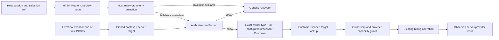

# Phase 233: Shared Direction & Portal Contract - Research

**Researched:** 2026-10-07  
**Domain:** Phoenix LiveView, host authorization, visual semantics  
**Confidence:** HIGH on source structure; MEDIUM on external guidance; LOW on rendered appearance (not observed)

<user_constraints>
## User Constraints (from CONTEXT.md)

### Locked Decisions

D-01–D-17 are locked. Preserve Admin --ax-* and public --accrue-* token names, separate package ownership/branding/shells, define concise DESIGN.md semantic roles, inventory current source separately from historical screenshots, keep host policy/selection host-owned, retain personal defaults, distinguish actor/billable/Customer/processor/target, authorize before provisioning, apply fresh checks across HTTP, LiveView reconnect/events/navigation and all four POSTs, pin forms to displayed context, preserve resource/provider guards and actual actor attribution, clear secure state on invalidation, fail closed with generic accessible recovery, and don't promise payment atomicity or success without evidence. [VERIFIED: .planning/phases/233-shared-direction-portal-contract/233-CONTEXT.md, D-01–D-17, read this session]

### Verbatim locked decisions

- **D-01:** Share semantic visual meanings and acceptance criteria across Admin and Portal, while keeping package-owned token APIs, asset delivery, brand identity, shells, and audience-specific layouts/control density. Admin remains the operator surface; Portal remains host-branded customer self-service. Do not make Portal depend on Admin or import a single shared stylesheet just to align colors.
- **D-02:** Preserve the existing Admin --ax-* system and public core/Portal --accrue-* token names. Use small local mappings/adapters only where inspection shows a real mismatch. Do not rename public tokens, duplicate a large token catalog, add a dependency, or build a standalone design-system project.
- **D-03:** Establish a concise canonical DESIGN.md direction for semantic roles, typography/spacing targets, color-independent state cues, focus, motion, reflow, host-brand boundaries, and token ownership. Keep route-specific hierarchy and workflow decisions in their owning phases and scoped UI contracts.
- **D-04:** First record the current source/route/flow/component/state inventory and distinguish it from historical captures. Inspect representative served Admin and Portal renders from the canonical host before asserting visual behavior; include source and asset provenance. Saved July screenshots and old pass counts are historical evidence, not proof of today's rendered tree. No browser render, build, or application test was run during this discussion.
- **D-05:** Keep accessibility expectations observable: status is not conveyed by color alone; visible text, labels and feedback are clear; keyboard focus remains visible; host accents are checked against relevant foreground/control contrast; layouts reflow without losing essential billing facts or actions; dynamic denial/result messages are exposed to assistive technology. This is a target for the owning slices, not a certification claim.
- **D-06:** Keep the selected billed entity visibly named throughout Portal billing pages and action confirmations, using host-provided display metadata. Make that name distinct from the host product brand, authenticated person, Accrue Customer, and processor. Long/duplicate names must remain understandable. Escape/render the value as presentation data; it never grants authorization.
- **D-07:** Keep personal-only use plain and compatible: no synthetic organization, required company vocabulary, or account picker. For mixed or organization/custom hosts, offer an optional link to the host's existing account selector when supplied. Account discovery and selection remain host-owned; do not embed a universal Portal selector.
- **D-08:** Use one optional Portal integration contract with two responsibilities: resolve the authenticated human actor's authorized billable context and authorize each named action against its server-loaded target. The exact callback names/signatures and context envelope remain implementation decisions for the researcher/planner; do not publish an API shape until current call sites and transport needs are reconciled.
- **D-09:** Preserve the existing authenticated-person billable behavior when no adapter is configured. For custom contexts, keep actor, billable, Accrue Customer, processor, and target distinct; do not override current_user to mean a company or hardcode host role names. Select the exact owner-type + owner-ID + processor Customer identity.
- **D-10:** Resolve the intended context and authorize the relevant read before any Customer provisioning/provider write. A denied, missing, deleted, explicit-invalid, or unavailable selection never falls back to personal billing, a first organization, another Customer, or operator scope. An authorized but unprovisioned billable remains distinct from denial/unavailability.
- **D-11:** Reuse one consistent resolution/authorization boundary for initial HTTP, LiveView mount/reconnect/events, protected navigation, and all four Portal POST paths. Host policy is checked freshly at the action boundary; a cached display permission or preview is never authority. Existing Customer/resource ownership and provider capability guards remain in force. Keep the actual human actor in operation attribution.
- **D-12:** Display names and switch/return destinations are host presentation/navigation inputs, not authority. Validate local return destinations and preserve existing provider-specific hosted-vs-mounted boundaries. A query parameter, Portal token, preview, or already-rendered control cannot establish payment or permission.
- **D-13:** Pin each open form, preview, confirmation, and checkout to the billed entity/Customer/processor it visibly names. Reauthorize that same context and target immediately before action. Separate tabs may retain independently pinned contexts while the host still authorizes them; a context change must never retarget an old form.
- **D-14:** A switch begins a fresh context. Clear pending confirmations/previews and secure payment-field state when that flow is abandoned or its authorization/context is invalidated. Preserve only harmless navigation state when it still refers to the same displayed billable. Never auto-replay a denied or uncertain payment mutation.
- **D-15:** Distinguish unauthenticated access from an authenticated actor whose selected billable is no longer available. Use a clear, generic blocked/unavailable state that does not disclose another account's existence. Offer the host-provided switch/return link when present; use existing safe host login/return behavior for unauthenticated requests and a non-looping safe Portal/host fallback otherwise. Do not add a separate recovery-URL callback/configuration knob absent an adopter case the existing host link cannot serve.
- **D-16:** On a denied mutation, say the change was not submitted; do not imply a charge or success. Clear secure card fields/nonces and mutation payloads; do not retry automatically. Announce in-place status changes accessibly; for a navigated blocked page, provide a clear heading and predictable focus destination.
- **D-17:** Apply host fresh authorization on reconnect and protected events/POSTs as well as initial render. Permission revocation stops later action, but does not imply atomic rollback of a remote payment already accepted by a provider; report only actual server/provider evidence.

### the agent's Discretion

Copy verbatim from CONTEXT.md:

- Choose the smallest maintainable callback/context shape after tracing the current HTTP, LiveView and POST paths. Prefer existing Phoenix/session mechanisms and short local code over another dependency; add a dependency only for a demonstrated capability/maintenance benefit. Do not hand-roll payment security or replace the official payment SDK boundary.
- Decide whether the visible label uses “Billing for [host name]” or an equally clear host-appropriate phrasing, and where to place secondary owner metadata, as long as the billed entity is clear across pages/confirmations and does not become authority.
- Choose representative route/state renders and a bounded source-inventory format that prove current served behavior without repeating every route across every theme, role, viewport, and state.
- Reuse the canonical host's existing organization selection and policy. Demonstrate personal defaults plus organization/custom and mixed examples without making Cadence's roles or model shape a library requirement.
- If a dedicated host recovery destination appears necessary, first demonstrate why the existing optional switch/return path is insufficient; keep it out of the first public contract by default.

### Deferred Ideas (OUT OF SCOPE)

Copy verbatim from CONTEXT.md:

- No new product capability was requested. A distinct Portal recovery-URL API, universal account selector/role model, shared component framework, and global cross-tab account-selection system remain out of scope unless concrete adopter evidence reopens them.
- Keep route-specific redesign/action behavior in Phases 234–238 and integrated all-route coverage/handoff in Phase 239.
</user_constraints>

<phase_requirements>
## Phase Requirements

| ID | Description | Research Support |
|----|-------------|------------------|
| BASE-01 | Current route/flow/component/state inventory with provenance; historical captures are not current rendering. | Source map plus fresh served captures. |
| SYS-01 | Shared visual roles across consumers; remove superseded overrides. | DESIGN.md and current consumer review. |
| SYS-02 | Share semantics while retaining Admin identity and host branding, without dependency. | Keep token APIs/shells/assets separate. |
| POR-08 | Resolve host billable context and freshly authorize Portal actions. | One optional adapter across transports. |
| SAFE-02 | Invalid/unavailable context fails closed; ownership/capability remain. | Authorize before provision; keep resource/provider checks. |
| SAFE-03 | Actions stay bound to displayed context and preserve actor. | Pin form context; fresh check; retain human actor. |
| SHIP-04 | Example/adopter guidance covers integration without new auth/runtime dependency. | Personal, custom and mixed host examples. |
</phase_requirements>

## Summary

Portal source has seven LiveViews, four POST controller routes, HTTP AuthPlug, LiveView AuthHook and direct user-to-Customer resolution. These are separate paths: additional on_mount hooks precede the default Customer hook, which resolves again; POSTs use a Plug pipeline. A host assign override cannot establish shared authorization. [VERIFIED: accrue_portal/lib/accrue_portal/router.ex:77-110; exact routes: post("/payment-methods", ..., :create), post("/payment-methods/:id/default", ..., :set_default), post("/payment-methods/:id/delete", ..., :delete), post("/checkout/:token/complete", ..., :complete); customer_session.ex:11-24; auth_hook.ex:11-38]

Recommend one optional Portal adapter with two responsibilities: resolve authenticated actor plus minimal host selection to a real billable and presentation/navigation metadata; authorize actor for a named action against that billable and a server-loaded target. Proposed illustrative signatures are resolve(actor, selection) -> {:ok, context} | {:error, reason} and authorize(actor, billable, action, target) -> :ok | {:error, reason}. These are not existing APIs. No adapter preserves personal behavior. Authorize reads before Customer provisioning and freshly reauthorize same pinned context at protected actions. [ASSUMED: exact public signatures/context envelope; reconcile with callsites before locking]

No browser render, application boot, asset build, test or provider operation was performed. Source inspection is not served-render or runtime evidence. Capture current representative routes from canonical host with source SHA, asset state/hash, viewport/theme/state/date; mark saved July captures historical. [VERIFIED: .planning/notes/2026-10-07-accrue-ui-refinement-scope.md:28-38, read this session]

**Primary recommendation:** Plan bounded slices: current evidence inventory + DESIGN.md; shared Portal resolution/authorization and pinned-flow handling; canonical host/adopter examples.

## Architectural Responsibility Map

| Capability | Primary Tier | Secondary Tier | Rationale |
|------------|-------------|----------------|-----------|
| Resolve actor's selected billable | API / Backend (host adapter) | Frontend Server | Host owns identity, selection and policy. |
| Customer materialization and resource scope | API / Backend | Database / Storage | Portal/core owns Customer and Customer-scoped records, after host allow. |
| Fresh named-action authorization | API / Backend | Browser / Client (display only) | Host decides; rendered control is not authority. |
| Semantic visual roles | Browser / Client | CDN / Static | Align meanings, retain owned tokens/assets/shells. |
| Baseline evidence | Browser / Client | Frontend Server / API | Need served output from actual consumer. |

## Standard Stack

### Core

| Library | Version | Purpose | Why Standard |
|---------|---------|---------|--------------|
| Phoenix | ~> 1.8 | Router/controller | Existing integration boundary. [VERIFIED: accrue_portal/mix.exs:37-50; exact: {:phoenix, "~> 1.8"}] |
| Phoenix LiveView | ~> 1.1 | Portal mounts/reconnect/events | Existing dep; on_mount runs before disconnected and connected mounts. [CITED: official LiveView API below; exact manifest value in accrue_portal/mix.exs:38] |
| ExUnit / LiveViewTest | Existing | HTTP, mount/event and ownership tests | Portal test tree has router, auth-hook, live and wrong-tenant tests. [VERIFIED: accrue_portal/test/accrue_portal/router_test.exs, auth_hook_test.exs, live/payment_methods_wrong_tenant_test.exs exist] |
| Playwright | Existing | Current captures and selected host switching | Existing host E2E is starting point, not rendering proof. [VERIFIED: examples/accrue_host/e2e/verify01-org-switching.spec.js exists] |

### Supporting

| Facility | Purpose | When to Use |
|----------|---------|-------------|
| Existing explicit session keys / LiveView session | Carry minimal host selection reference | Reuse; don't serialize whole membership structs or rely on Plug.Conn during events. [VERIFIED: router.ex:115-143 builds host_session and keys "accrue_portal", "mount_path", "login_path", "brand_css_path", "theme"] |
| Existing Auth actor context | Human mutation attribution | Preserve Auth.actor_id/Actor.with_actor; inspect actual event to prove durability. [CITED: accepted context note, Keep the actual person in audit history] |

### Alternatives Considered

| Instead of | Could Use | Tradeoff |
|------------|-----------|----------|
| Optional resolver + authorizer | Separate host Portal UI | Duplicates UI/security fixes. |
| Host-owned selection | Universal picker/role system | Assumes domain model and exceeds scope. |
| Configured processor identity | Request-selected provider | Untrusted input must not route providers. |
| Semantic role mapping | Shared token catalog/stylesheet | Couples package APIs and brand. |

No packages should be installed.

## Package Legitimacy Audit

Not applicable: no external package recommended.

## Architecture Patterns

### System Architecture Diagram



### Recommended Project Structure

Keep code adjacent to accrue_portal/lib/accrue_portal (customer_session, auth_plug, auth_hook, authorize, controllers); host policy in examples/accrue_host; public contract in Portal README/guide and canonical host README. No shared UI framework/CSS dependency.

### Pattern 1: One resolver, transport adapters

**What:** HTTP and LiveView derive actor and minimal selection through their transport, then call one shared resolver. Protected events/controller actions repeat authorization against pinned context and a server-loaded target.

**When to use:** Every protected read, reconnect, protected navigation/event and mutation.

**Illustrative proposed shape (not existing API):**
```elixir
resolve(actor, selection) -> {:ok, context} | {:error, reason}
authorize(actor, billable, action, target) -> :ok | {:error, reason}
```

Keep actor, billable, display name, optional safe switch path, Customer and configured processor distinct. Customer schema says field(:owner_type, :string), field(:owner_id, :string), field(:processor, :string) [VERIFIED: accrue/lib/accrue/billing/customer.ex:47-53]. Portal no-create lookup predicate is customer.owner_type == ^billable_type and customer.owner_id == ^owner_id and customer.processor == ^Processor.name() [VERIFIED: accrue_portal/lib/accrue_portal/customer_session.ex:34-44]. Align exact identity across lookup/provision paths.

Authorize read before Billing.customer/1 can provision. Preserve lazy creation only for no-adapter personal mode. Custom mode distinguishes authorized-unprovisioned from denial/unavailable; explicit invalid/deleted selection never falls back. Pin displayed Customer/context and reauthorize before mutation; retain target ownership and provider capability checks. Never auto-replay denied/uncertain mutation. Exact callback shape remains [ASSUMED].

### Pattern 2: Presentation-only context

Render host-provided billed entity name persistently, optionally link to host-owned switch destination. Escape display data and validate local destinations. Name is not authority. Keep host product brand separate. Personal-only default has no synthetic organization or required picker.

### Anti-Patterns to Avoid

- Override current_customer in extra hook: default hook re-resolves; POST routes are separate.
- Provision Customer before policy allow.
- Trust query/hidden input, stale can_manage, preview, token, label or already-rendered control.
- Select by owner_id alone or omit processor.
- Redefine current_user, invent universal roles, dynamic processor routing, parallel audit framework or new dependency.

## Don't Hand-Roll

| Problem | Don't Build | Use Instead | Why |
|---------|-------------|-------------|-----|
| Membership/account policy | Portal tenancy/role model | Host resolver/authorizer | Host owns its domain. |
| Resource ownership | Parallel query framework | BillingReadModel/Authorize | Keep existing Customer scoping. |
| Payment protocol | Custom card fields/tokenization | Provider SDK and existing Hosted Fields | Preserve payment SDK boundary. |
| Authorization | Hide buttons only | Fresh server-side named check | Client state is mutable/stale. |
| Account selection | Package picker | Host switcher/entry links | Host owns discovery. |

**Key insight:** host policy and local Customer/resource/provider guards are complementary.

## Common Pitfalls

### Access paths disagree
Plug, LiveView and POST paths resolve separately. Share boundary and test initial HTTP, connected mount/reconnect, protected event/navigation and each POST. [VERIFIED: router.ex:48-58,77-109]

### Denied selection provisions/falls back
Resolve and authorize before any materializing Billing call; prove no DB/provider writes. [CITED: OWASP Authorization Cheat Sheet; LiveView security model]

### Stale form retargets
An A form must not save to B after selection changes. Pin exact Customer/provider/target; reauthorize same context, clear nonce/preview on invalidation, no blind retry. [CITED: OWASP Business Logic Security Cheat Sheet]

### Checkout path mismatch
POST checks LocalSession customer_id against assigned Customer; LV checks against socket current_customer. Unify guard and test expired/completed/duplicate flows and truthful result. [VERIFIED: checkout_controller.ex:10-37; checkout_live.ex:20-35,66-120]

### Historical/source-only evidence mistaken for rendering
Capture fresh served output; no application launch occurred during research.

### Token equality mistaken for visual coherence
Define semantic roles plus text cues, focus, motion, contrast and narrow reflow; preserve separate token ownership. [CITED: WCAG Use of Color, Status Messages, Reflow]

## Code Examples

Existing session transport takes explicit session_keys and merges values with exact keys "accrue_portal", "mount_path", "login_path", "brand_css_path", "theme" [VERIFIED: accrue_portal/lib/accrue_portal/router.ex:115-143; quoted verbatim]. Reuse only for minimal selection ref, not as permission.

```elixir
where:
  customer.owner_type == ^billable_type and customer.owner_id == ^owner_id and
    customer.processor == ^Processor.name()
```
Current no-create predicate [VERIFIED: customer_session.ex:34-44].

Official LiveView docs state on_mount is called before both disconnected and connected mounts; security guidance requires corresponding checks for Plug and LiveViews and explicit event authorization. [CITED: https://phoenix-live-view.hexdocs.pm/Phoenix.LiveView.html; https://hexdocs.pm/phoenix_live_view/0.18.13/security-model.html]

## State of the Art

| Old Approach | Current Approach | When Changed | Impact |
|--------------|------------------|--------------|--------|
| Hook override of Customer assign | Shared Plug/LV/POST boundary | Phase 233 target | Existing hook re-resolves. |
| User equals billable | Distinct actor and host billable | Phase 233 target | Supports custom/mixed hosts. |
| Saved captures baseline | Current served capture + provenance | Phase 233 target | Old captures cannot prove current render. |

Portal README calls existing boundary “session-resolved-customer-only”; update docs with adapter and don't state custom support implemented prematurely. [VERIFIED: accrue_portal/README.md, exact phrase read this session]

## Assumptions Log

| # | Claim | Section | Risk if Wrong |
|---|-------|---------|---------------|
| A1 | Proposed resolver/authorizer arities/envelope are sufficient. | Pattern 1 | Public API may not express target/lifecycle needs. |
| A2 | Session is suitable for minimal selection reference. | Pattern 1 | Some host may require route-bound persisted pin. |
| A3 | Canonical host can provide representative captures. | Validation | Runtime availability unprobed. |

## Open Questions

1. **Pinned-context transport:** selection session changes across tabs. Recommend form-specific pin + mismatch rejection; keep tabs independently pinned only while fresh authorization passes.
2. **Representative render set:** Admin home/detail, Portal overview/add-card or checkout and denial/recovery; sample theme/narrow viewport without screenshot Cartesian growth.
3. **Audit evidence:** inspect actual emitted event after mutation; helper/assign alone doesn't prove durable attribution.

## Environment Availability

Step 2.6 skipped: no new external dependency; code/config/docs only. Existing browser/build tool availability was not probed.

## Validation Architecture

### Test Framework

| Property | Value |
|----------|-------|
| Framework | ExUnit / Phoenix LiveViewTest; existing host/Admin Playwright |
| Config file | accrue_portal/mix.exs |
| Quick run command | cd accrue_portal && mix test test/accrue_portal/auth_hook_test.exs test/accrue_portal/router_test.exs |
| Full suite command | cd accrue_portal && mix test --warnings-as-errors |

No test was run. Nyquist enabled: .planning/config.json contains "nyquist_validation": true [VERIFIED: read this session].

### Phase Requirements → Test Map

| Req ID | Behavior | Test Type | Automated Command | File Exists? |
|--------|----------|-----------|-------------------|-------------|
| BASE-01 | Current inventory and captures provenance | Browser/artifact contract | host Playwright + provenance verifier | Partial; historical Admin artifacts exist, no Phase 233 current capture. |
| SYS-01 | Roles align on consumers; branding/reflow/focus remain | CSS + browser | Admin Playwright plus new Portal/host scenario | Admin E2E exists; Portal browser assertions needed. |
| SYS-02 | Keep token ownership separate/no dependency | Source contract | package tests/manifest check | Existing token/asset tests; add guard. |
| POR-08 | Personal/custom resolution in Plug/LV and fresh action checks | ExUnit integration | focused Portal then full suite | Existing auth/router/live tests; add parity cases. |
| SAFE-02 | Invalid/deleted/foreign selection no fallback/provision/write | ExUnit with scripted processor | focused Portal tests | Wrong-tenant tests exist; add no-provision and exact identity cases. |
| SAFE-03 | Pinned form, actor attribution, denial clears secure data | ExUnit + browser | Portal tests and host E2E | Hosted Fields/checkout tests exist; add switch/revoke/audit cases. |
| SHIP-04 | Docs/example demonstrate personal/custom/mixed Portal | docs + E2E | doc checks + host scenario | Org switch E2E exists; Portal and mixed cases/docs needed. |

### Sampling Rate

- **Per task commit:** focused Portal ExUnit.
- **Per wave merge:** cd accrue_portal && mix test --warnings-as-errors plus host browser proof.
- **Phase gate:** automated tests, fresh served baseline and provenance verifier; CLAUDE.md disallows recurring human UAT where executable assertion exists.

### Wave 0 Gaps

- [ ] Adapter absent/present, custom billable, action denial, invalid/deleted and no-provision tests.
- [ ] Four POST boundaries + LV tokenized checkout event, reconnect, stale pin and actual actor attribution.
- [ ] Current route/flow/component/state inventory and captures with SHA, asset hash/state, viewport/theme/state and historical/current label.
- [ ] Portal browser assertions for served CSS/JS, keyboard/reflow/feedback; Admin suite cannot prove Portal static assets.

## Security Domain

### Applicable ASVS Categories

| ASVS Category | Applies | Standard Control |
|---------------|---------|-----------------|
| V2 Authentication | yes | Host auth; distinguish unauthenticated from billable unavailable. |
| V3 Session Management | yes | Minimal session data; re-resolve reconnect/action. |
| V4 Access Control | yes | Fresh host action check plus Customer/target/provider checks. |
| V5 Input Validation | yes | Treat selection, IDs, paths and labels as untrusted; resolve server-side. |
| V6 Cryptography | yes, payment boundary | Keep SDK/Hosted Fields; no custom card/token protocol. |

### Known Threat Patterns for Phoenix LiveView + Portal

| Pattern | STRIDE | Standard Mitigation |
|---------|--------|---------------------|
| Forged event/stale permission | Elevation | Fresh server authorization per target. |
| Cross-account IDOR | Disclosure/tampering | Exact Customer query and target ownership. |
| Form retarget after switch | Tampering | Pin context and reject mismatch. |
| Invalid selection provisions | Tampering | Resolve/authorize before provision; no fallback. |
| Open redirect | Spoofing | Local path validation and safe fallback. |
| Color-only/unannounced denial | Accessibility | Text cues and announced status. |

## Project Constraints (from AGENTS.md)

No AGENTS.md found. CLAUDE.md requires machine-verifiable automated evidence, prohibits destructive git commands with uncommitted work, requires positive controls for negative checks, and archive-safe phase artifact readers. No project skills declared/found. .impeccable/config.json says "buildPath": "code" [VERIFIED: file read this session]; use code-first evidence.

## Sources

### Primary (HIGH confidence)
- Current Portal router, customer_session, auth_plug, auth_hook, authorize, read model, controllers/LiveViews; read this session.
- Customer schema and canonical host Billing/Scope/organization selection source; read this session.
- Portal Mix manifest/test tree and Admin E2E manifest; listed/read this session.
- 233-CONTEXT, REQUIREMENTS, ROADMAP §233, PROJECT, PRODUCT, accepted October 7 scope/context notes.

### Secondary (MEDIUM confidence)
- Phoenix LiveView API: https://phoenix-live-view.hexdocs.pm/Phoenix.LiveView.html
- Phoenix security model: https://hexdocs.pm/phoenix_live_view/0.18.13/security-model.html
- OWASP Authorization: https://cheatsheetseries.owasp.org/cheatsheets/Authorization_Cheat_Sheet.html
- OWASP Business Logic: https://cheatsheetseries.owasp.org/cheatsheets/Business_Logic_Security_Cheat_Sheet.html
- WCAG 2.2: Use of Color, Status Messages, Reflow (W3C)
- GOV.UK tag guidance (precedent only)

## Metadata

- Standard stack: HIGH, existing manifests/source inspected.
- Architecture: HIGH for seams; proposed callbacks assumed.
- Pitfalls: HIGH for source mismatch, MEDIUM external guidance.
- Visual baseline: LOW; no served render inspected.
- **Research date:** 2026-10-07
- **Valid until:** 2026-11-06
