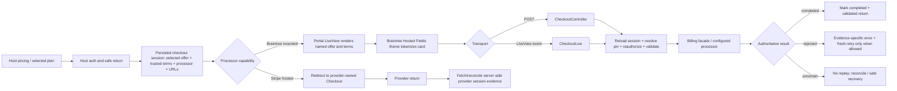

<user_constraints>
## User Constraints (from CONTEXT.md)

### Locked Decisions

- **D-01:** Show the offer selected by the existing host flow. Use its trusted session/catalog metadata for the plan name, amount, currency, interval, and other supported charge terms; do not infer terms from a price identifier, a default, or a browser return parameter.
- **D-02:** If a material charge term is missing or ambiguous, identify it as unavailable and provide a safe recovery path. Do not turn missing data into a free price, guess an amount, or enable payment for an unknown charge. Keep plan discovery host-owned; do not create a generic Accrue catalog API in this phase.
- **D-03:** Preserve the exact selected offer and the displayed billable, Customer, and processor through sign-in and return. Revalidate the same context and action when the customer resumes. A context pin is an identity locator, not a lasting authorization grant; the host remains authoritative for actor, billable, membership, and action permission.
- **D-04:** Keep processor-supported paths distinct: provider-hosted checkout stays provider-owned, while mounted checkout uses the existing supported Hosted Fields integration. Do not imply provider parity from Fake-backed evidence, replace the official payment SDK, or use a return URL/query parameter as proof of payment.
- **D-05:** Use validated host/local return destinations and the existing safe fallback behavior. A completion state is shown only after server/provider evidence supports it; cancellation, unavailable return, and blocked context remain distinct outcomes.
- **D-06:** Re-read session state and freshly authorize the same customer/provider/offer before an irreversible action. Represent invalid input, stale promotion, expiry, completed session, provider rejection, cancellation, and ambiguous outcome according to their evidence; do not collapse them into a success-like message.
- **D-07:** Never automatically replay an uncertain payment. Clear single-use nonce and secure-field state on failure, abandonment, or context invalidation. Permit another attempt only after authoritative state permits it and the customer starts a fresh action.
- **D-08:** Apply the project shift-left default: give every testable acceptance claim deterministic executable evidence, retain automated UAT results, and run checks in merge-blocking CI when they protect recurring behavior. Skip confirmation-only UAT when passing evidence covers the claim. Hand off only an actual product decision, unavailable external setup, irreversible external action, or irreducible subjective judgment.

### the agent's Discretion

- Choose the smallest session/form mechanism that preserves the existing selected offer and pinned context across the current host sign-in and return flow; do not add a public callback or dependency without concrete evidence that the existing boundary cannot serve it.
- Choose component boundaries, exact concise copy, and test layering. Keep accessible focus/status behavior, current host branding, secure SDK lifecycle, and evidence-specific payment outcomes intact.
- Determine which checkout assertions belong in unit/LiveView tests, host integration tests, browser tests, and recurring CI based on the observed seam and maintenance value.

### Deferred Ideas (OUT OF SCOPE)

- No new product capability was added to Phase 235. A generic plan-discovery/catalog API, new payment processor, dynamic processor routing, custom card fields, new pricing policy, or broad account-selection model remains out of scope.
- Broader Portal payment-method/subscription/invoice self-service is owned by Phase 236; integrated cross-surface coverage and handoff is owned by Phase 239.
</user_constraints>

<phase_requirements>
## Phase Requirements

| ID | Description | Research Support |
|----|-------------|------------------|
| CKO-01 | Customers can complete or recover from the visible checkout form through the actual browser payment hook, with valid, invalid, provider-failure, cancellation, and retry outcomes represented truthfully. | Extend `CheckoutLive` and Hosted Fields hook tests plus the Braintree Playwright lane through tokenize, actual form transport, visible result, retry reset, and leave behavior. [VERIFIED: .planning/REQUIREMENTS.md:29] Quote: `Customers can complete or recover from the visible checkout form through the actual browser payment hook, with valid, invalid, provider-failure, cancellation, and retry outcomes represented truthfully.` |
| CKO-02 | Customers receive distinct, capability-aware hosted-provider and mounted-checkout handoffs and safe returns; Fake evidence is not presented as live-provider parity. | Preserve the processor matrix distinction; assert Stripe hosted URL handoff and Braintree mounted form/return separately; treat Fake as deterministic contract proof. [VERIFIED: .planning/REQUIREMENTS.md:30] Quote: `Customers receive distinct, capability-aware hosted-provider and mounted-checkout handoffs and safe returns; Fake evidence is not presented as live-provider parity.` |
| CKO-03 | Both reachable checkout submission paths handle expired or completed sessions, stale promotions, and repeated submissions according to the existing contract, without claiming an unproven charge or rendering missing price as zero. | Exercise LiveView tokenized-event and HTTP POST controllers; assert session status, provider call count, promotion revalidation, and outcome copy. [VERIFIED: .planning/REQUIREMENTS.md:31] Quote: `Both reachable checkout submission paths handle expired or completed sessions, stale promotions, and repeated submissions according to the existing contract, without claiming an unproven charge or rendering missing price as zero.` |
| CKO-04 | Customers retain their plan choice through sign-in and return; displayed charge terms come from trusted available metadata, and unknown terms or outcomes lead to a safe recovery path instead of a guessed authorization or blind resubmission. | Carry the persisted selected offer through host login return and render only server-owned session/catalog metadata; add missing/ambiguous metadata and uncertainty cases. [VERIFIED: .planning/REQUIREMENTS.md:32] Quote: `Customers retain their plan choice through sign-in and return; displayed charge terms come from trusted available metadata, and unknown terms or outcomes lead to a safe recovery path instead of a guessed authorization or blind resubmission.` |
</phase_requirements>

# Phase 235: Customer Plan Selection & Checkout - Research

**Researched:** 2026-10-08  
**Domain:** Phoenix LiveView customer checkout, Braintree Hosted Fields, provider-hosted checkout handoff, server-authoritative billing outcomes  
**Confidence:** HIGH for repository seams and current source behavior; MEDIUM for external SDK/API guidance verified against official docs during this session.

## Summary

Phase 235 should refine the existing host plan-selection, persisted local checkout-session, Portal LiveView/POST, and Braintree Hosted Fields flow. Do not add a plan catalog or payment dependency. The session schema already persists `price_id`, `line_items`, `success_url`, `cancel_url`, `return_url`, `operation_id`, `metadata`, and `data`; the example host already owns the human-readable plan label and billing terms. Preserve the selected offer by placing the host's trusted display metadata on the existing server-side session (or by using an already persisted metadata contract), then let the Portal render from that trusted session data. Do not ask the Portal to derive a plan name from an identifier. [VERIFIED: accrue/lib/accrue/checkout/local_session.ex:20-36] Quote: `field(:price_id, :string)`; `field(:line_items, {:array, :map}, default: [])`; `field(:success_url, :string)`; `field(:cancel_url, :string)`; `field(:return_url, :string)`; `field(:operation_id, :string)`; `field(:metadata, :map, default: %{})`; `field(:data, :map, default: %{})`. [VERIFIED: examples/accrue_host/lib/accrue_host/billing/plans.ex:6-8,14-27,29-43] Quote: `@labels %{basic: "Launch", pro: "Studio", metered: "Scale"}`; `unit_amount_minor: @amounts.basic`; `currency: "USD"`; `billing_cycle: %{unit: :month, count: 1}`; `unit_amount_minor: @amounts.pro`; `currency: "USD"`; `billing_cycle: %{unit: :month, count: 1}`.

Several acceptance-critical defects are already visible in current source and should drive task order: checkout renders the raw `price_id`, computes a first-line total with a default of `"0.00"` and a no-line-item result of `0`, and the POST controller treats any subscribe error alike while the LiveView branch reports generic failure. The POST success path can create a subscription and then fail `mark_completed`, after which it shows “No payment was submitted”; the LiveView success branch pattern-matches completion persistence and may raise. Fix outcome semantics and missing-price behavior before visual polish. [VERIFIED: accrue_portal/lib/accrue_portal/live/checkout_live.ex:280-283,533-553] Quote: `Confirm subscription for <strong>{@checkout_session.price_id}</strong>.`; `Map.get("amount", "0.00")`; `defp checkout_amount_minor(_session), do: 0`; `defp parse_amount_minor(_), do: 0`. [VERIFIED: accrue_portal/lib/accrue_portal/controllers/checkout_controller.ex:54-72,143-149] Quote: `{:ok, _subscription} ->`; `case LocalSession.mark_completed(checkout) do`; `{:error, _changeset} ->`; `Checkout access is unavailable. No payment was submitted.`

Keep the two processor paths explicit. The support matrix describes Stripe Checkout as upstream-hosted and Braintree checkout as a mounted first-party local page. A return parameter can route or identify a session, but completion display must be based on server/provider state. Official Stripe's Checkout Session object has independent `status` and `payment_status` fields and documents payment status as the fulfillment signal; official Braintree Hosted Fields sends card data directly from the browser to Braintree and returns a one-time payment-method nonce for the server. [VERIFIED: .planning/processor-support-matrix.md:59,67,104] Quote: `checkout.hosted_handoff`; `Stripe returns upstream hosted URLs; Braintree returns mounted first-party local checkout and portal URLs.` [CITED: https://docs.stripe.com/api/checkout/sessions/object] [CITED: https://developer.paypal.com/braintree/docs/guides/hosted-fields/overview/javascript/v3/]

**Primary recommendation:** First trace the existing host plan-selection and login return path; enrich the persisted checkout-session from host-owned plan metadata, then make both LiveView and POST share the same fail-closed state/outcome rules. Add deterministic ExUnit/LiveView coverage for all testable branches and extend the existing visible-form Playwright lane to tokenize, submit, and inspect outcomes. Keep the existing required `playwright-e2e` job merge-blocking; no new dependency or broad CI job is justified. [VERIFIED: .github/workflows/ci.yml:10-14,1614-1623] Quote: `Merge-blocking on pull_request`; `playwright-e2e`; `Run configured Braintree checkout browser lane`.

## Architectural Responsibility Map

| Capability | Primary Tier | Secondary Tier | Rationale |
|------------|-------------|----------------|-----------|
| Plan discovery, selected offer, and plan-label/term metadata | Frontend Server (host) | Database / Storage (local checkout session) | The host owns the catalog and current selection; the persisted local session is the boundary used by Portal checkout. Do not introduce a generic Accrue catalog API. [VERIFIED: examples/accrue_host/lib/accrue_host/billing/plans.ex:12-27; accrue/lib/accrue/checkout/local_session.ex:20-36] |
| Customer sign-in, return destination, and account/billable selection | Frontend Server (host) | API / Backend (Portal context resolution) | Login and account selection remain host-owned; the Portal pin locates context and each completion action resolves and authorizes again. [VERIFIED: accrue_portal/lib/accrue_portal/live/checkout_live.ex:425-468; accrue_portal/lib/accrue_portal/controllers/checkout_controller.ex:26-33] |
| Secure payment-field collection and tokenization | Browser / Client | API / Backend (nonce submission) | Braintree Hosted Fields owns sensitive card fields in iframes, while the browser sends only the nonce to the existing server transport. [CITED: https://developer.paypal.com/braintree/docs/guides/hosted-fields/setup-and-integration/javascript/v3] |
| Subscription creation, fresh authorization, and final payment outcome | API / Backend | Database / Storage (checkout session + billing records) | The server reloads the persisted session and pinned context and invokes the billing facade; browser events/return query are not payment evidence. [VERIFIED: accrue_portal/lib/accrue_portal/live/checkout_live.ex:448-468; accrue_portal/lib/accrue_portal/controllers/checkout_controller.ex:14-25] |
| Provider-hosted handoff and return | API / Backend (session create/lookup) | Browser / Client (redirect) | Stripe provides an upstream-hosted URL; Braintree uses the mounted local Portal. Return resolution must preserve that capability split. [VERIFIED: .planning/processor-support-matrix.md:59,67,104] Quote: `Stripe returns upstream hosted URLs; Braintree returns mounted first-party local checkout and portal URLs.` |
| Portal theme, responsive checkout layout, and delivered JS/CSS | CDN / Static (package assets) | Browser / Client | Portal CSS/JS are read from package static assets and embedded by its assets module; verify the source actually served by Portal, not the Admin asset build. [VERIFIED: accrue_portal/lib/accrue_portal/assets.ex:8-27] |

## Standard Stack

### Core

| Library / subsystem | Version | Purpose | Why Standard |
|---------|---------|---------|--------------|
| Phoenix LiveView + HEEx | Existing project dependency; no upgrade indicated | Render checkout, validate promos, and handle tokenized checkout events | Existing Portal checkout implementation and tests already own the mounted flow. [VERIFIED: accrue_portal/lib/accrue_portal/live/checkout_live.ex:1-2,182-245] |
| `Accrue.Checkout.LocalSession` | In-repository | Persisted selected checkout, processor, offer, URLs, expiry, and status | Current server authority for Braintree mounted checkout. [VERIFIED: accrue/lib/accrue/checkout/local_session.ex:20-36] |
| `BraintreeHostedFields` browser hook | Braintree Web JavaScript v3, source pins CDN assets to `3.132.0` | Secure card collection, nonce tokenization, mounted checkout POST/LiveView transport, teardown | Existing official integration is already in place and Braintree documents iframe-hosted fields and one-time nonce exchange. [VERIFIED: accrue_portal/lib/accrue_portal/live/checkout_live.ex:16-21] Quote: `@client_script_src "https://js.braintreegateway.com/web/3.132.0/js/client.min.js"`; `@hosted_fields_script_src "https://js.braintreegateway.com/web/3.132.0/js/hosted-fields.min.js"`. [CITED: https://developer.paypal.com/braintree/docs/guides/hosted-fields/overview/javascript/v3/] |
| Playwright host E2E lane | Existing lockfile/install; observed local CLI `1.59.1` | Prove visible browser form, actual hook transport, focus, responsive layout, and served assets | Canonical host tests already start with `phase233-braintree-checkout.spec.js`; lane runs inside required CI job. [VERIFIED: examples/accrue_host/package.json:7-22; .github/workflows/ci.yml:1614-1623] |

No package installation or package legitimacy audit is needed for this phase: use current project dependencies and the already loaded provider SDK. [ASSUMED] No new library is needed unless code inspection during planning demonstrates an existing boundary cannot preserve selection or prove the visible path.

### Supporting

| Library / mechanism | Purpose | When to Use |
|---------|---------|-------------|
| Phoenix LiveView hooks | Browser-side SDK lifecycle and tokenization; LiveView event path when native POST transport is unavailable | Keep the existing `BraintreeHostedFields` hook and verify `mounted`/`destroyed`, nonce reset, pending state, and server event handling. [CITED: https://phoenix-live-view.hexdocs.pm/js-interop.html] |
| Ecto-backed checkout session | Re-read state and exact customer/provider/offer before irreversible action | Both `handle_event` and controller completion; avoid relying on socket assigns or browser-hidden fields as authority. [VERIFIED: accrue_portal/lib/accrue_portal/live/checkout_live.ex:448-505; accrue_portal/lib/accrue_portal/controllers/checkout_controller.ex:14-33] |
| Existing Portal brand/CSS bridge | Host theme, input sizing, responsive structure | Keep the package-owned `--accrue-*` roles; test Portal's served stylesheet and theme variants. [VERIFIED: accrue_portal/priv/static/accrue_portal.css:466-504,529-551] |

### Alternatives Considered

| Instead of | Could Use | Tradeoff |
|------------|-----------|----------|
| Portal independently resolves any plan ID | Put the chosen label and supported terms onto existing host-created session metadata | Preserves host catalog ownership and selected choice without publishing a new catalog API. This follows D-01/D-02. [VERIFIED: .planning/phases/235-customer-plan-selection-checkout/235-CONTEXT.md, D-01/D-02] |
| One generic checkout UI for all processors | Explicit provider-hosted URL vs mounted Hosted Fields branches | Generic rendering risks advertising a mounted form where capability is absent and conflating evidence. Existing processor matrix already distinguishes these paths. [VERIFIED: .planning/processor-support-matrix.md:59,67,104] |
| Live provider transaction as the normal CI proof | Deterministic Fake-backed server tests plus the Braintree-configured visible browser lane; separate provider fidelity only when explicitly configured | Stable merge-blocking tests exercise logic and hook path without claiming test credentials/mock SDK equal production parity. [VERIFIED: .planning/processor-support-matrix.md:9-18] |

## Architecture Patterns

### System Architecture Diagram



The diagram models the selected-offer-to-outcome data flow. A return destination routes the customer, while completion must be decided from server/provider evidence. [VERIFIED: accrue_portal/lib/accrue_portal/controllers/checkout_controller.ex:123-149; .planning/phases/235-customer-plan-selection-checkout/235-CONTEXT.md D-04/D-05] Quote: `A completion state is shown only after server/provider evidence supports it`.

### Recommended Project Structure

```text
accrue/lib/accrue/checkout/local_session.ex             # Persisted checkout session authority
accrue_portal/lib/accrue_portal/live/checkout_live.ex   # Mounted checkout UI + LiveView event
accrue_portal/lib/accrue_portal/controllers/checkout_controller.ex # HTTP POST completion
accrue_portal/priv/static/accrue_portal.js              # Hosted Fields hook / nonce lifecycle
accrue_portal/priv/static/accrue_portal.css             # Portal layout / theme / responsive rules
examples/accrue_host/lib/accrue_host/billing/plans.ex   # Host catalog and selected plan display facts
examples/accrue_host/e2e/phase233-braintree-checkout.spec.js # Existing Braintree browser proof
```

These are current code ownership seams; keep implementation changes local to the flow and adjacent tests rather than creating a shared UI or catalog subsystem. [VERIFIED: .planning/phases/235-customer-plan-selection-checkout/235-CONTEXT.md canonical refs; paths above are those named by the current context.]

### Pattern 1: Preserve the selected offer in the existing server-side checkout session

**What:** At the host's existing plan action, create the checkout session for the exact selected `price_id` and include server-resolved display name, amount, currency, billing interval, and processor facts in the session's existing persisted metadata/data shape. The Portal reads that session and refuses to enable payment if any material term is absent or inconsistent with the checkout target. [VERIFIED: accrue/lib/accrue/checkout/local_session.ex:20-36; examples/accrue_host/lib/accrue_host/billing/plans.ex:12-27]

**When to use:** The plan originates in host-owned catalog state and survives an unauthenticated-to-authenticated return.

**Example:** The existing session schema has fields for `metadata` and `data`, while `Plans` returns a plan map with `label`, `unit_amount_minor`, `currency`, and `billing_cycle`; use the existing shape and store the selected map values at session creation rather than looking up a browser-provided identifier during rendering. [VERIFIED: accrue/lib/accrue/checkout/local_session.ex:35-36; examples/accrue_host/lib/accrue_host/billing/plans.ex:16-27] Quote: `field(:metadata, :map, default: %{})`; `field(:data, :map, default: %{})`; `label: @labels.basic`; `unit_amount_minor: @amounts.basic`; `currency: "USD"`; `billing_cycle: %{unit: :month, count: 1}`.

### Pattern 2: Treat each transport as a server-side action boundary

**What:** Before mutation, load the session again, resolve the same pinned context, verify the customer/billable/processor/offer, check open/unexpired state, and freshly authorize completion. Keep LiveView tokenized event and POST behavior contract-equivalent, but preserve distinct response mechanics. [VERIFIED: accrue_portal/lib/accrue_portal/live/checkout_live.ex:448-505; accrue_portal/lib/accrue_portal/controllers/checkout_controller.ex:14-33]

**Example:**

```elixir
checkout = LocalSession.by_token(token)

with %LocalSession{} = checkout <- checkout,
     {:ok, context} <- resolve_pinned_context(conn, pin),
     true <- checkout_target?(context, checkout),
     true <- checkout_ready?(checkout),
     :ok <- Context.authorize_action(context, adapter, :checkout_complete, checkout) do
  subscribe(conn, context, checkout, nonce)
end
```

This mirrors the current POST boundary; use it as a refactor target, not a copy-and-paste replacement until the parallel LiveView behavior is reconciled. [VERIFIED: accrue_portal/lib/accrue_portal/controllers/checkout_controller.ex:14-24]

The existing action atom is `:checkout_complete`. [VERIFIED: accrue_portal/lib/accrue_portal/controllers/checkout_controller.ex:18-22] Quote: `:checkout_complete`.

### Pattern 3: Hosted Fields tokenizes in the browser; the server owns the result

**What:** The SDK iframes collect sensitive fields and produce a nonce, then the browser sends that nonce through the actual form POST or the LiveView event. Disable duplicate submits during tokenization; clear single-use nonce and fields after failure, abandonment, or context invalidation; do not automatically resend on a timeout/uncertain response. [CITED: https://developer.paypal.com/braintree/docs/guides/hosted-fields/setup-and-integration/javascript/v3] [VERIFIED: accrue_portal/priv/static/accrue_portal.js:94-172]

**Example:**

```javascript
hostedFieldsInstance.tokenize(function (tokenizeErr, payload) {
  if (tokenizeErr) {
    // Clear nonce, restore submit, and surface an accessible failure.
    return;
  }
  nonceInput.value = payload.nonce;
  form.submit();
});
```

Braintree's official setup guide documents tokenization returning a nonce that is sent to the server; Phoenix's hook docs describe lifecycle callbacks and `pushEvent` for browser-to-LiveView integration. [CITED: https://developer.paypal.com/braintree/docs/guides/hosted-fields/setup-and-integration/javascript/v3] [CITED: https://phoenix-live-view.hexdocs.pm/js-interop.html]

## Don't Hand-Roll

| Problem | Don't Build | Use Instead | Why |
|---------|-------------|---------|-----|
| Secure card capture | Custom card inputs or home-grown encryption | Existing Braintree Hosted Fields SDK boundary | Braintree documents its iframe-hosted fields and nonce exchange; keep raw card data outside the Accrue server. [CITED: https://developer.paypal.com/braintree/docs/guides/hosted-fields/overview/javascript/v3/] |
| Plan catalog | Generic Accrue plan discovery endpoint for this journey | Host-owned `Billing.Plans`/selected offer + server-side checkout session metadata | Host already owns display labels and available terms; new catalog API is expressly excluded. [VERIFIED: examples/accrue_host/lib/accrue_host/billing/plans.ex:12-64; 235-CONTEXT D-02] |
| Payment completion inference | Query-string checks, nonce receipt, browser success booleans | Persisted server session and authoritative billing/provider result | A nonce is payment input; a redirect is navigation. Stripe describes Checkout Session `status` and `payment_status` as server-side fields used for fulfillment. [CITED: https://docs.stripe.com/api/checkout/sessions/object] |
| Return URL security | Hand-built open redirect filtering | Existing Portal `Context.valid_local_path?/1`, host-approved return behavior, safe fallback | Existing controller already centralizes local-vs-HTTPS destination checks; plans should reuse it and add tests to cover malicious/userinfo/unsupported destinations. [VERIFIED: accrue_portal/lib/accrue_portal/controllers/checkout_controller.ex:123-139] |

**Key insight:** The visible offer and the authorized mutation must be derived from the same server-persisted session. The UI can present host metadata, but the session token, context pin, nonce, or return query alone cannot grant access or prove completion. [VERIFIED: accrue_portal/lib/accrue_portal/live/checkout_live.ex:425-505; accrue_portal/lib/accrue_portal/controllers/checkout_controller.ex:14-33]

## Common Pitfalls

### Pitfall 1: Missing line-item metadata turns into an apparent free checkout

**What goes wrong:** Current pricing uses the first line item's amount, defaults a missing amount to `"0.00"`, and returns integer `0` for no line items or parse failure. The page also labels the offer with the raw `price_id`. [VERIFIED: accrue_portal/lib/accrue_portal/live/checkout_live.ex:280-283,533-553] Quote: `Map.get("amount", "0.00")`; `defp checkout_amount_minor(_session), do: 0`; `defp parse_amount_minor(_), do: 0`.

**How to avoid:** Represent unknown terms as unavailable, suppress the pay action, and give a safe return/recovery path. Use the selected host plan's trusted name/terms persisted in the session. Test missing amount, missing currency, absent interval, mismatched offer, and legitimate zero amount separately; do not conflate a valid zero-priced plan with missing metadata.

### Pitfall 2: POST and LiveView report incompatible outcomes

**What goes wrong:** The POST controller's catch-all failure says nothing was submitted, although an error may be ambiguous; after a successful subscription but failed local session update it emits the same no-payment flash. The LiveView branch directly assumes `mark_completed` returns success. [VERIFIED: accrue_portal/lib/accrue_portal/controllers/checkout_controller.ex:54-72,143-149; accrue_portal/lib/accrue_portal/live/checkout_live.ex:124-141]

**How to avoid:** Define evidence-specific outcomes for rejected-before-submit, provider-declined, accepted/completed, and uncertain-after-request. Keep an accepted/uncertain remote operation from being described as unsubmitted. Make completion persistence idempotent and reconcile from a known billing result/operation ID before enabling a fresh action.

### Pitfall 3: Session open-check plus submit is not a concurrency guard

**What goes wrong:** Both transports check the session's open/unexpired state before calling the billing facade; `create_or_reuse` can reuse by operation ID, but its current lookup then insert path is not a reservation/atomic claim. Two concurrent submits can race unless a lower billing idempotency boundary makes them safe. [VERIFIED: accrue/lib/accrue/checkout/local_session.ex:65-76; accrue_portal/lib/accrue_portal/live/checkout_live.ex:448-468; accrue_portal/lib/accrue_portal/controllers/checkout_controller.ex:14-24]

**How to avoid:** Establish deterministic duplicate-submit behavior at the billing operation boundary and add a concurrent/replay regression test. Do not blindly mark an attempt completed before processor acceptance; preserve uncertain outcome without replaying a nonce.

### Pitfall 4: A Braintree initialization probe is mistaken for payment-path proof

**What goes wrong:** The current Playwright Braintree spec installs a browser shim that counts client and Hosted Fields initialization, and checks visibility/denial. It does not tokenize or submit the visible form. [VERIFIED: examples/accrue_host/e2e/phase233-braintree-checkout.spec.js:5-32,35-75]

**How to avoid:** Extend the browser seam with deterministic fake SDK tokenization, interact with the rendered form's submit button, and assert the actual POST/event, resulting server record/session state, visible message, safe return, and cleared/re-enabled controls. Label evidence as mocked SDK + configured Braintree browser-path proof, not live Braintree card acceptance.

### Pitfall 5: “Hosted” is read as one common checkout capability

**What goes wrong:** Stripe hosted Checkout is a provider page, while Braintree first-party checkout mounts Portal Hosted Fields. Reusing labels/statuses or declaring success solely after either provider redirects blurs capabilities and proof levels. [VERIFIED: .planning/processor-support-matrix.md:59,67,104] Quote: `Stripe returns upstream hosted URLs; Braintree returns mounted first-party local checkout and portal URLs.`

**How to avoid:** Assert each branch's visible destination, available form/capability, and server/provider return evidence distinctly; Fake remains an isolated deterministic proof lane.

### Pitfall 6: Hosted Fields inner styling and outer theme diverge

**What goes wrong:** Braintree field text is inside provider iframes; page CSS styles the outer containers, while SDK styles configure field text. Braintree also notes media queries apply relative to the iframe viewport. [CITED: https://developer.paypal.com/braintree/docs/guides/hosted-fields/styling/javascript/v3/]

**How to avoid:** Verify host theme against iframe text/placeholder and container background/border/focus/invalid states, explicit container height, narrow reflow, and zoom. Use system fonts as current code does. Test actual served package CSS/JS via Portal mount, not just source HTML or the Admin asset build. [VERIFIED: accrue_portal/priv/static/accrue_portal.css:466-480,529-551; accrue_portal/lib/accrue_portal/assets.ex:8-27]

## Code Examples

### Braintree Hosted Fields tokenization boundary

```javascript
hostedFieldsInstance.tokenize(function (tokenizeErr, payload) {
  if (tokenizeErr) {
    // Do not submit; clear single-use state and show the supported retry guidance.
    return;
  }
  sendNonceToServer(payload.nonce);
});
```

This follows the official Braintree setup flow: create client, create Hosted Fields, tokenize on submit, send the returned nonce to the server. Accrue must preserve its existing official SDK boundary rather than add custom card collection. [CITED: https://developer.paypal.com/braintree/docs/guides/hosted-fields/setup-and-integration/javascript/v3]

### Session and outcome contract (planning target)

```text
trusted selected offer + pinned customer/provider
  -> reload checkout session and reauthorize action
  -> validate session freshness and current promotion
  -> submit one fresh nonce to billing facade
  -> classify authoritative result
       completed: persist completion and show/return success
       rejected: clear nonce and show safe retry guidance
       uncertain: keep outcome unknown, reconcile, never auto-resubmit
```

This is a planning contract, not a new public API or a representation of current complete behavior. [VERIFIED: .planning/phases/235-customer-plan-selection-checkout/235-CONTEXT.md D-03 through D-07]

## State of the Art

| Old Approach | Current Approach | When Changed | Impact |
|--------------|------------------|--------------|--------|
| Merchant-built card inputs posted to merchant server | Braintree Hosted Fields embeds secure iframes and returns a nonce | Braintree's JavaScript v3 Hosted Fields docs; currently used in this repo | Keep payment fields inside official SDK and ensure browser proof covers tokenization and submission. [CITED: https://developer.paypal.com/braintree/docs/guides/hosted-fields/overview/javascript/v3/] |
| Treat the return page as proof that payment completed | Retrieve/read authoritative provider/session outcome and separately handle asynchronous completion | Current Stripe Checkout documentation describes session/payment statuses and fulfillment; repo context locks no query-only success | Keep host return as navigation only and reconcile server-side before success copy. [CITED: https://docs.stripe.com/api/checkout/sessions/object; https://docs.stripe.com/payments/existing-customers?platform=web&ui=stripe-hosted] |
| One visual checkout assumed for each provider | Capability-specific hosted redirect vs mounted secure fields | Existing processor support matrix | Keep proof and customer guidance capability-aware. [VERIFIED: .planning/processor-support-matrix.md:59,67,104] |

**Deprecated/outdated:** Do not introduce Braintree JS v2 or custom card entry; the repository pins SDK v3 assets and current official integration guidance documents v3. [VERIFIED: accrue_portal/lib/accrue_portal/live/checkout_live.ex:16-21] [CITED: https://developer.paypal.com/braintree/docs/guides/hosted-fields/overview/javascript/v3/]

## Validation Architecture

### Test Framework

| Property | Value |
|----------|-------|
| Framework | ExUnit + Phoenix LiveView tests; Playwright Test for browser journeys. [VERIFIED: existing test modules and examples/accrue_host/package.json:7-22] |
| Config file | Existing package Mix configs; `examples/accrue_host/playwright.braintree.config.js` |
| Quick run command | `cd accrue_portal && mix test test/accrue_portal/live/checkout_live_test.exs test/accrue_portal/live/checkout_live_discount_test.exs test/accrue_portal/checkout_context_test.exs` |
| Full browser lane | `cd examples/accrue_host && npm run e2e:braintree-checkout` |

### Phase Requirements → Test Map

| Req ID | Behavior | Test Type | Automated Command | File Exists? |
|--------|----------|-----------|-------------------|-------------|
| CKO-01 | Visible form initializes, tokenizes, submits by actual POST/event, and presents valid/invalid/provider failure/retry/cancel outcomes | LiveView + browser integration | Focused ExUnit command above; `cd examples/accrue_host && npm run e2e:braintree-checkout` | ✅ Existing checkout tests and Braintree spec; submit/result expansion needed |
| CKO-02 | Stripe hosted redirect vs Braintree mounted form are distinct; validated return and server evidence control result | ExUnit facade/controller + browser return | `cd accrue && mix test test/accrue/checkout_test.exs test/accrue/billing/checkout_session_facade_test.exs`; plus browser lane | ✅ Existing processor/facade paths; add asserted checkout handoff/return cases |
| CKO-03 | Both LiveView and POST reject expired/completed/stale-promo/replayed actions; no false charge/zero-price result | LiveView/controller/DB integration | Focused ExUnit command above | ✅ Existing files cover portions; extend for both transports, failure ambiguity, invalid/missing price, and duplicate/concurrent submit |
| CKO-04 | Chosen plan survives sign-in; trusted name/amount/currency/interval shown; missing terms and uncertain outcome recover safely | Host integration + rendered browser journey | `cd examples/accrue_host && npm run e2e:braintree-checkout` plus focused ExUnit command | ⚠️ Existing host `Billing.Plans`, session fields, login return mechanism, and browser fixture exist; assertions for selected offer/sign-in continuity are needed |

**Sampling rate:** Run focused ExUnit tests per implementation task. Run visible browser checkout proof when hook, markup, return, CSS, or served assets change; keep it in the existing merge-blocking `playwright-e2e` job because it protects recurring payment behavior. [VERIFIED: .github/workflows/ci.yml:10-14,1614-1623]

**Wave 0 gaps:** No framework/config/fixture install gap is evident. Existing test infrastructure exists; phase-specific assertions should be added alongside the implementation in the existing checkout tests and browser lane. Current browser proof does not submit/tokenize, so CKO-01 remains an implementation-wave gap, not a reason to add separate infrastructure. [VERIFIED: accrue_portal/test/accrue_portal/live/checkout_live_test.exs; accrue_portal/test/accrue_portal/live/checkout_live_discount_test.exs; accrue_portal/test/accrue_portal/checkout_context_test.exs; examples/accrue_host/e2e/phase233-braintree-checkout.spec.js]

### Shift-left evidence rule

For each acceptance assertion, name a deterministic executable artifact and retain its result. Merge-block the existing Playwright lane and focused Elixir contracts where they guard repeated checkout/session behavior. Do not require confirmation-only UAT for claims fully covered by repeatable evidence; reserve handoff for an actual product choice, unavailable provider setup, irreversible action, or irreducible visual judgment. [VERIFIED: .planning/phases/235-customer-plan-selection-checkout/235-CONTEXT.md D-08; .planning/STATE.md:203-220]

## Security Domain

Checkout mutates billing state and handles a single-use payment nonce; keep server-side authorization, target binding, input validation, session freshness, safe return validation, and no-replay semantics in scope. Phoenix docs explicitly say authentication/session validation spans HTTP and LiveView mount, with authorization at mount and events; the code correctly has separate LiveView and POST paths that must stay independently covered. [CITED: https://phoenix-live-view.hexdocs.pm/1.2.9/security-model.html] [VERIFIED: accrue_portal/lib/accrue_portal/controllers/checkout_controller.ex:14-33; accrue_portal/lib/accrue_portal/live/checkout_live.ex:448-468]

### Applicable ASVS 5.0 Categories

| ASVS Category | Applies | Standard Control |
|---------------|---------|-----------------|
| V2 Validation and Business Logic | Yes | Validate selected offer/session consistency, amount/currency shape, promotion drift, expiry, replay and duplicate action at trusted server boundary. [CITED: https://cornucopia.owasp.org/taxonomy/asvs-5.0/02-validation-and-business-logic/02-input-validation] |
| V6 Authentication | Yes | Preserve host-authenticated actor on return; unauthenticated login return must not itself authorize checkout. [CITED: https://cornucopia.owasp.org/taxonomy/asvs-5.0] |
| V7 Session Management | Yes | Validate session and context on HTTP, LiveView mount/reconnect/action; pin identity without making the pin a durable grant. [CITED: https://cornucopia.owasp.org/taxonomy/asvs-5.0/07-session-management/02-fundamental-session-management-security] |
| V8 Authorization | Yes | Freshly authorize the exact billable, Customer, processor, offer, and completion action on each path. [CITED: https://cornucopia.owasp.org/taxonomy/asvs-5.0] |
| V11 Cryptography | Yes, bounded to SDK/provider | Keep card collection/tokenization in official Hosted Fields; never hand-roll cryptography or accept raw card fields in Portal server. [CITED: https://developer.paypal.com/braintree/docs/guides/hosted-fields/overview/javascript/v3/] |
| V12 Secure Communication | Yes | Provider SDK/assets and return transport use secure HTTPS; retain SRI/CSP and safe external URL rules. [VERIFIED: accrue_portal/lib/accrue_portal/live/checkout_live.ex:16-21; accrue_portal/lib/accrue_portal/controllers/checkout_controller.ex:123-139] |
| V16 Error Handling and Logging | Yes | Distinguish declined/rejected from uncertain and accepted; no success-like generic failure and no false “not submitted” after an accepted provider action. [CITED: https://cornucopia.owasp.org/taxonomy/asvs-5.0] |

### Known Threat Patterns

| Pattern | STRIDE | Standard Mitigation |
|---------|--------|---------------------|
| Forged checkout token, context pin, hidden offer, or nonce | Spoofing / Tampering | Reload persisted session, bind it to exact customer/processor/offer, and freshly authorize before mutation. |
| Replayed or concurrent POST/event | Repudiation / Tampering | Server-side idempotency/replay protection and duplicate-path tests; never infer safety from disabled button alone. |
| Unsafe return URL | Spoofing | Validate local paths and allow approved HTTPS host behavior; fallback safely. |
| Query-string `success` or local return mistaken for paid | Tampering | Verify provider/session evidence server-side; separate complete/unpaid/expired/uncertain outcomes. |
| Raw card data entering host server | Information disclosure | Maintain Braintree iframe Hosted Fields; only nonce crosses to server. |
| Error copy leaks provider internals or falsely claims no charge | Information disclosure / Repudiation | Use customer-safe evidence-specific copy and link an uncertain state to reconciliation/recovery without a blind retry. |

## Environment Availability

| Dependency | Required By | Available | Version | Fallback |
|------------|------------|-----------|---------|----------|
| Elixir / Mix | Portal ExUnit and host integration | ✓ | Elixir toolchain present; pinned repo: `1.19.5-otp-28` | — |
| Node / npm | Playwright host lane | ✓ | Node `v22.14.0`; npm `11.1.0` | — |
| Playwright | Host browser lane | ✓ | `1.59.1` local CLI | — |
| Real Braintree credentials/provider response | Live provider fidelity only | Not established by local environment probe | — | Deterministic mock/Fake proofs; no live parity claim |

No test suite or application was run during this research; version and executable availability checks only. The Braintree browser lane in CI has separate Braintree-configured fixture seeding, but the current spec mocks the browser SDK and therefore establishes integration-path behavior only. [VERIFIED: .github/workflows/ci.yml:1614-1623; examples/accrue_host/e2e/phase233-braintree-checkout.spec.js:5-32]

## Project Constraints (from AGENTS.md)

No `AGENTS.md` exists at the project root. Phase constraints are therefore taken from the locked `235-CONTEXT.md`, project posture, and repository architecture documented above.

## Assumptions Log

| # | Claim | Section | Risk if Wrong |
|---|-------|---------|---------------|
| A1 | No new dependency is needed; existing persisted `metadata`/`data` can carry selected plan display terms for this flow. | Standard Stack / Pattern 1 | If host-to-Portal currently lacks a path to populate it, session creation adapter may need a small internal change; adding public API would be unnecessary scope. |

## Open Questions

1. **What is the current host offer-selection-to-login initiation call chain, and which server-side values are already forwarded into checkout session creation?**
   - What we know: host `Billing.Plans` includes display labels, minor-unit amount, currency, and billing cycle; local session schema includes metadata/data; host sign-in controller supports local `return_to` storage. [VERIFIED: examples/accrue_host/lib/accrue_host/billing/plans.ex:12-64; accrue/lib/accrue/checkout/local_session.ex:20-36; examples/accrue_host/lib/accrue_host_web/controllers/user_session_controller.ex:69-77]
   - What's unclear: exact selection action/form path through authentication and where the session is created.
   - Recommendation: trace before task decomposition and pass the already selected plan through the smallest current host session/form mechanism; no callback/dependency unless that inspection proves necessary.

2. **What is the existing billing facade's provider error taxonomy for rejected versus indeterminate subscription creation?**
   - What we know: checkout paths currently group generic subscription failures, and operation ID is persisted. [VERIFIED: accrue_portal/lib/accrue_portal/live/checkout_live.ex:124-167; accrue_portal/lib/accrue_portal/controllers/checkout_controller.ex:54-72]
   - What's unclear: which typed errors and provider reconciliation paths are available to determine whether a request may have been accepted.
   - Recommendation: inspect facade/provider error structs and use their existing types. If any outcome is indeterminate, preserve an explicit unknown/reconcile state and block automatic resubmission.

## Sources

### Primary (HIGH confidence)

- Repository source opened this session: checkout LiveView/controller, LocalSession, Portal static JS/CSS/assets, host plan definitions, existing ExUnit tests, Playwright browser spec, package scripts, CI workflow, processor matrix, phase context and requirements.
- [Braintree Hosted Fields overview](https://developer.paypal.com/braintree/docs/guides/hosted-fields/overview/javascript/v3/) — hosted iframe boundary and nonce model.
- [Braintree Hosted Fields setup](https://developer.paypal.com/braintree/docs/guides/hosted-fields/setup-and-integration/javascript/v3) — SDK client/Hosted Fields/tokenization flow.
- [Braintree Hosted Fields styling](https://developer.paypal.com/braintree/docs/guides/hosted-fields/styling/javascript/v3/) — host container styling vs iframe field text and media-query scope.
- [Phoenix LiveView JavaScript interoperability](https://phoenix-live-view.hexdocs.pm/js-interop.html) — hook lifecycle and client/server events.
- [Phoenix LiveView security considerations v1.2.9](https://phoenix-live-view.hexdocs.pm/1.2.9/security-model.html) — separate HTTP/LiveView authentication and authorization boundaries.
- [Stripe Checkout Session object](https://docs.stripe.com/api/checkout/sessions/object) — server-visible session and payment statuses.
- [Stripe hosted Checkout fulfillment](https://docs.stripe.com/payments/existing-customers?platform=web&ui=stripe-hosted) — webhook/session fulfillment guidance and unreliable landing-page-only fulfillment.
- [OWASP ASVS 5.0 taxonomy](https://cornucopia.owasp.org/taxonomy/asvs-5.0) and [Input Validation](https://cornucopia.owasp.org/taxonomy/asvs-5.0/02-validation-and-business-logic/02-input-validation) — current relevant security areas and trusted-layer validation.

### Secondary (MEDIUM confidence)

- Web search results were used only to locate the official documentation pages above. Current provider claims are cited directly to official sources.

## Metadata

**Confidence breakdown:**
- Standard stack: HIGH — current implementation, test, workflow, and package scripts inspected.
- Architecture: HIGH — source and locked Phase 233/235 contracts establish tier ownership and processor split.
- Pitfalls: HIGH — multiple checkout defects found directly in current source; external Hosted Fields constraints are cited from official docs.

**Research date:** 2026-10-08  
**Valid until:** 2026-11-07 for repository architecture; verify SDK and provider docs again if SDK/API versions change.
