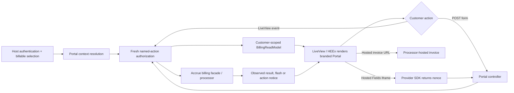

<user_constraints>
## User Constraints (from CONTEXT.md)

### Locked Decisions

- **D-01:** Make the selected billed entity legible in the existing Portal journeys and keep its name distinct from the actor, product, Customer, and processor. Preserve host-owned selection and branding; personal-only installs continue to work without an organization model or account picker.
- **D-02:** Preserve fresh authorization for the same displayed billable and target across HTTP, LiveView mount/reconnect/events, and POST. Context pins identify the displayed context; they are not lasting grants. Do not fall back to a different account after an explicit selection or denial.

### Existing payment and subscription actions

- **D-03:** Expose only actions supported by the current provider, owner, and subscription state. List and detail entry points disclose the same consequence before confirmation, then reauthorize the exact target at mutation time. Do not imply provider parity or add a new billing capability.
- **D-04:** Describe observed subscription lifecycle accurately. Unknown or missing observations remain unknown; billing state does not promise host access, complete invoice counts, or document-retention guarantees.

### Invoice access, outcomes, and secure fields

- **D-05:** Show only existing invoices belonging to the authorized Customer and use the existing hosted-invoice access. Missing or unauthorized records fail safely. A failed read is a visible unavailable/error state, not an empty list.
- **D-06:** Direct add-card navigation must initialize the supported official Hosted Fields flow when authorized. Keep card data inside the provider SDK, clear single-use nonce/field state on failure or abandonment, and report only outcomes supported by server/provider evidence. Checkout failure must not claim a charge; query parameters do not prove payment; leaving checkout is not subscription cancellation.
- **D-07:** Keep host return destinations validated and local/host-approved, with the existing safe fallback. LiveView actions and POST/redirects provide visible, announced success or failure tied to the actual result.

### Verification posture

- **D-08:** Apply the project shift-left default: give every testable acceptance claim deterministic executable evidence at the cheapest credible seam; run stable recurring checks in merge-blocking CI when that protects ongoing behavior. Target zero human UAT. Hand off only an actual product decision, unavailable external/live-provider evidence, an irreversible external action, or irreducible subjective judgment, with the reason recorded. Do not reopen verified coverage without new evidence.

### the agent's Discretion

- Choose page hierarchy, concise copy, and component reuse that fit the established Portal patterns and host brand.
- Preserve the Phase 233 semantic visual roles and public `--accrue-*` Portal tokens. Cover the route-owned keyboard, 320 CSS pixel reflow, theme, focus, and reduced-motion states with current rendered/browser evidence where interaction or served assets are involved.
- Choose unit, LiveView, controller, property, and browser coverage by invariant and recurring maintenance value. Prefer existing deterministic fixtures and CI lanes; do not add a dependency or broad CI redesign without concrete evidence.

### Deferred Ideas (OUT OF SCOPE)

No new capability was added during discussion. New providers, new Portal routes/actions, account discovery/role policy, local invoice detail/PDF, and unrelated host-page redesign remain outside this phase.
</user_constraints>

<phase_requirements>
## Phase Requirements

| ID | Description | Research Support |
|----|-------------|------------------|
| POR-01 | Customers can use all seven existing Portal pages and supported actions with legible, responsive content scoped to the selected billed entity and compatible with host branding. | Reuse existing Portal router, layouts and CSS tokens; verify all seven rendered routes with owner-scoped browser fixtures and the approved UI contract. |
| POR-02 | Customers can add, default, or remove supported payment methods and change or cancel eligible subscriptions without crossing account or provider capabilities; list and detail entry points disclose the same consequences before confirmation. | Reuse the existing POST/controller and LiveView paths, capability-aware copy, and fresh authorization; compare list/detail confirmation consequences and test stale/forged targets. |
| POR-03 | Customers can reach existing invoice records and hosted invoice access for the correct Customer; missing and unauthorized records fail safely. | Customer-scoped `BillingReadModel` query plus `hosted_url` handoff exist; add safe missing/denied/provider-read-failure outcomes. |
| POR-04 | Customers receive visible and announced outcomes after LiveView actions and POST/redirects; failed reads are not represented as empty lists and checkout failure does not assert a charge. | Existing flash/action notices and checkout uncertain/declined branches are proof seams; focused read failure injection must distinguish errors from `[]`. |
| POR-05 | Direct add-card navigation initializes the supported secure Hosted Fields flow, and its supported states remain readable across shell themes and LiveView patches. | Existing AddPaymentMethodLive, Braintree hook and package-served JS/CSS; browser checks must test actual served assets and direct route initialization. |
| POR-06 | Customers see known trial, incomplete, unpaid, and canceled states accurately, without claims about host access, complete invoice counts, or unsupported retention/document availability. | `AccruePortal.Copy` lifecycle functions are the copy seam; test known and unknown observations, plus invoice list bounds/copy. |
| POR-07 | Customers return only to validated host destinations; query parameters cannot prove payment, and leaving checkout is not described as subscription cancellation. | Existing checkout controller and `Accrue.Portal.Context.valid_local_path?/1` are the return-validation seam; exercise local, approved HTTPS, unsafe and fallback destinations without treating query params as evidence. |
</phase_requirements>

# Phase 236: Portal Billing Self-Service - Research

**Researched:** 2026-10-08  
**Domain:** Phoenix LiveView customer billing UI, account-scoped authorization, Braintree Hosted Fields  
**Confidence:** HIGH for in-repo architecture and constraints; MEDIUM for external API guidance.

## Summary

Phase 236 is an existing-route refinement across seven LiveViews plus payment-method and checkout POST actions; do not add a billing capability, route, provider, package, data model, or account-selection policy. [VERIFIED: `accrue_portal/lib/accrue_portal/router.ex:102-144`; verbatim route declarations below] The selected host billable, authenticated actor, Accrue Customer, and processor remain separate; context pins preserve displayed context identity but fresh authorization remains required on every action. [VERIFIED: `accrue_portal/lib/accrue_portal/context.ex:3-11`; verbatim excerpt below]

Plan from the existing `AccruePortal.Authorize` → `BillingReadModel` → LiveView/controller seams. Make data-read failures representable separately from empty lists before adjusting empty states: invoice reads currently return a list and render `[]` as empty, and payment-method reads pattern-match the success tuple. [VERIFIED: `accrue_portal/lib/accrue_portal/billing_read_model.ex:43-66`; `accrue_portal/lib/accrue_portal/live/invoices_live.ex:10-18,36-56`; verbatim excerpts below] Existing CI already runs Portal unit tests and example-host Playwright, so add narrowly scoped tests there rather than introducing dependencies or a CI redesign. [VERIFIED: `accrue_portal/mix.exs:28-35`; `.github/workflows/ci.yml:1488-1492,1538-1561`]

**Primary recommendation:** Keep the work in the Portal package and canonical example host: first close read/error, consequence parity, and authorization seams; then prove rendered/theme/keyboard/320px behavior against served package assets in the existing browser lane.

## Architectural Responsibility Map

| Capability | Primary Tier | Secondary Tier | Rationale |
|------------|-------------|----------------|-----------|
| Billing identity and host brand display | Browser / Client | API / Backend | Layout displays server-resolved host context; display names are presentation only and cannot authorize. |
| Scoped invoice/subscription/payment reads | API / Backend | Database / Storage | `BillingReadModel` scopes data to the resolved Accrue Customer; templates display read results. |
| Fresh authorization and payment/subscription mutation | API / Backend | Browser / Client | Host adapter authorizes named actions on exact targets; browser submits intent only. |
| Hosted Fields/tokenization | Browser / Client | API / Backend | Braintree iframe fields tokenize card details; server accepts a single-use nonce and performs billing mutation. |
| Return URLs and result/flash handling | API / Backend | Browser / Client | Controller validates destinations and observes processor/local-session outcome before redirecting. |
| Responsive, theme, focus, announcements | Browser / Client | — | CSS/HEEx/LiveView own presentation and accessible feedback; browser validation is needed for served output. |

## Standard Stack

### Core

| Library | Version | Purpose | Why Standard |
|---------|---------|---------|--------------|
| Elixir | `~> 1.19` | Portal application language | Existing package constraint. [VERIFIED: `accrue_portal/mix.exs:7-14`; quote: `elixir: "~> 1.19"`] |
| Phoenix | `~> 1.8` | Router/controller and HTML rendering | Existing package dependency and route macro. [VERIFIED: `accrue_portal/mix.exs:46-52`; quote: `{:phoenix, "~> 1.8"}`] |
| Phoenix LiveView | `~> 1.1` | Existing seven Portal pages and live interactions | Existing package dependency; no new frontend framework. [VERIFIED: `accrue_portal/mix.exs:46-52`; quote: `{:phoenix_live_view, "~> 1.1"}`] |
| Accrue / `accrue_portal` | workspace package | Billing domain and customer UI | Reuse current package APIs/controllers/read model; phase does not add dependencies. [VERIFIED: `accrue_portal/mix.exs:7-10,46-52`; exact app and deps quoted above] |
| Braintree Hosted Fields JS v3 | existing official provider SDK | Secure card inputs and single-use nonce | Existing supported flow is attached to the add-card form. Official docs say Hosted Fields renders card inputs in an iframe and tokenization returns a nonce for server use. [CITED: [Braintree Hosted Fields overview](https://developer.paypal.com/braintree/docs/guides/hosted-fields/overview/javascript/v3); [setup and integration](https://developer.paypal.com/braintree/docs/guides/hosted-fields/setup-and-integration/javascript/v3)] |

### Supporting

| Library | Version | Purpose | When to Use |
|---------|---------|---------|-------------|
| Phoenix LiveViewTest | from project LiveView dep | Deterministic mount/event/render assertions | Use for state and action outcomes; official API documents `live/2`, `render_click`, and `render_submit`. [CITED: [Phoenix.LiveViewTest docs](https://hexdocs.pm/phoenix_live_view/Phoenix.LiveViewTest.html)] |
| Playwright Test | existing host dev dependency `^1.57.0` | Served-browser and responsive/accessibility checks | Use for browser-dependent styles, JS hooks, keyboard and viewport assertions; package and CI already install/run it. [VERIFIED: `examples/accrue_host/package.json:19-22`; quote: `"@playwright/test": "^1.57.0"`] |
| Bypass/Mox test doubles | current test infrastructure | Provider/controller result scripting | Reuse existing fixtures and Mox/Braintree support when injecting deterministic outcomes; do not call live payment provider in merge-blocking checks. |

### Alternatives Considered

| Instead of | Could Use | Tradeoff |
|------------|-----------|----------|
| Existing LiveView/HEEx and package CSS | A new UI framework/component library | Rejected by locked UI spec: adds dependencies and duplicates Portal tokens/layout. |
| Existing Braintree Hosted Fields | Raw card form or new payment-fields library | Rejected by D-06 and provider boundary; would move sensitive card entry out of the supported provider iframe flow. |
| Existing Playwright host lane | New browser stack or broad CI redesign | No evidence requires a new stack; add focused specs to current host setup and existing recurring lane. |

**Installation:** None. Phase does not install packages. No Package Legitimacy Audit is needed.

## Architecture Patterns

### System Architecture Diagram



### Recommended Project Structure

```text
accrue_portal/
├── lib/accrue_portal/live/         # Existing seven page modules; refine in place
├── lib/accrue_portal/controllers/  # Existing payment method and checkout POSTs
├── lib/accrue_portal/billing_read_model.ex # Customer-scoped reads and explicit read outcomes
├── lib/accrue_portal/copy.ex       # Truthful lifecycle and action language
└── priv/static/                    # Served Portal CSS/JS used by actual host
examples/accrue_host/e2e/           # Served-host browser proof for Portal contracts
```

### Pattern 1: Resolve, scope, authorize, mutate

**What:** Resolve current actor and selected host billable into `Accrue.Portal.Context`; read the requested object under `context.customer`; authorize the named action against that exact object; mutate as the original actor; present only the returned outcome. [VERIFIED: `accrue_portal/lib/accrue_portal/authorize.ex:11-26,52-80`; `accrue_portal/lib/accrue_portal/context.ex:3-11,139-163`]

**When to use:** Every protected read, LiveView event/reconnect action, and POST. Pins are context locators, so preserve them in navigation but never use their presence as authorization. [VERIFIED: `accrue_portal/lib/accrue_portal/context.ex:8-11`; exact excerpt below]

**Example:** The existing code pattern is `BillingReadModel.subscription(context.customer, id)` followed by `Context.authorize_action(context, adapter, action, subscription)`. Quote from source: `{:ok, %Subscription{} = subscription} <- BillingReadModel.subscription(context.customer, id)` and `Context.authorize_action(context, socket.assigns[:current_context_adapter], action, subscription)`. [VERIFIED: `accrue_portal/lib/accrue_portal/authorize.ex:11-21`]

### Pattern 2: Model read failure separately from empty

**What:** Give customer-scoped reads an explicit success/error outcome and let the view render `[]` as empty only after a successful read. Existing invoice implementation assigns a bare list and tests `@invoices == []`; `Repo.all/1` has no local error branch. [VERIFIED: `accrue_portal/lib/accrue_portal/live/invoices_live.ex:10-18,36-42`; `accrue_portal/lib/accrue_portal/billing_read_model.ex:59-66`]

**When to use:** Invoice, payment-method, subscription and home-summary reads that can fail at the database or processor boundary. Distinguish unavailable from empty and avoid showing partial counts as complete totals. [INFERENCE from the UI requirement and current list-only pattern.]

### Pattern 3: Hosted Fields owns card data; server owns mutation

**What:** Render official provider-hosted input containers; JS initializes only after authorized client token is present, tokenizes on submit, writes only the resulting nonce into the hidden input, prevents duplicate submits, and tears down/clears transient state on failure or abandonment. [VERIFIED: `accrue_portal/lib/accrue_portal/live/add_payment_method_live.ex:14-29,82-126`; existing hook in `accrue_portal/priv/static/accrue_portal.js:4-175`]

**When to use:** Direct add-card navigation and existing checkout. Braintree documentation states card data is collected in iframe fields, and the successful tokenize callback returns a nonce for server use. [CITED: [Braintree setup and integration](https://developer.paypal.com/braintree/docs/guides/hosted-fields/setup-and-integration/javascript/v3)]

### Pattern 4: Consequence parity before exact-target mutation

**What:** Share a consequence/target formatter or common copy function for list and detail entry points, require an explicit confirmation action, then resolve and authorize that exact target again when the mutation is submitted. [LOCKED: D-03, copied above; existing detail confirmation seam `accrue_portal/lib/accrue_portal/live/subscription_live.ex:40-44,115-141`]

**When to use:** Cancel/non-renew and delete-card actions; avoid changing action eligibility just to make the UI uniform across providers.

### Anti-Patterns to Avoid

- Treating `context_pin` as a durable grant: re-resolve/re-authorize at event and POST time.
- Falling through from selected organization/billable to the actor's personal account after denial.
- Treating read exceptions or provider errors as `[]`; this produces a false empty state.
- Showing provider-unsupported actions or using one provider's cancellation timing language for another.
- Treating URL query parameters as payment proof or marking an uncertain processor outcome as failed/successful.
- Copying the invoice limit (`20`) into user-facing “all invoices” language or reviving the seven-year retention claim without evidence.
- Checking source CSS only: tests must verify the actual content served by hashed package asset routes.
- Passing card values, token, or full PAN/CVV into logs, LiveView params, server HTML, or test snapshots.

## Don't Hand-Roll

| Problem | Don't Build | Use Instead | Why |
|---------|-------------|-------------|-----|
| Secure card collection/tokenization | Custom card inputs, client cryptography, or a new token protocol | Existing Braintree Hosted Fields iframe and BraintreeClient | Provider SDK owns sensitive field collection and single-use nonce; official integration supports this flow. |
| Account and object authorization | A Portal-local account picker, cached boolean grant, or duplicated policy | `Accrue.Portal.Context` adapter and `AccruePortal.Authorize` | The context contract explicitly separates actor, billable, display-only fields and target policy. |
| Hosted invoices | Local invoice/PDF rendering or a new invoice route | Existing invoice `hosted_url` for scoped Customer record | Locked phase boundary excludes local invoice surfaces. |
| Return URL safety | Ad hoc path checks or trust of query strings | Existing `Context.valid_local_path?/1` and `CheckoutController.success_destination/2` | Reuse existing URL checks and fallback; test host-approved HTTPS policy as currently configured. |
| Accessibility and responsive verification | Source-only selector assertions as proof of served UI | Existing Playwright browser fixture against actual host and hashed CSS/JS | Responsive reflow, focus, themes, hosted-field initialization and browser announcements require rendered output. |

**Key insight:** The high-risk complexity is not page markup: it is maintaining the exact actor → billable → Customer → provider → object chain as reads and actions cross LiveView and POST boundaries.

## Common Pitfalls

### Pitfall 1: Empty list masks failed read

**What goes wrong:** Customer sees “No invoices yet” or “no payment methods” after a real database/provider failure.  
**Why it happens:** Invoice query returns `Repo.all/1` directly; invoice mount only assigns that value, and the template uses `[]` for empty. Payment-method listing pattern-matches `{:ok, methods}`. [VERIFIED: `accrue_portal/lib/accrue_portal/billing_read_model.ex:43-45,59-66`; `accrue_portal/lib/accrue_portal/live/invoices_live.ex:10-18,36-42`]  
**How to avoid:** Introduce tagged read outcomes at the read-model seam and test failure injection separately from zero records.  
**Warning signs:** Broad rescue returning `[]`, or only empty/populated tests.

### Pitfall 2: Context identity drifts between display and action

**What goes wrong:** A stale view, forged ID, or context switch targets a different owner/Customer.  
**Why it happens:** A signed pin is tempting to treat as authorization even though the context contract calls it a locator. [VERIFIED: `accrue_portal/lib/accrue_portal/context.ex:8-11`; verbatim excerpt below]  
**How to avoid:** Resolve fresh context, compare owner/customer/provider to mounted context, load resource through Customer-scoped query, authorize exact target, then mutate. Keep actor for audit attribution. [VERIFIED: `accrue_portal/lib/accrue_portal/authorize.ex:52-80`; `accrue_portal/lib/accrue_portal/controllers/payment_method_controller.ex:107-120`]  
**Warning signs:** Action handler directly trusts a client-sent ID or only checks owner on page mount.

### Pitfall 3: List and detail action semantics diverge

**What goes wrong:** Same cancel/delete affordance produces different warning, target identity, or eligibility depending on entry point.  
**How to avoid:** Extract/reuse the same consequence and target copy; test equivalence and enforce eligibility and fresh authorization separately for each entry route. [LOCKED: D-03]

### Pitfall 4: UI asserts payment outcome without server evidence

**What goes wrong:** A query string, redirect, or timeout is presented as successful charge/subscription creation.  
**How to avoid:** Use server-observed local-session and processor result; uncertain means uncertain and prevents automatic resubmit. Existing checkout controller already separates `CardError` from uncertain outcomes. [VERIFIED: `accrue_portal/lib/accrue_portal/controllers/checkout_controller.ex:68-95,244-250`]

### Pitfall 5: Hosted Fields works only on prior navigation or fails after patch

**What goes wrong:** Deep link to `/payment-methods/new` renders but never initializes; LiveView patch replaces fields and loses hook state; nonce persists after abandonment.  
**How to avoid:** Browser test direct route, authorized/denied, tokenization error, teardown/remount, and patched/recovered field states. Verify rendered package-served JS/CSS, not just source files. UI-SPEC prescribes this coverage; current form uses `BraintreeHostedFields` hook and hidden nonce input. [VERIFIED: `accrue_portal/lib/accrue_portal/live/add_payment_method_live.ex:82-110`; [Braintree Hosted Fields setup](https://developer.paypal.com/braintree/docs/guides/hosted-fields/setup-and-integration/javascript/v3)]

### Pitfall 6: Partial data reads like complete account history

**What goes wrong:** Bounded invoice results imply complete invoice count or retention, or missing lifecycle fields are rendered as known states.  
**How to avoid:** Keep exact invoice list semantics/copy transparent; unknown observations stay unknown; don't claim unsupported retention or application access. [VERIFIED: `accrue_portal/lib/accrue_portal/billing_read_model.ex:59-66`; locked D-04 and approved UI-SPEC]

## Code Examples

Verified authorization sequence already used by the project:

```elixir
with {:ok, context} <- fresh_context(socket),
     {:ok, %Subscription{} = subscription} <-
       BillingReadModel.subscription(context.customer, id),
     :ok <- Context.authorize_action(context, adapter, action, subscription) do
  {:ok, subscription}
end
```

Source: [`accrue_portal/lib/accrue_portal/authorize.ex:11-21`]. This order is material: customer-scoped lookup first, then exact target authorization; mutation handlers should repeat fresh resolution at action time.

Verified Braintree flow at the API level: initialize the client from the server-provided client token, create Hosted Fields, call `tokenize`, send its nonce to the server, and handle tokenize errors. Source: [Braintree Hosted Fields setup and integration](https://developer.paypal.com/braintree/docs/guides/hosted-fields/setup-and-integration/javascript/v3). Existing application form names are `payment_method_nonce` and `BraintreeHostedFields`; see [`accrue_portal/lib/accrue_portal/live/add_payment_method_live.ex:82-110`].

## State of the Art

| Old Approach | Current Approach | When Changed | Impact |
|--------------|------------------|--------------|--------|
| Treat absence of rendered records as proof of zero | Explicitly model `ok([])` separately from unavailable/error | Required by Phase 236 D-05 / POR-04 | Stops failed reads from becoming misleading empty states. |
| Trust mount-time authorization for later UI events | Fresh context and exact-target authorization at event/POST time | Existing Portal context contract | Keeps account selection from acting as a durable capability. |
| Custom card inputs on app origin | Official Braintree Hosted Fields iframe and nonce | Existing supported Portal flow; Braintree JS v3 docs | Payment fields remain provider-hosted. |

**Deprecated/outdated:** No new library/API migration is called for. Do not replace the existing Braintree JS v3 integration or existing CSS token system within this phase.

## Runtime State Inventory

Not applicable. This phase refines existing Portal behavior and is not a rename, refactor, or migration phase.

## Environment Availability

Step 2.6 skipped: the phase changes in-repo Elixir/HEEx/JS/CSS and uses already configured host test infrastructure; no new external dependency or runtime is required. [VERIFIED: existing dependencies and test alias in `accrue_portal/mix.exs:28-35,46-52`; browser package in `examples/accrue_host/package.json:7-22`]

## Validation Architecture

### Test Framework

| Property | Value |
|----------|-------|
| Framework | ExUnit and Phoenix LiveViewTest in `accrue_portal`; Playwright Test in `examples/accrue_host` |
| Config file | Existing package mix config and host Playwright config |
| Quick run command | `cd accrue_portal && mix test` |
| Full package command | `cd accrue_portal && mix test.ci` (format, warnings-as-errors compile/test, audit) |
| Served browser command | `cd examples/accrue_host && npm run e2e -- e2e/<phase-236-spec>.spec.js` *(confirm exact runner filtering when authoring the plan)* |

### Phase Requirements → Test Map

| Req ID | Behavior | Test Type | Automated Command | File Exists? |
|--------|----------|-----------|-------------------|-------------|
| POR-01 | Seven routes, billed identity, branding, responsive/reflow, themes | LiveView + browser | `mix test` plus host Playwright spec | Existing route LiveView tests; new Phase 236 served-browser coverage needed |
| POR-02 | List/detail consequence parity, owner/provider eligibility, exact target reauthorization | LiveView/controller/property | `cd accrue_portal && mix test` | Existing subscription, payment-method and wrong-tenant suites; extend with parity and state/capability cases |
| POR-03 | Customer-scoped invoice access; missing/unauthorized and read-failed distinctions | LiveView + controller | `cd accrue_portal && mix test` | Invoice and wrong-tenant suites exist; read-failure path needs coverage |
| POR-04 | Announced actual outcome; failures are not empty; checkout uncertainty truthful | LiveView/controller | `cd accrue_portal && mix test` | Existing controller/checkout tests; add failure-injected read/result assertions |
| POR-05 | Direct add-card initialization, token field clearing, theme/patch behavior | JS/browser + LiveView | host Playwright spec in CI | Add-payment LiveView tests and Braintree browser fixture exist; extend served-route states |
| POR-06 | Known lifecycle labels and unknown/partial data; no unsupported access/retention claims | ExUnit + LiveView | `cd accrue_portal && mix test` | `copy.ex`/subscription LiveView tests exist; add table/property cases if gaps remain |
| POR-07 | Valid local/host-approved destinations, fallback, query strings not proof | Controller/property + browser | `cd accrue_portal && mix test` | Checkout context/controller tests exist; add explicit rejection matrix and uncertainty assertions |

### Sampling Rate and CI

- Run the focused ExUnit/LiveView/controller suite as each related behavior is changed; run `mix test.ci` as the package gate.
- Put rendered CSS/JS, 320 CSS px reflow, theme, keyboard/focus and direct Hosted Fields checks in the existing host Playwright lane when they are stable. CI already has a recurring Playwright E2E job and a Portal package test job. [VERIFIED: `.github/workflows/ci.yml:1488-1492,1538-1561`; `accrue_portal/mix.exs:28-35`]
- Use deterministic fake/provider-scripted fixtures for merge-blocking paths. Live Braintree credentials or real external actions are not needed for routine acceptance; if provider-only fidelity remains untestable, record the exact external limitation as the D-08 handoff.
- Verify acceptance claim coverage against `.planning/phases/236-portal-billing-self-service/236-UI-SPEC.md` states table: empty, loading, error, populated, partial, overflow, zero-one-many, long-text. This is an existing approved contract, not evidence that implementation already passes.

### Wave 0 Gaps

- Add explicit read-model failure injection for invoices and payment methods and test visible unavailable state separately from successful empty result.
- Add focused served-host Portal Playwright coverage for each route/action where UI-SPEC requires actual browser proof; current Playwright host harness and fixtures are reusable.
- Capture machine-readable test evidence and make recurring phase-owned checks merge-blocking in the existing CI workflow; do not create human UAT for deterministic cases.

## Security Domain

Security enforcement is enabled by default (no explicit false setting). Portal handles authentication, authorization, CSRF-protected POST forms, customer data and a payment nonce. Applicable ASVS guidance: V2 Authentication, V3 Session Management, V4 Access Control, V5 Input Validation, V6 Cryptography (as categorized in the research template; focus this phase on its existing auth/session/access/input seams). OWASP currently identifies ASVS 5.0.0 as its latest stable version and recommends version-qualified requirement references. [CITED: [OWASP ASVS project](https://owasp.org/projects/asvs)]

### Applicable ASVS Categories

| ASVS Category | Applies | Standard Control |
|---------------|---------|-----------------|
| V2 Authentication | Yes | Keep host authentication authoritative; test unauthorized request behavior and do not create a Portal identity system. |
| V3 Session Management | Yes | Re-resolve and authorize after LiveView reconnect/events and POST; pins are signed short-lived locators, not grants. |
| V4 Access Control | Yes | Customer-scoped lookup before exact-target action check; negative two-owner tests on reads and mutations. |
| V5 Input Validation | Yes | Validate IDs/nonce/return destination; reject unsafe return targets and never trust query values as provider outcomes. |
| V6 Cryptography | Yes | Do not hand-roll cryptography; continue using Phoenix.Token for existing pins and provider SDK for card tokenization. |

### Known Threat Patterns for Phoenix LiveView Billing Portal

| Pattern | STRIDE | Standard Mitigation |
|---------|--------|---------------------|
| Forged/stale record ID or stale billable context | Elevation of privilege | Fresh resolve + Customer-scoped DB lookup + exact target authorization at mutation time; add two-owner tests. |
| CSRF on payment-method/checkout POST | Spoofing | Preserve browser pipeline `protect_from_forgery`; test POST requires valid browser session/token. |
| Open redirect through checkout return URL | Spoofing | Existing local path validation / approved HTTPS handling / safe fallback; test protocol-relative, backslash and malformed values. |
| Leaking full PAN/CVV/token in DOM, logs or traces | Information disclosure | Keep fields in provider iframe; only nonce submitted; inspect rendered HTML and logs in failure tests. |
| Duplicate checkout after timeout / uncertain processor result | Repudiation / Tampering | Preserve LocalSession claim/uncertain state and explicit no-resubmit copy; never infer success from URL. |

## Verified In-Repo Source Anchors

These excerpts are exact to make in-repository discrete values and implementation observations independently checkable.

| Claim | Verbatim source excerpt | Source |
|-------|------------------------|--------|
| Existing seven customer routes | `live("/", AccruePortal.Live.HomeLive, :index)`<br>`live("/subscriptions", AccruePortal.Live.SubscriptionsLive, :index)`<br>`live("/subscriptions/:id", AccruePortal.Live.SubscriptionLive, :show)`<br>`live("/payment-methods", AccruePortal.Live.PaymentMethodsLive, :index)`<br>`live("/payment-methods/new", AccruePortal.Live.AddPaymentMethodLive, :new)`<br>`live("/invoices", AccruePortal.Live.InvoicesLive, :index)`<br>`live("/checkout/:token", AccruePortal.Live.CheckoutLive, :show)` | `accrue_portal/lib/accrue_portal/router.ex:128-134` |
| Actor/billable/display boundary | `The human actor performs policy checks. The billable identifies the billing`<br>`owner. Display fields are presentation only and never grant access.`<br>`Adapters must reload their own membership and billable records before`<br>`authorizing an action; a session selection or pin is only a locator.` | `accrue_portal/lib/accrue_portal/context.ex:3-11` |
| Discrete host action values | `:read`<br>`| :manage_payment_methods`<br>`| :payment_method_create`<br>`| :payment_method_default`<br>`| :payment_method_delete`<br>`| :manage_subscription`<br>`| :subscription_cancel`<br>`| :subscription_change`<br>`| :subscription_preview`<br>`| :checkout_validate_promo`<br>`| :checkout_complete` | `accrue_portal/lib/accrue_portal/context.ex:33-44` |
| Package Elixir and framework constraints | `elixir: "~> 1.19"`<br>`{:phoenix, "~> 1.8"}`<br>`{:phoenix_live_view, "~> 1.1"}` | `accrue_portal/mix.exs:7-14,46-52` |
| Existing payment POST paths | `post("/payment-methods", AccruePortal.Controllers.PaymentMethodController, :create)`<br>`post("/payment-methods/:id/default", AccruePortal.Controllers.PaymentMethodController, :set_default)`<br>`post("/payment-methods/:id/delete", AccruePortal.Controllers.PaymentMethodController, :delete)`<br>`post("/checkout/:token/complete", AccruePortal.Controllers.CheckoutController, :complete)` | `accrue_portal/lib/accrue_portal/router.ex:102-116` |
| Invoice result is capped | `order_by: [desc: invoice.inserted_at],`<br>`limit: 20`<br>`|> Repo.all()` | `accrue_portal/lib/accrue_portal/billing_read_model.ex:59-66` |
| Lifecycle states represented by the UI requirement | `trialing`, `incomplete`, `unpaid`, `past_due`, `active`, and canceled | `236-UI-SPEC.md:87-88` (quoted verbatim from approved UI contract; not asserted as a code enum) |

## Assumptions Log

| # | Claim | Section | Risk if Wrong |
|---|-------|---------|---------------|
| A1 | `npm run e2e -- e2e/<spec>.spec.js` is accepted by the installed Playwright runner script. | Validation Architecture | The planner should confirm CLI arg forwarding; use the existing CI command shape if different. |
| A2 | Current package/browser tests and fake-provider fixtures can support every acceptance state listed in UI-SPEC without a new test dependency. | Validation Architecture | If a state has no deterministic seam, add the smallest local seam before asking for external/manual evidence. |

## Open Questions

1. **How should existing invoice list truncation be communicated?** The local query caps at 20, while D-04 disallows a complete-count implication. Keep copy neutral and avoid adding total counts unless the product contract explicitly defines them; this is not a blocker.
2. **Are return URLs restricted by a host allowlist beyond current validation?** Existing controller accepts validated local paths and HTTPS URL shape; Phase 235 host-approved return behavior is the authority. Planner should reuse the accepted checkout contract and test its exact rules rather than invent a new allowlist.

## Sources

### Primary (HIGH confidence)

- `236-CONTEXT.md` — all locked boundaries and D-08; copied verbatim above.
- `236-UI-SPEC.md` — approved copy, interaction, visual, and route-state acceptance contract.
- `REQUIREMENTS.md` and `ROADMAP.md` — exact POR-01..POR-07 scope and phase goal.
- `accrue_portal/lib/accrue_portal/router.ex`, `context.ex`, `authorize.ex`, `billing_read_model.ex`, existing LiveViews/controllers and tests — actual implementation seams.
- `accrue_portal/mix.exs`, `examples/accrue_host/package.json`, `.github/workflows/ci.yml` — existing tool/dependency/CI seams.

### Secondary (MEDIUM confidence)

- [Braintree Hosted Fields overview](https://developer.paypal.com/braintree/docs/guides/hosted-fields/overview/javascript/v3) and [setup/integration](https://developer.paypal.com/braintree/docs/guides/hosted-fields/setup-and-integration/javascript/v3) — hosted iframe/tokenize/nonce lifecycle and field styling.
- [Phoenix LiveViewTest](https://hexdocs.pm/phoenix_live_view/Phoenix.LiveViewTest.html) — event, submit, and rendered-output testing interface.
- [OWASP ASVS](https://owasp.org/projects/asvs) — current standard/version reference.

## Metadata

**Confidence breakdown:**
- Standard stack: HIGH — directly read current package constraints; no dependencies are proposed.
- Architecture: HIGH — routes, context adapter, auth helper, read model, and action modules inspected.
- Pitfalls: HIGH — directly evidenced by current list-only read handling and mutation seams; recommendations map to locked requirements.
- External APIs: MEDIUM — current official provider/framework docs searched; no live-provider test run performed.

**Research date:** 2026-10-08  
**Valid until:** 2026-11-07 (stable internal architecture; recheck external Braintree/LiveView API details if dependency versions change)
