# Phase 241: Billing Operator Journeys - Research

**Researched:** 2026-10-09  
**Domain:** Phoenix LiveView billing journeys, scoped navigation, action review and evidence  
**Confidence:** HIGH for existing route/action/test seams; MEDIUM for cross-version Phoenix guidance

<user_constraints>
## User Constraints (from CONTEXT.md)

### Locked Decisions

### Subscription page emphasis and invoice destinations

- **D-01:** Lead subscription detail with identity/current owner, lifecycle, exact confirmed plan/amount/period/collection facts, material blockers or uncertainty, and the supported subscription action group. Follow with related billing and deeper evidence. Use the incumbent shared roles and existing components; no universal columns, extra dashboard chrome or rebrand.
- **D-02:** Consolidate repeated owner-wide invoice queue panels/primary CTAs into one secondary, visible related-billing group. Keep supported invoice-worklist access discoverable without making unrelated invoice records dominate this subscription. The full worklist remains on the existing Invoices route; a duplicated embedded owner preview is not required.
- **D-03:** Use the supported `customer_id` invoice filter and name its meaning, for example **Open invoices for this customer** when `status=open` is retained. A separate **All open invoices in current scope** link names the wider result set. Use the actual selected-owner wording when applicable; global Admin scope must not be described as one customer's or one owner's queue. Remove any promise of subscription-only filtering and the ignored `subscription_id` filter.
- **D-04:** Subscription-local invoice counts, customer-wide results and the owner/authorized-scope queue are distinct. If an existing subscription count is retained, label it as subscription-local and do not attach it as the count of a customer or scope link. Do not add a count/query solely for decoration. Never infer zero money or a healthy/completed state from missing amounts, absent records or unavailable evidence.

### Return labels, bounded context and Recovery

- **D-05:** Name the actual validated return destination: **Back to invoices**, **Back to payments**, **Back to subscriptions**, **Back to customers**, **Back to customer invoices/payments/subscriptions**, or **Back to Recovery** as appropriate. Derive destination and visible label from the same validated meaning; raw untrusted return text cannot determine either. Keep structural breadcrumbs separate from the explicit contextual return.
- **D-06:** Preserve only enumerated meanings that the existing destination decoders actually support: current owner, relevant search/status/customer/collection filters, lens, supported sort/direction, same-customer tab, and valid Recovery window. Inventory decoder/allowlist parity during focused planning; do not retain ignored parameters or claim restoration from URL equality alone. A recognized unfiltered local list is a valid origin even without a query string. Pagination/accumulated-row/scroll restoration is not a new acceptance promise.
- **D-07:** Reuse the existing `ScopedPath` ownership boundary. Local returns stay inside the configured Admin mount, approved route family and freshly resolved current scope. Strip caller-supplied owner/secrets/unsupported keys; customer-detail returns must match the loaded record's customer. Reject external/scheme-relative/ambiguous or cross-mount destinations and use the route's safe scoped fallback. Do not add arbitrary detail origins, nested return stacks, a session navigation service or a routing dependency. Preserve established safe scope-rebuilding behavior rather than weakening it.
- **D-08:** Campaign direct entry, absent/invalid origin or unrelated list origin returns to **scoped Recovery**. Entry from Recovery preserves only a valid existing `7d`, `30d` or `90d` window and current owner. Both breadcrumb and explicit return agree. A concise selected-window caption may orient the user; do not narrate URLs. Preserve the existing default window when no valid window is supplied. Keep **View subscription** a distinct destination.
- **D-09:** Keep current subscription state and historical campaign evidence distinct. Retaining a Recovery window does not mean the campaign's complete historical timeline has been filtered to that window. Missing, empty, loading and unavailable observations retain their supported meanings. Browser Back remains browser history, not an implementation substitute for the explicit return contract.

### Billing-action review composition and truthful results

- **D-10:** Reuse the Phase 240 invoice review's semantic arrangement inside the existing subscription, payment/refund and customer payment-method forms/drawers. Share presentation only where genuine repetition warrants it. Keep action-specific inputs, validation, step-up, eligibility and results with their current owners; do not introduce a universal wizard/schema, action framework or duplicate billing rules.
- **D-11:** A review is self-contained: exact selected target and identifying record ID, material customer and owner/scope, current relevant state, exact requested money/currency when applicable, supported consequence/timing, and provider/observation limits. Human-readable identity is prominent; identifiers remain legible and exact. Material blockers, uncertainty and consequences remain visible. Do not require the user to remember facts hidden behind the overlay or expand diagnostic payloads to understand the action.
- **D-12:** Subscription reviews distinguish immediate versus scheduled effects and show a confirmed provider-backed preview only where supported. Refund reviews identify the payment and reviewed refund amount/currency. Payment-method reviews identify the selected method and customer and explain the supported default/removal consequence. A missing amount/preview is unavailable, not zero or an estimate. Preserve exact currency/minor-unit formatting and confirmed-versus-observed facts.
- **D-13:** Confirmation names the specific action; review dismissal is visibly different from cancellation of a subscription or another domain action. Extend the exemplar's **Back to invoice** pattern where suitable, such as **Back to subscription** or **Back to payment**. Dismissal/Escape cannot dispatch the billing action. Retain correction before submission, associated errors/status, overlay containment and logical focus restoration when a trigger is replaced or removed.
- **D-14:** Preserve fresh authorization, current owner, target/material-state revalidation, step-up, provider capability and duplicate protections through every touched action. Stale review/input must not silently act on a newly loaded target. Real busy states retain labels/icons and original disabled controls; reconnect cannot unlock prematurely or replay mutation. Form input recovery is not permission to replay a billing submission.
- **D-15:** Results state only the evidence-specific accepted, pending, completed, failed, denied or unknown outcome. A server acknowledgement or local update is not proof of settlement. Keep supported evidence/next-step links and prevent blind retries of uncertain outcomes. Provider-specific idempotency guidance does not expand Accrue's supported retry or processor contract.

### Delivery, automation and stopping rules

- **D-16:** Use Impeccable **Operate** and existing Emil motion principles: familiar controls, coherent content hierarchy, existing Cobalt/Geist/Geist Mono/`--ax-*` roles, restrained accent and immediate frequent keyboard work. Carry Phase 240's deliberate 2px dense/1px structural exceptions, coarse-pointer geometry, theme precedence and focus/state rules. No new motion, font or UI dependency.
- **D-17:** The maintainer prefers small, flat dependency trees: a small local presentation/helper is preferable to a new dependency when it faithfully solves this bounded problem. Reuse existing scope, money, auth and component owners; this preference does not justify copying or weakening their safety logic. A concrete unmet need must justify any proposed dependency.
- **D-18:** Each owning change includes recurring ExUnit/query/contract/browser proof and focused negative controls at existing owners. Prove exact destination result membership, retained filter/lens/tab/window behavior, alternate mounts, safe fallbacks, label/destination agreement and action target/money/safety/results. Exercise actual keyboard correction/dismissal, busy/reconnect replacement and changed consumer responsive/effective-theme behavior. Zero required human UAT remains the target; feedback after delivery is optional.
- **D-19:** Source advice is not current mounted proof. Confirm presentation candidates in served output before cosmetic edits; preserve source/fixture/built/compiled/served provenance. Build package assets explicitly. Keep mutation/reset fixtures separate from the feedback preview. Retain existing CI checks, complete-baseline guard and pixel thresholds; final reviewed Linux goldens remain Phase 243. No paid evaluator, new full-matrix workflow, hiding masks, fixed sleeps or blanket retries.
- **D-20:** This bounded three-advisor pass resolves the selected questions. No further broad milestone or sibling-project research is warranted. Reopen only for a named defect, safety/behavior failure, changed task requirement or explicit owner feedback. Preserve the delivery budget: one complete build/check plus one batched desktop/narrow/effective-theme inspection, one corrective batch and at most one confirming inspection per agreed batch. Actual browser zoom, physical devices, screen-reader speech and live-provider evidence remain accurately limited, without becoming confirmation-only owner UAT.

### Agent Discretion

Exact decomposition, faithful routine copy, use of existing shared components, small local helpers, representative fixtures and cheapest precise assertions are delegated. Close a visual candidate as already adequate or unobserved when current evidence supports that outcome. The three researched recommendations are adopted under the maintainer's delegation; no further approval interview is required. This context capture authorizes planning, not publication, a new milestone or a new capability.

### Deferred Ideas (OUT OF SCOPE)

Events/webhooks/catalog/Connect/Home/navigation/search and cross-route language propagation remain Phase 242. Final integrated coverage, justified reviewed Linux goldens and feedback preview remain Phase 243. New subscription invoice filters, global queue redesign, Portal cleanup, diagnosis/causality/rooms, provider expansion, universal action frameworks, broad dependency migration, paid evaluators, CI redesign and publication remain outside this phase. No backlog capability was promoted.
</user_constraints>

<phase_requirements>
## Phase Requirements

| ID | Description | Research Support |
|----|-------------|------------------|
| JRN-01 | Operators following subscription invoice links reach exactly the supported customer or owner result set described by the visible label. | `Invoices.decode_filter/1` and subscription detail link scope; customer-wide versus current owner invoice semantics and matching tests. |
| JRN-02 | Operators can enter existing filtered lists, open details and return with supported owner, filter/lens and customer-tab context intact through validated local destinations. | `ScopedPath` allowlists, route-specific `decode_filter/1` and LiveView list/detail test owners; parity matrix and negative controls. |
| JRN-03 | Operators opening a campaign directly return to Recovery, while navigated campaign returns preserve the selected recovery window and scope. | Recovery window parser/selector, campaign return fallback, owner-aware `ScopedPath`; direct and originating-list test cases. |
| JRN-04 | Operators can review supported billing actions in self-contained content showing the exact target, material customer/scope, money and consequence, then receive evidence-specific outcomes. | Existing invoice review exemplar and subscription/refund/payment-method owners; preserve the existing fresh review, step-up, capability, duplicate and result contracts. |
</phase_requirements>

## Summary

Phase 241 is a bounded propagation pass over existing billing routes. The implementation seams are already present: `ScopedPath` parses local returns and rebuilds them under the current mount and owner, query modules decode list filters, Recovery owns its window, and the four action routes stage/revalidate/dispatch actions. The highest-risk work is correcting decoder/allowlist mismatches and truthful labels without bypassing those owners. [VERIFIED: `accrue_admin/lib/accrue_admin/scoped_path.ex:50-65`; `accrue_admin/lib/accrue_admin/queries/invoices.ex:90-107`; `accrue_admin/lib/accrue_admin/live/analytics/recovery_live.ex:27-35,227-228`]

Use no new package. `accrue_admin/mix.lock` pins Phoenix LiveView `1.1.31` and `examples/accrue_host/mix.lock` pins `1.1.32`; official docs were opened for `1.1.31`. HexDocs default search resolves to the newer `1.2.12` line, so plan against the pinned API and do not infer an upgrade. [VERIFIED: `accrue_admin/mix.lock:68`; `examples/accrue_host/mix.lock:66`] [CITED: https://phoenix-live-view.hexdocs.pm/1.1.31/Phoenix.LiveView.html]

**Primary recommendation:** Make a route/decoder/label parity matrix first; extend the existing scoped return helper only for supported route meanings, add focused assertions at current ExUnit and mounted-browser owners, and reuse the invoice review arrangement locally in action owners.

## Architectural Responsibility Map

| Capability | Primary Tier | Secondary Tier | Rationale |
|------------|-------------|----------------|-----------|
| Scoped list/detail returns and owner rebuilding | API / Backend | Frontend Server (SSR) | Server LiveViews parse untrusted URL context and rebuild it using the freshly assigned OwnerScope; the browser only follows the resulting local link. |
| Invoice/customer/payment result-set filtering | API / Backend | Frontend Server (SSR) | `AccrueAdmin.Queries.*` determines actual record membership and owner scoping; LiveViews render the decoded filter and label. |
| Recovery window and campaign origin | Frontend Server (SSR) | API / Backend | LiveView route params select window and destination while scoped reads supply campaign observations. |
| Billing action review, authorization and outcome | API / Backend | Frontend Server (SSR) | Each LiveView owns form/review state and invokes its existing server-side fresh authorization, validation, step-up and processor/result contracts. |
| Focus, busy controls, responsive/theme rendering | Browser / Client | Frontend Server (SSR) | Existing hooks/CSS and LiveView-rendered state own these interactions; server must preserve authoritative action lock state. |

## Standard Stack

### Core

| Library | Version | Purpose | Why Standard |
|---------|---------|---------|--------------|
| Elixir/Phoenix LiveView | 1.19 toolchain; package lock `1.1.31`, host lock `1.1.32` | Existing Admin route, query-param navigation, server-rendered forms/drawers | Existing package and host implementation; use the two locked versions as they stand. No dependency update is in scope. |
| Ecto/ExUnit | Existing package lock | Owner-scoped record reads, query filters, route and action regression tests | Existing query and authorization test owners; assertions can verify record membership and no-dispatch negatives at the semantic source. |
| Playwright | Admin package lock `@playwright/test` `1.59.1`; host package manifest range `^1.57.0` | Package browser and mounted host journeys | Existing CI lanes already exercise keyboard, reconnect, responsive/theme and host composition. |
| Existing `ScopedPath`, `MoneyFormatter`, `Detail`, `DetailDrawer`, `StepUpAuthModal`, `WindowSelector` | In-repo | URL boundary, exact money, semantic review and overlay behavior | These already own the required behavior; extending them narrowly avoids duplicate rules and dependencies. |

### Supporting

| Library / owner | Version | Purpose | When to Use |
|-----------------|---------|---------|-------------|
| `AccrueAdmin.Queries.Invoices` / `Charges` / `Subscriptions` / `Customers` | In-repo | Decode actual filter params and impose owner scope | For result-set assertions and exact return-meaning inventory. |
| `Phoenix.LiveViewTest` | Locked with each package LiveView version | Exercise LiveView initial params, patches and event outcomes | For semantic route/result/authorization proof; browser assertions are still needed for real focus, busy/reconnect and served rendering. |
| Existing package asset task and mounted host fixture | In-repo | Build package CSS/JS and verify compiled/served identity | For changed consumers; do not claim source or historical capture proves served output. |

### Alternatives Considered

| Instead of | Could Use | Tradeoff |
|------------|-----------|----------|
| Extend `ScopedPath` and current owner modules | New router/service/dependency or arbitrary `return_to` handling | Adds a second security boundary and grows attack surface; conflicts with D-07 and D-17. |
| Reuse local review structure and small shared presentation only where repeated | Universal action wizard/schema | Would move action-specific eligibility, step-up and outcomes away from existing owners; explicitly excluded by D-10. |
| Extend existing acceptance owners | New route × viewport × theme workflow or recurring manual UAT | Duplicates CI setup and evidence; project Executable Acceptance Policy requires automated evidence where assertions can decide. |

**Installation:** None. This phase adds no external package. Package Legitimacy Audit is not applicable.

## Architecture Patterns

### System Architecture Diagram

```mermaid
flowchart LR
  A[Operator opens list or detail] --> B[LiveView parses URL params]
  B --> C[ScopedPath validates route and allowlisted context]
  C --> D[Current authenticated actor and OwnerScope]
  D --> E[Queries decode filters and read scoped records]
  E --> F[LiveView renders destination label and record]
  F --> G[Action form stages target and requested inputs]
  G --> H[Owner re-reads actor, owner, target and material state]
  H --> I{Eligible and current?}
  I -->|no| J[Denied or stale review result]
  I -->|yes| K[Existing step-up and duplicate guard]
  K --> L[Existing processor/domain dispatch]
  L --> M[Accepted, pending, completed, failed or unknown evidence]
  M --> N[Scoped record refresh and supported next step]
```



### Recommended Project Structure

```text
accrue_admin/lib/accrue_admin/
├── scoped_path.ex                     # local route/query allowlists and owner rebuilding
├── queries/{invoices,charges,subscriptions,customers}.ex # decoded filter meaning and scope
├── live/{subscription_live,invoice_live,charge_live,customer_live}.ex # action owners
└── live/analytics/{recovery_live,campaign_live}.ex       # recovery window/origin owners
accrue_admin/test/accrue_admin/
├── scoped_path_test.exs
├── queries/query_modules_test.exs
└── live/*_live_test.exs
```

### Pattern 1: Return path is a parsed, scoped value

**What:** Validate local path + approved mount/family; strip unsupported parameters; rebuild with current scope. Use the record-aware overload for customer-detail destinations. Derive the human label from the validated route meaning, not from raw input. [VERIFIED: `accrue_admin/lib/accrue_admin/scoped_path.ex:50-105,108-161`]

**When to use:** Every explicit contextual return from an invoice, payment, subscription, customer or campaign detail.

**Example:**

```elixir
# Keep the route owner as the single authority for the fallback and scope.
return_path =
  ScopedPath.return_path(
    mount_path,
    raw_return_path,
    current_owner_scope,
    expected_customer_id,
    recovery_suffix
  )
```

Values are caller-derived identifiers/suffixes, not values trusted from the raw return URL. For a customer-detail route, use its loaded customer ID. Do not add an arbitrary destination field to this pattern.

### Pattern 2: Filter and link label express the same data set

**What:** Drive filter construction from the existing query decoder, then test actual rows and visible copy together. Invoices decode `q`, `status`, `customer_id`, `collection_method`; charges decode `q`, `status`, `customer_id`, `fees_settled`; subscriptions decode `q`, `status`, `customer_id`; customers decode `q`, `owner_type`, `has_default_payment_method`. [VERIFIED: `accrue_admin/lib/accrue_admin/queries/invoices.ex:90-104`; `charges.ex:84-96`; `subscriptions.ex:131-141`; `customers.ex:90-102`]

**Planning finding:** The current allowlist is not at parity: it lacks invoice `customer_id`/`collection_method`, payment `customer_id`/`fees_settled`, and list lens values `view` on invoice/payment paths. Query-free local list returns are currently rejected because the validator requires `uri.query` to be binary. Allowlisted `sort`/`direction` keys currently have no corresponding list-query sort decoder, so do not present them as restored sorting unless a real current owner is identified. [VERIFIED: `scoped_path.ex:6-24,108-127`; `queries/invoices.ex:90-104`; `queries/charges.ex:84-96`; `invoices_live.ex:65-72`; `charges_live.ex:65-76`]

| Destination | Actual decoded query meaning | ScopedPath today | Planning action |
|-------------|------------------------------|------------------|-----------------|
| `/subscriptions` | `q`, `status`, `customer_id`; `view=all` lens; cursor is separately rejected by `Subscriptions.cursor_valid?/3` | `view`, `status`, `q`, `sort`, `direction`, `cursor`, `customer_id` | Keep only supported filters/lens; don't promise cursor/sort restore. |
| `/customers` | `q`, `owner_type`, `has_default_payment_method`; same-customer detail `tab` values `subscriptions`, `invoices`, `payments` | `q`, `owner_type`, `has_default_payment_method`, `sort`, `direction`, `cursor`, `tab` | Keep supported filters and validated same-customer tab; don't promise sort/cursor restore. |
| `/invoices` | `q`, `status`, `customer_id`, `collection_method`; default queue or `view=all` | `q`, `status`, `sort`, `direction`, `cursor` | Add supported customer/collection/lens meanings; omit unsupported sort and pagination claims. |
| `/payments` | `q`, `status`, `customer_id`, `fees_settled`; default queue or `view=all` | `q`, `status`, `sort`, `direction`, `cursor` | Add supported customer/fee/lens meanings; omit unsupported sort and pagination claims. |
| `/analytics/recovery` | `window` with `7d`, `30d`, `90d` and default `30d` | `window` | Keep a valid window and rebuild current scope. |

The route allowlist was read verbatim from `ScopedPath`:

```elixir
"/subscriptions" => ~w(view status q sort direction cursor customer_id),
"/customers" => ~w(q owner_type has_default_payment_method sort direction cursor tab),
"/invoices" => ~w(q status sort direction cursor),
"/payments" => ~w(q status sort direction cursor),
"/analytics/recovery" => ~w(window)
```

The current value checks are also source-quoted: `(key != "view" or value in ["all", "at_risk"])`, `(key != "direction" or value in ["asc", "desc"])`, `(key != "window" or value in ["7d", "30d", "90d"])`, `(key != "tab" or value in ~w(subscriptions invoices payments))`. Only keep `at_risk` if a current destination decoder actually assigns that meaning; the current invoice, payment and subscription list lens source shown here uses `view=all`. [VERIFIED: `accrue_admin/lib/accrue_admin/scoped_path.ex:6-24,153-161`; `queries/subscriptions.ex:131-144`; `queries/customers.ex:90-105`; `queries/invoices.ex:90-107`; `queries/charges.ex:84-99`; `live/analytics/recovery_live.ex:227-228`]

Invoice lenses: the default queue is the defined open/uncollectible queue and `view=all` is a separate all-results lens. Subscription and payment lists have analogous default queue vs `view=all`; avoid treating free-form status as a lens. Supported ordinary filter values should pass through their query decoder, which owns actual sanitization. Recovery window is parsed separately by Recovery. [VERIFIED: `accrue_admin/lib/accrue_admin/live/invoices_live.ex:25,65-79,385-419`; `charges_live.ex:25,65-76,349-382`; `subscriptions_live.ex:25,86-101,499-536`; `live/analytics/recovery_live.ex:27-35,227-228`]

Verbatim lens definitions read from the source owners:

```elixir
@default_queue_status "open,uncollectible"
@default_queue_status "failed"
@default_queue_status "past_due,canceling"
handle_params(%{"view" => "all"} = params, _uri, socket) do
```

The same files provide the exact values above; these are existing query lenses, not new Phase 241 enums.

### Pattern 3: Keep review and dispatch inside existing action owner

**What:** Present the selected exact record, customer/scope, requested amount/currency when applicable, and material consequence with existing Detail components. The same owner retains staging, fresh scope/target/fingerprint checks, step-up and dispatch; dismissal only clears staged review state. [VERIFIED: `subscription_live.ex:148-250,700-718,1790-1835`; `charge_live.ex:96-170,427-439`; `customer_live.ex:165-248,518-522`; `invoice_live.ex:126-214,680-705,1092-1126`]

**Supported action families:** The current subscription action owner accepts `"swap_plan"`, `"cancel_at_period_end"`, `"pause"`, `"resume"`, `"update_quantity"`, `"add_item"`, `"update_item_quantity"`, `"remove_item"`, `"cancel_now"`, and `"comp_subscription"`. Refund is one `"refund"` action for a selected charge with exact minor-unit amount (blank uses the remaining refundable amount only when it is available). Payment-method actions are `"set_default"` and `"delete"`. Invoice actions are `"finalize"`, `"pay"`, `"void"`, and `"mark_uncollectible"`. These are current owner vocabularies; plan only actions actually rendered/eligible and retain each owner’s checks. [VERIFIED: `subscription_live.ex:1652-1682`; `charge_live.ex:547-581`; `customer_live.ex:1028-1036`; `invoice_live.ex:1299-1315`]

Source-owner value quotes: `action_available?(subscription, "swap_plan")`; `action_available?(subscription, "cancel_at_period_end")`; `action_available?(subscription, "pause")`; `action_available?(subscription, "resume")`; `action_available?(subscription, "update_quantity")`; `when action in ["add_item", "update_item_quantity", "remove_item"]`; `when action in ["cancel_now", "comp_subscription"]`; `when action_type in ["set_default", "delete"]`; refund staged as `type: "refund"`; invoice dispatch patterns are `type: "finalize"`, `type: "pay"`, `type: "void"`, `type: "mark_uncollectible"`. [VERIFIED: `subscription_live.ex:1652-1682`; `customer_live.ex:1028-1036`; `charge_live.ex:547-559`; `invoice_live.ex:1299-1315`]

**Results:** Preserve the owner's vocabulary and evidence. Invoice dispatch distinguishes a refreshed success, customer action required while payment remains incomplete, processor decline with no payment accepted, rejection before processor submission, and unconfirmed/possibly submitted outcomes; unknown outcomes are not retried automatically. Treat local refresh/acknowledgement as weaker than processor settlement. [VERIFIED: `invoice_live.ex:1243-1315`]

### Anti-Patterns to Avoid

- **Do not pass `subscription_id` as an invoice filter:** invoice decoding ignores it; customer-level `customer_id` is the supported local subset and owner-scope results are a separate broader set. [VERIFIED: `queries/invoices.ex:90-104,109-134`; `subscription_live.ex:328-338`]
- **Do not infer route meaning from unvalidated `return_to`:** link label, breadcrumb and destination can drift apart; use one validated meaning for both explicit link label and URL.
- **Do not preserve unsupported query keys simply because the validator accepts them:** `sort` and `direction` currently lack matching query decoder behavior. Pagination/scroll retention is not promised by D-06.
- **Do not conflate staged review dismissal with domain cancellation, or a queued/acknowledged response with completion.**
- **Do not use browser Back as the explicit return contract.** Direct entry needs a safe scoped fallback.
- **Do not reuse a feedback preview DB for mutation/reset tests; host setup and phase239/v1.64 seams distinguish fixture-backed disposable proof from feedback state.**

## Don't Hand-Roll

| Problem | Don't Build | Use Instead | Why |
|---------|-------------|-------------|-----|
| Local return validation / owner rebuilding | New return service, session stack, arbitrary URL allowlist | `AccrueAdmin.ScopedPath` | Existing security boundary fixes mount and current owner and has direct unit test ownership. |
| Billing query filters | URL-only filtering or local row filtering in LiveView | `AccrueAdmin.Queries.*.decode_filter/1` and owner-scoped query functions | Ensures the label matches actual data membership and scope. |
| Exact money | Hand-formatted decimals/zero defaults | Existing money structs and `MoneyFormatter` | Preserves currency/minor-unit semantics; missing amount stays unavailable. |
| Action eligibility/auth/step-up/idempotency | Shared wizard that owns submit rules | Existing `SubscriptionLive`, `ChargeLive`, `CustomerLive`, `InvoiceLive` handlers | They revalidate current actor, owner, target and reviewed state; keep action-specific capability checks local. |
| Focus trap, reconnect control state, theme and semantic roles | New JS/CSS framework or route-wide overrides | Existing `DetailDrawer`, `StepUpAuthModal`, focus trap, `connection_state.js`, theme hooks and `--ax-*` styles | Phase 240 already established these owners and acceptance seams; Phase 241 must test changed consumers. |

**Key insight:** The correctness property is agreement among record membership, current owner, displayed label, reviewed facts and evidence-specific result. These facts are already decided in query/action owners; duplicating them in link-building or presentation code creates drift.

## Common Pitfalls

### Pitfall 1: Return allowlist/query decoder drift

**What goes wrong:** Valid invoice/payment origins lose customer/collection/fee filters, or a path claims a restored sort that the data query ignores. Query-free recognized list paths fall back.
**Why it happens:** `ScopedPath` routes and allowlists are maintained separately from each LiveView/query decoder.
**How to avoid:** Build a table for every route with accepted filters, lens, current owner, same-customer tab and safe fallback. Change the allowlist and its negative/positive unit cases beside the true decoder owner.
**Warning signs:** Asserted URL equality without asserting the resulting query params/rows or visible return label.

### Pitfall 2: Scope escalation / cross-record return

**What goes wrong:** Caller-supplied owner changes, cross-mount destinations, hostile URLs, or a customer detail belonging to another record survive.
**Why it happens:** Treating return input as trusted navigation or only validating an allowlisted query key.
**How to avoid:** Continue to reject external/scheme-relative/ambiguous routes and use current OwnerScope during rebuilding; compare returned customer detail to the loaded record. Cover global vs organization scope and both Admin mount paths.
**Warning signs:** `org` accepted from return parameters, `return_to` directly rendered as href, or a generic fallback exposed as an unrelated resource.

### Pitfall 3: Misnamed invoice set

**What goes wrong:** A subscription-only label is attached to all open invoices, potentially from other subscriptions/customers.
**Why it happens:** `subscription_id` appears in outbound URL, but `Invoices.decode_filter/1` supports customer rather than subscription filtering.
**How to avoid:** Customer result is `customer_id + status=open`, named “Open invoices for this customer”; current owner queue is separate and labeled for actual selected scope; preserve any local subscription count as local only.
**Warning signs:** Link lacks `customer_id`, has ignored `subscription_id`, or a queue/count is presented as customer-local under global scope.

### Pitfall 4: Campaign destination depends on text not validated route

**What goes wrong:** “Recovery” breadcrumb/return URL leads to Subscriptions for direct/invalid entry.
**Why it happens:** Generic `ScopedPath.return_path/3` fallback is subscription list and Campaign uses it.
**How to avoid:** Give campaign its Recovery-specific scoped fallback and use the validated route to set both label and href. Preserve only a valid Recovery window and the current owner; retain View subscription as a distinct link.
**Warning signs:** Direct-entry path tests check only rendered text or Campaign timeline appears filtered by its navigation window despite historical events.

### Pitfall 5: Action facts disappear while reusing presentation

**What goes wrong:** Exact target/money/scope/consequence is omitted or stale form state can confirm a newly loaded target; user may read pending/accepted as settlement.
**Why it happens:** Sharing markup becomes accidental sharing of validation, eligibility or result logic.
**How to avoid:** Keep local action owner and preserve staged fingerprint, actor/scope, target/material-state, step-up, capability, duplicate and no-blind-retry behavior. Run exact negative controls on each changed action owner.
**Warning signs:** Dismiss event shares a submit handler; initial values are read at confirm time rather than checked against reviewed intent; one generic success toast replaces evidence-specific status.

### Pitfall 6: Source/history evidence called live mounted proof

**What goes wrong:** Old screenshots or source inspection are used to claim current served appearance and consumer acceptance.
**Why it happens:** Phase 240 artifacts are mistaken for Phase 241 propagation coverage.
**How to avoid:** Include changed-consumer mounted inspection after rebuilding package assets. Record source, fixture, package build, host compile, served bytes and exercised behavior separately. Keep Phase 243 as final reviewed Linux golden closure.
**Warning signs:** CSS source check without serving current bundle; run against feedback fixture; new masks or changed baseline threshold.

## Code Examples

Verified existing API pattern (adapt the caller's fallback to its owner route):

```elixir
ScopedPath.return_path(
  mount_path,
  Map.get(params, "return_to"),
  current_owner_scope,
  expected_customer_id,
  fallback_suffix
)
```

The helper only succeeds for local validated route meanings and reconstructs the URL under current scope. Query free recognized local lists need to be deliberately accepted by validator semantics (currently the code requires `uri.query`); add an explicit test before changing that behavior. [VERIFIED: `accrue_admin/lib/accrue_admin/scoped_path.ex:68-105,108-127`]

Invoice filter decoder evidence: the opened source includes these keys verbatim: `q`, `status`, `customer_id`, `collection_method`. Its query applies customer and collection constraints; it has no `subscription_id` clause. [VERIFIED: `accrue_admin/lib/accrue_admin/queries/invoices.ex:90-104,109-134`]

## State of the Art

| Old Approach | Current Approach | When Changed | Impact |
|--------------|------------------|--------------|--------|
| Link to a “subscription's invoices” list with a `subscription_id` query key | Link to supported customer-filtered open invoices and a separately labeled owner-scope queue | Phase 241 context, 2026-10-09; current code already ignores `subscription_id` | No query/schema capability expansion; tests must prove record set matches wording. |
| Generic subscription-list fallback for campaign | Recovery-specific scoped fallback plus preserved valid Recovery window | Phase 241 context, 2026-10-09 | Direct-entry return agrees with breadcrumb; campaign history remains historical. |
| Source/history screenshot as route proof | Current mounted/served evidence per changed consumer; final reviewed Linux goldens in Phase 243 | Phase 240 propagation contract | Phase 240 remains complete and is not rerun; current routes require their own owner evidence. |

**Deprecated/outdated:** Online HexDocs search surfaces `1.2.12` as current default. Do not copy APIs/features from that version without checking pinned `1.1.31`/`1.1.32` docs and project locks; no update is planned. [CITED: https://phoenix-live-view.hexdocs.pm/1.1.31/Phoenix.LiveView.html]

## Project Constraints (from AGENTS.md)

No `AGENTS.md` or `.codex/AGENTS.md` exists at project root. Applicable project directives from `CLAUDE.md`:

- **Executable Acceptance Policy:** machine-verifiable behavior must be automated and shifted into existing merge-blocking CI; no human UAT/tracer/manual checkpoint when executable assertions decide outcome; phase artifacts require automated UAT and zero behavior-unverified at completion.
- **Agent Working Discipline:** do not run destructive git commands over uncommitted work; a zero-result guard needs a known-positive control; guards must not embed the sensitive value they protect.
- GSD workflow enforcement requires planned edits through GSD workflow. This task is Phase 241 research, authorized via the GSD orchestration; research is documentation only.
- No project-local skills were found in `.agents/skills/`, `.codex/skills/` or `.claude/skills/`.

## Environment Availability

| Dependency | Required By | Available | Version | Fallback |
|------------|------------|-----------|---------|----------|
| Elixir/Mix | ExUnit, asset task, host compile | ✓ `[VERIFIED: local CLI probe]` | Elixir/Mix 1.19.5, OTP 28 `[VERIFIED: local CLI probe]` | Existing CI compatibility cells; no code fallback. |
| Node/npm | Package/host Playwright checks | ✓ `[VERIFIED: local CLI probe]` | Node 22.14.0; npm 11.1.0; Admin local Playwright 1.59.1 `[VERIFIED: local CLI probe]` | CI-owned Playwright lane. |
| PostgreSQL | package/host DB-backed LiveViews and mounted fixtures | ✓ `pg_isready` `[VERIFIED: local CLI probe]` | Local `:5432` accepting connections `[VERIFIED: local CLI probe]` | Existing CI service; don't claim test suite has run. |
| Chromium | package/host browser proof | ✓ Playwright-managed binaries are cached `[VERIFIED: local filesystem probe]` | Playwright cache has headless shells; `/opt/homebrew/bin/chromium` shim target is missing `[VERIFIED: local filesystem probe]` | Existing Playwright-managed binary; CI installs Chromium when needed. |
| Graphify | semantic code graph | Not enabled in project config | — | Direct source-of-truth reads completed. |

## Validation Architecture

### Test Framework

| Property | Value |
|----------|-------|
| Framework | ExUnit / Phoenix LiveViewTest; Playwright `@playwright/test` 1.59.1 for `accrue_admin` |
| Config file | `accrue_admin/playwright.config.js`; host config `examples/accrue_host/playwright.config.js` |
| Quick run command | `cd accrue_admin && MIX_ENV=test mix test test/accrue_admin/scoped_path_test.exs test/accrue_admin/queries/query_modules_test.exs test/accrue_admin/live/invoices_live_test.exs test/accrue_admin/live/charges_live_test.exs test/accrue_admin/live/subscriptions_live_test.exs test/accrue_admin/live/customers_live_test.exs test/accrue_admin/live/invoice_live_test.exs test/accrue_admin/live/charge_live_test.exs test/accrue_admin/live/subscription_live_test.exs test/accrue_admin/live/customer_live_test.exs test/accrue_admin/live/analytics/recovery_live_test.exs test/accrue_admin/live/analytics/campaign_live_test.exs` |
| Full Admin server suite | `cd accrue_admin && MIX_ENV=test mix compile --warnings-as-errors && MIX_ENV=test mix test` |
| Package browser command | `cd accrue_admin && npm run e2e:phase191 -- --grep "billing"` (extend the existing Phase 191 owner if it is the smallest truthful owner; config starts `mix accrue_admin.e2e.server` and checks `/__e2e__/health`) |
| Host browser command | `cd examples/accrue_host && npm run e2e -- e2e/phase237-admin-billing.spec.js --project=chromium-desktop --workers=1` (extend this existing mounted billing owner where host composition differs; its config/global setup owns the disposable host fixture) |
| Asset build | `cd accrue_admin && mix accrue_admin.assets.build` |

### Phase Requirements → Test Map

| Req ID | Behavior | Test Type | Automated Command / Owner | Existing? |
|--------|----------|-----------|---------------------------|------------|
| JRN-01 | Customer open invoices, separate owner queue, membership agrees with each visible link | LiveView/query + mounted browser | Quick ExUnit command above; extend the existing package billing browser owner for visible text and selected customer/owner record IDs | Existing route tests; exact new destination assertions are a Wave 0 gap. |
| JRN-02 | Filtered and lens returns preserve only actual supported keys; same-customer tabs; valid query-free list; hostile/cross-mount/cross-customer inputs fall back | `ScopedPath` unit + route LiveView/browser | `cd accrue_admin && MIX_ENV=test mix test test/accrue_admin/scoped_path_test.exs test/accrue_admin/live/invoice_live_test.exs test/accrue_admin/live/charge_live_test.exs test/accrue_admin/live/subscription_live_test.exs test/accrue_admin/live/customer_live_test.exs` | Existing owners exist; parity matrix/positive query-free case is a Wave 0 gap. |
| JRN-03 | Campaign direct/invalid/unrelated origins return scoped Recovery; valid `7d`/`30d`/`90d` and owner survive from Recovery | LiveView + mounted browser | `cd accrue_admin && MIX_ENV=test mix test test/accrue_admin/live/analytics/recovery_live_test.exs test/accrue_admin/live/analytics/campaign_live_test.exs test/accrue_admin/scoped_path_test.exs` | Owners exist; direct-entry fallback, valid window return and mounted labels need focused cases. |
| JRN-04 | Review target/customer/scope/money/consequence; dismissal/correction/focus; current auth, step-up, stale/repeated/unknown result controls | Existing action-owner ExUnit + package & host browser | `cd accrue_admin && MIX_ENV=test mix test test/accrue_admin/live/invoice_live_test.exs test/accrue_admin/live/subscription_live_test.exs test/accrue_admin/live/charge_live_test.exs test/accrue_admin/live/customer_live_test.exs test/accrue_admin/components/overlay_components_test.exs` plus phase spec | Action tests exist; each changed action needs exact local review content + focused negative assertions. |

### Sampling Rate

- **Per task commit:** run the owning ExUnit file(s) with current failure controls.
- **Per wave merge:** run full Admin ExUnit suite and the focused desktop/narrow package/mounted browser owners.
- **Phase gate:** confirm built package assets are the bytes served by the host; run existing CI owners rather than adding a new matrix. No current runtime/CI proof is asserted by this research.

### Wave 0 Gaps

- [ ] Extend `scoped_path_test.exs` with route-vs-decoder parity, allowlisted supported filters/lenses/tabs/windows, current owner rebuilding, cross-mount/external/scheme-relative/unsupported parameter controls, same-customer validation, and a positive recognized query-free local list return.
- [ ] Extend list/detail LiveView tests to assert destination row membership and link copy together (including no accidental subscription-only claim).
- [ ] Add campaign direct-entry, invalid/unrelated-origin fallback and all supported Recovery-window return cases to existing `campaign_live_test.exs`.
- [ ] Extend the existing `admin-page-flow-phase191.spec.js`/appropriate current package browser owner for changed billing return/review keyboard, busy/reconnect, narrow and effective-theme behavior; extend `phase237-admin-billing.spec.js` only for host-specific served integration evidence.
- [ ] Bind served asset assertions to the changed consumer and retain source → package-built → host-compiled → HTTP-served digest provenance.
- No new framework/config/CI lane is required. New cases belong to existing owners.

**Evidence layering:** ExUnit/query checks are cheap semantic proof of decoder, result membership, action safety and evidence-state handling. LiveViewTest does not prove real browser focus, escape/correction, overlay replacement, actual busy/reconnect, effective browser styles, narrow/coarse-pointer geometry or served bytes. Package browser and existing mounted host browser owners prove these behaviors. Phase 240 recorded historical successful commands (`mix test` 618/0, package browser 89 passed/19 incumbent skips, host full gate), but those are not Phase 241 current proof. Actual browser zoom, screen-reader speech, physical devices and live-provider outcomes remain explicit limits. Phase 243 owns final reviewed Linux goldens; preserve thresholds, masks and the complete-baseline guard.

**Existing merge-blocking CI owners:** `release-gate` runs package server tests; `admin-hardening-guardrails` owns Admin browser checks; `admin-phase200-guardrails` owns Storybook/component checks; `host-integration` owns host acceptance and mounted billing browser; `playwright-e2e` shards are existing required UI checks. Add focused cases into those established paths; do not create another workflow or call the current CI proof in this research. [VERIFIED: `.github/workflows/ci.yml:525,957-958,1064-1065,1329,1488-1489`]

## Security Domain

`security_enforcement` is absent from `.planning/config.json`; policy therefore treats it as enabled.

### Applicable ASVS Categories

| ASVS Category | Applies | Standard Control |
|---------------|---------|-----------------|
| V2 Authentication | Yes | Existing host-authenticated Admin actor; use current actor reload/check before dispatch. |
| V3 Session Management | Yes | Existing LiveView session and reconnect contract; keep staged actions locked until current connected/authorized state. |
| V4 Access Control | Yes, critical | Resolve fresh owner scope; re-read record under scope at action confirmation; return URLs cannot select owner/target. |
| V5 Input Validation | Yes, critical | Validate route/query keys and bounded values; route filters continue through query decoders; reject untrusted cross-customer destinations. |
| V6 Cryptography | Not directly | No new cryptography or token handling; preserve existing step-up credential boundary. |

### Known Threat Patterns for Phoenix LiveView / scoped billing navigation

| Pattern | STRIDE | Standard Mitigation |
|---------|--------|---------------------|
| Open or cross-mount redirect via `return_to` | Spoofing / Elevation of privilege | Parse with `URI`; reject scheme/host/userinfo/fragment; approved mount and route only; rebuild with current owner scope. |
| Cross-customer return or stale action target | Elevation of privilege / Tampering | Customer ID must match loaded record; re-read actor, owner and reviewed fingerprint immediately before dispatch. |
| Query key claims unsupported result set | Tampering | Allowlist mirrors actual destination decoder; assert result membership and link label together. |
| Replayed refund/subscription mutation after reconnect or unknown provider outcome | Tampering / Repudiation | Retain existing busy lock, duplicate control and unknown outcome state; no automatic/blind retry. |

Phoenix LiveView 1.1.31 docs state route params are public/user-modifiable and that `handle_params/3` runs after mount and on patches; follow project validation and authorization on all query/event input. [CITED: https://phoenix-live-view.hexdocs.pm/1.1.31/Phoenix.LiveView.html]

## Sources

### Primary (HIGH confidence)

- Project-owned Phase 241 `241-CONTEXT.md`, `.planning/REQUIREMENTS.md`, `.planning/ROADMAP.md`, `.planning/STATE.md` — locked scope, requirement wording, current focus and stopping rules.
- `.planning/research/v1.64/{OPERATOR-EXPERIENCE,VISUAL-SYSTEM,AUTOMATION-AND-SEAMS}.md` — route defects, system hierarchy, proof owners and evidence limits.
- `.planning/phases/240-shared-system-and-real-billing-exemplar/{240-CONTEXT,240-UI-SPEC,240-COVERAGE,240-VERIFICATION}.md` — inherited visual/interaction contract and completed exemplar baseline.
- `accrue_admin/lib/accrue_admin/scoped_path.ex`; four `AccrueAdmin.Queries.*`; relevant billing and analytics LiveViews/tests — current implementation and exact enum/key sources (all discrete quoted values above read from their defining files this session).
- `.github/workflows/ci.yml`, `accrue_admin/playwright.config.js`, `examples/accrue_host/playwright.config.js`, and package manifests — test commands, browser server/setup and merge-blocking owners.

### Secondary (MEDIUM confidence)

- [Phoenix LiveView 1.1.31 API documentation](https://phoenix-live-view.hexdocs.pm/1.1.31/Phoenix.LiveView.html) — `handle_params`, router params, `push_patch`, event and lifecycle guidance checked against the package lock; docs page date observed 2026-10-07.
- [W3C WCAG 2.2 link purpose in context](https://www.w3.org/WAI/WCAG22/Understanding/link-purpose-in-context.html) — descriptive link text guidance.
- [W3C WCAG 2.2 error prevention (legal, financial, data)](https://www.w3.org/WAI/WCAG22/Understanding/error-prevention-legal-financial-data.html) — review/correction protection for consequential changes.
- [WAI-ARIA modal dialog pattern](https://www.w3.org/WAI/ARIA/apg/patterns/dialog-modal/) — focus containment/restoration semantics.
- [OWASP Unvalidated Redirects and Forwards Cheat Sheet](https://cheatsheetseries.owasp.org/cheatsheets/Unvalidated_Redirects_and_Forwards_Cheat_Sheet.html) — allowlisted local destinations and validation.

### Tertiary (LOW confidence)

- None used for implementation recommendations.

## Assumptions Log

| # | Claim | Section | Risk if Wrong |
|---|-------|---------|---------------|
| A1 | Phase 241 adds no dependency; in-repo components suffice for semantic review and scoped routes. | Standard Stack | A new dependency would need legitimacy verification, but no unmet need was found in the locked scope. |
| A2 | Phase 241 does not require PostgreSQL/Chromium availability during research; CI provides those for execution. | Environment Availability | Missing local setup could change the quickest delivery command, but not plan ownership. |

## Open Questions

1. **Do both package and host mounted routes need new Playwright cases?**
   - What we know: package fixture `/billing` is Admin; host `/admin` is Admin and `/billing` is Portal.
   - What's unclear: host needs a case only where it provides behavior absent from package fixture.
   - Recommendation: use package browser for consumer interaction; add host mounted case only where deployed composition/asset serving differs, using disposable fixture setup.

## Metadata

**Confidence breakdown:**
- Standard stack: HIGH — locked versions and existing test owners read from package manifests/locks.
- Architecture: HIGH — route, query, return and action boundaries read directly from source.
- Pitfalls: HIGH — mismatches are direct comparisons of return allowlists, route decoders and current visible outbound links.

**Research date:** 2026-10-09  
**Valid until:** 2026-11-08 for repo architecture; recheck LiveView docs/locks on dependency change.
