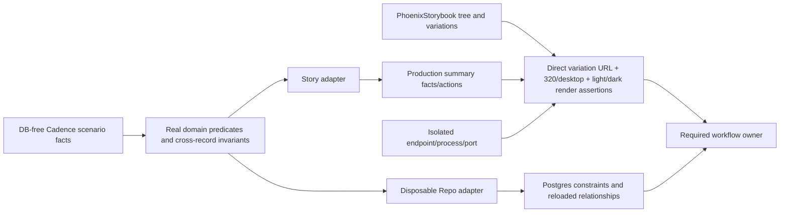

# Phase 252: Production-backed Subscription Stories — Research

**Researched:** 2026-10-26  
**Domain:** Phoenix Storybook, production-shared LiveView components, deterministic billing fixtures, isolated review tooling, CI admission  
**Confidence:** HIGH for the in-repo stack and seams; MEDIUM for the proposed new adapters and lab contracts, which Phase 252 has not implemented

## User Constraints

No `252-CONTEXT.md` exists. Apply the already approved requirements and roadmap; this section summarizes those constraints rather than copying nonexistent context. The owner approved the subscription-first proposal; the requirements say routine implementation choices do not reopen scope. [VERIFIED: `.planning/REQUIREMENTS.md:7`]

### Locked Scope

- Build coverage around the existing subscription job in the Cadence world, using launch/new-account and growing-team situations. Preserve current brand/token ownership, DataTable lifecycle, the independent component kitchen, canonical example-host dev mounts, package boundaries, and provider/authority semantics. [VERIFIED: `.planning/ROADMAP.md:44-48`; `.planning/REQUIREMENTS.md:22-30`]
- Phase 252 owns `SBK-01`, `SBK-02`, `SBK-03`, `SCEN-01`, `SCEN-02`, `SCEN-03`, `SCEN-04`, `LAB-01`, `LAB-02`, and `CIQ-01`. It includes real narrow/desktop and light/dark render checks, lab-isolation negative controls, package boundaries, and workflow admission. [VERIFIED: `.planning/ROADMAP.md:69-78`]
- Keep subscription list/full-page/action journey proof in Phase 253; recurring browser selection, reviewed visual corrections, and curation belong to Phase 254. Static stories and metadata do not prove mounted effects, persistence, provider completion, or authorization. [VERIFIED: `.planning/ROADMAP.md:48,82-84`; `.planning/REQUIREMENTS.md:16-18,32-37`]
- Do not add billing capability/provider parity/money semantics, a Portal or all-page extraction, new Admin rooms, rebranding/token migration, a dependency campaign, an exhaustive Cartesian product, weakened gates, automatic screenshot approval, or mandatory repeated human UAT. [VERIFIED: `.planning/REQUIREMENTS.md:61-73`]
- Every machine-verifiable vertical slice, including the first tracer-like slice, must use automated tasks/assertions. CLAUDE’s policy says: “Do not use `type="tracer"`, `checkpoint:human-verify`, or `<human-check>` when an executable assertion can decide the outcome.” [VERIFIED: `CLAUDE.md:201-205`]

### Project Constraints (from AGENTS.md)

No root `AGENTS.md` was found. GSD agent skill lookup returned no configured skills; `.planning/config.json` has `agent_skills: {}`. Nyquist validation is enabled: `"nyquist_validation": true`. [VERIFIED: `.planning/config.json:15-20,87`; `rg --files --hidden -g AGENTS.md` and `query agent-skills gsd-phase-researcher` returned no matches/configured skills]

<phase_requirements>
## Phase Requirements

| ID | Description | Research Support |
|----|-------------|------------------|
| SBK-01 | Maintainer can locate the subscription job's real production callers and useful component → group → area → section → page compositions in one current coverage map, with reachable, uncovered and not-applicable states distinguished and remaining UI jobs visible as gaps. | Extend the existing registry/story coverage map from real callers and production compositions; keep uncovered jobs visible. |
| SBK-02 | Reviewer can open each retained subscription situation from a stable story/variation URL with its actor, job, input source, production renderer and static-versus-mounted proof lane identified; generated discovery reconciles with actual rendered variations, and metadata-only markers cannot satisfy rendering coverage. | Generate manifest entries from installed PhoenixStorybook backend/story variation APIs, then prove each direct route renders the expected production component and scenario identity. |
| SBK-03 | Reviewer can inspect complete active, scheduled-cancellation and incomplete-evidence subscription areas rendered by the same production-owned summary/facts/action components used by the application, in light/dark and narrow/desktop contexts, without copied markup or story-local formatting, copy, eligibility or scoped-link rules. | Extract only the smallest reusable summary/facts/action area from `SubscriptionLive`; render it at 320 CSS px and desktop width in light/dark. |
| SCEN-01 | Maintainer can select deterministic launch/new-account and growing-team situations in the existing Cadence world from one DB-free fact source, with explicit actor, billed entity, supported provider, lifecycle, fixed clock and stable identities, consumed through narrow story/test/seed adapters rather than a cross-package fixture framework. | Keep a plain facts source outside package runtime/compile roots and adapt it separately for stories, tests, and seeds. |
| SCEN-02 | Maintainer can reject impossible realistic fixtures before rendering using real domain helpers and cross-record invariants for enums, relationships, provider compatibility, money and chronology; deliberately invalid enum, orphan, provider, amount and timestamp controls demonstrate rejection without duplicating billing rules. | Use subscription predicates/changesets, provider capability support labels, Money constructors, and explicit relationship/time invariants; include invalid controls. |
| SCEN-03 | Maintainer can persist representative shared scenarios through a narrow disposable Repo adapter and prove actual database constraints and resulting record relationships match the source facts; DB-free validation alone is never reported as persisted conformance. | Use the test Repo only in a dedicated disposable database lane, then reload and assert customer/subscription/item relationships. |
| SCEN-04 | Reviewer can use plausible ordinary data and separately labelled held-out stress data without cross-lane contamination, real personal data or secrets; existing guarded writes and exact cleanup authority remain proved, including refusal to remove unrelated children. | Preserve existing ordinary/held-out owners; add a refusal test that inserts an unrelated child and asserts it remains after cleanup rejects the request. |
| LAB-01 | Maintainer can launch the reused lab with documented prerequisites, an explicit disposable database/namespace, distinct loopback port and process identity, refusal of unexpected existing-server reuse, and a negative control proving a normal test reset cannot alter review-session data; DB-free rendering is distinguished from DB-backed endpoint startup. | Harden a wrapper around the existing E2E bootstrap, which currently accepts an existing database/server; use distinct DB/port/process identity and reset negative control. |
| LAB-02 | An adopter can compile and use production packages without scenario payloads, fixture imports, Storybook runtime requirements or Node tooling, with production-route absence and package-content/compile checks; canonical example-host dev mounts and the independent component kitchen remain preserved. | Extend existing prod-like route/dependency tests and run production compile/package-content checks. |
| CIQ-01 | A change confined to any consumed story, shared scenario, component, registry, generated manifest, token or runner root invokes its named required CI owner, proved by representative positive path/classifier controls and an unrelated-path negative control; in-job selection cannot substitute for workflow admission. | Use the existing unconditional merge-blocking `admin-phase200-guardrails` owner; contract-test workflow admission plus consumed-root classification and unrelated-path exclusion. |
</phase_requirements>

## Summary

The project already has a production subscription detail LiveView, a registry/kitchen, Storybook 1.2 in dev/test, browser coverage, Postgres-backed test support, and a real host seed cleanup guard. The main gap is attribution: the current `SubscriptionDetail` story is a static Phase 195-shaped copy with locally assembled rows/actions, and the current registry coverage tests reconcile metadata rather than proving each actual story variation rendered. Phase 252 should replace the copied panel with a small production-owned summary/facts/action composition and generate its stable review URLs from PhoenixStorybook’s compiled story tree and each story’s declared variations. [VERIFIED: `accrue_admin/lib/accrue_admin/live/subscription_live.ex:253-315,846-892`; `storybook/components/subscription_detail.story.exs:1-88`; `accrue_admin/test/accrue_admin/dev/storybook_coverage_test.exs:11-60`; installed `phoenix_storybook` sources cited below]

Keep scenario facts plain and database-free, validate them against Accrue’s real billing/domain rules, then provide two narrow consumers: a pure story/test adapter and a separate disposable-Repo adapter. The Repo lane must prove persisted foreign-key relationships and database constraints; successful in-memory validation is not that evidence. Set a fixed Fake clock for time-based cancellation predicates. [VERIFIED: `.planning/REQUIREMENTS.md:22-25`; `accrue/lib/accrue/billing/subscription.ex:38-47,124-132,148-194`; `accrue/lib/accrue/clock.ex:5-15,25-30`; migration `accrue/priv/repo/migrations/20260412100002_create_accrue_billing_schemas.exs:89-104`]

The current browser bootstrap is unsafe as an interactive review-lab boundary: it accepts an already-created database and started Repo/processes; local Playwright also reuses an existing server. Add a preflight launcher that refuses occupied/unexpected DB or port state, records the child process identity, and uses an explicit disposable DB namespace. Prove its reset cannot touch a separately seeded review session. Keep static browser rendering, DB-backed endpoint bootstrap, and Phase 253 mounted action journeys as separate evidence lanes. [VERIFIED: `accrue_admin/test/support/e2e_server.ex:50-70,86-104`; `accrue_admin/playwright.config.js:30-35`; `.planning/ROADMAP.md:48`]

**Primary recommendation:** deliver a tracer-first automated vertical slice: one validated shared scenario rendered by the same production-owned summary/facts/action function as the app, with generated variation URLs, real 320/desktop light/dark browser proof, disposable Repo proof, reset/cleanup negative controls, production boundary checks, and a required CI owner contract. Do not label it complete based on screenshots, metadata, or manual review. [VERIFIED: `.planning/ROADMAP.md:48,74-78`; `CLAUDE.md:201-205`]

## Architectural Responsibility Map

| Capability | Primary Tier | Secondary Tier | Rationale |
|------------|-------------|----------------|-----------|
| Production summary/facts/action rendering | Browser / Client | Frontend Server (SSR) | HEEx components create the rendered area; Storybook supplies deterministic assigns while production remains the policy owner. The current LiveView composes `Detail.summary_card` and `Detail.summary_list` from subscription/customer facts. [VERIFIED: `accrue_admin/lib/accrue_admin/live/subscription_live.ex:287-301,846-892`] |
| Scenario validity and lifecycle meaning | API / Backend | Database / Storage | Accrue owns status predicates, schemas, changesets, money constructors and provider support; scenario adapters must call these. [VERIFIED: `accrue/lib/accrue/billing/subscription.ex:121-132,148-194`; `accrue/lib/accrue/money.ex:47-73`; `accrue/lib/accrue/processor/capabilities.ex:70-106`] |
| Persisted scenario conformance | Database / Storage | API / Backend | The disposable Repo test proves actual constraints and records/relations after loading them from Postgres; DB-free facts alone cannot prove persistence. [VERIFIED: `.planning/REQUIREMENTS.md:24`; `accrue/priv/repo/migrations/20260412100002_create_accrue_billing_schemas.exs:89-104`] |
| Story variation discovery and direct URL proof | Frontend Server (SSR) | Browser / Client | PhoenixStorybook backend exposes the story tree/leaves/load operation and variation callbacks; Playwright opens each generated route and checks actual iframe content. [VERIFIED: `accrue_admin/deps/phoenix_storybook/lib/phoenix_storybook.ex:56-70`; installed `PhoenixStorybook.BackendBehaviour` in `phoenix_storybook.ex:16-39`; `stories/story.ex:144-175`; `live/story_live.ex:94-166`] |
| Review lab lifecycle/reset isolation | API / Backend | Database / Storage | The endpoint/Repo/Fake process and E2E reset route mutate test state; isolation belongs in launcher, DB namespace and exact cleanup guards. [VERIFIED: `accrue_admin/test/support/e2e_server.ex:6-20,50-104`; `accrue_admin/test/support/e2e_plug.ex`; `accrue_admin/test/support/e2e_fixtures.ex`] |
| Production package and route boundary | Frontend Server (SSR) | CDN / Static | Mix compile paths, package file allowlist and router options determine whether dev tooling reaches an adopter. [VERIFIED: `accrue_admin/mix.exs:31-59`; `accrue_admin/lib/accrue_admin/dev/storybook.ex:1-20`; `accrue_admin/test/accrue_admin/dev/storybook_asset_test.exs:30-57`] |
| CI workflow admission | CDN / Static | — | GitHub Actions decides whether a required workflow/job exists for the changed roots before its scripts can classify/select work. `ci.yml` has no path filter and already names the required guardrail owner. [VERIFIED: `.github/workflows/ci.yml:3-18,22-27,1242-1246`] |

## Standard Stack

### Core

| Library / tool | Current version | Purpose | Why this is the standard here |
|----------------|-----------------|---------|-------------------------------|
| Phoenix | 1.8.7 locked | Router and server-rendered component framework | Existing production Admin and Storybook backend. [VERIFIED: `accrue_admin/mix.lock:66`] |
| Phoenix LiveView | 1.1.31 locked | Production `SubscriptionLive` composition and Storybook host | Current detail area and installed Storybook LiveViews use it. [VERIFIED: `accrue_admin/mix.lock:68`] |
| PhoenixStorybook | 1.2.0 locked; dev/test only | Story and variation registry/renderer | Existing installed backend has story tree and variation APIs; not a production dependency. [VERIFIED: `accrue_admin/mix.lock:70`; `accrue_admin/mix.exs:45-46`] |
| Ecto / Ecto SQL / Postgrex | 3.13.6 / 3.13.5 / 0.22.2 locked | Real changesets, Repo inserts and Postgres constraints | Existing billing schema and test Repo use these. [VERIFIED: `accrue_admin/mix.lock:19-20,77`] |
| ExUnit | Existing Mix test framework | Pure scenario, contract, and Repo tests | Current `storybook_coverage_test`, route, and `SubscriptionLiveTest` are ExUnit. [VERIFIED: `accrue_admin/test/accrue_admin/dev/storybook_coverage_test.exs:1-4`; `accrue_admin/test/accrue_admin/dev/storybook_asset_test.exs:1-4`] |
| Playwright Test | 1.59.1 locked | Actual variation URL, responsive and theme render proof | Existing browser runner already hosts the Admin test endpoint and runs browser suites. [VERIFIED: `accrue_admin/package-lock.json:10-11`; `accrue_admin/playwright.config.js:8-42`] |
| Node `node:test` | Node v22.14.0 available in this environment | Workflow/path contract self-tests | Existing `scripts/ci/phase248_heldout_isolation.test.mjs` uses `node:test` and VM-loaded contracts. [VERIFIED: `scripts/ci/phase248_heldout_isolation.test.mjs:1-21`; environment probe, 2026-10-26] |

### Supporting Existing Owners

| Existing owner | Use | Constraint |
|----------------|-----|------------|
| `Accrue.Billing.Subscription` predicates and changeset | Lifecycle, cancellation, required customer relationship and enum checks | Do not copy eligibility or derive lifecycle separately in Storybook. [VERIFIED: `accrue/lib/accrue/billing/subscription.ex:38-47,121-194`] |
| `Accrue.Money` | Integer minor-unit construction and known currency validation | Do not hand-roll currency exponent/format behavior or convert through float. [VERIFIED: `accrue/lib/accrue/money.ex:47-73`] |
| `Accrue.Processor.Capabilities` | Provider/action compatibility | It labels provider support by capability; do not infer provider parity from a rendered button. [VERIFIED: `accrue/lib/accrue/processor/capabilities.ex:70-106,156-175`] |
| Admin `Copy`, `ScopedPath`, summary/detail/action components | Production copy, owner-scoped links, and presentational semantics | Extract a narrow reusable view/function; keep state/eligibility in the owning production tier. [VERIFIED: `accrue_admin/lib/accrue_admin/live/subscription_live.ex:269-301,846-892`] |
| `AccrueAdmin.TestRepo` + real migrations | Persisted fixture proof | Only use with explicit disposable database identity; current test config derives database from `MIX_TEST_PARTITION`. [VERIFIED: `accrue_admin/config/test.exs:5-15`] |

**Installation:** none. The approved phase adds no dependency; reuse installed package/lock versions. Package legitimacy audit is therefore not applicable. [VERIFIED: `.planning/REQUIREMENTS.md:69`; `accrue_admin/mix.exs:39-51`; `accrue_admin/package.json:50-54`]

## Architecture Patterns

### Data and proof lanes

The story/browser lane proves rendered static composition and route/variation attribution. It does not prove `SubscriptionLive` mount behavior, an effect, provider dispatch, persisted updates, or the full operator journey. The Repo lane proves only explicitly persisted facts/constraints. Full page and mounted journey evidence stays in Phase 253. [VERIFIED: `.planning/ROADMAP.md:48,82-84`; `.planning/REQUIREMENTS.md:16-18,24`]

### Recommended implementation boundaries

| Boundary | Recommendation |
|----------|----------------|
| Production view | Extract the smallest complete subscription area from `SubscriptionLive`: summary card, lifecycle/facts rows, and applicable action presentation. Pass real `Subscription`, `Customer`, mount path and owner scope; preserve existing `Copy`, `ScopedPath`, status and eligibility helpers. Leave the entire page’s lazy event/audit/actions and interaction lifecycle in the current LiveView for Phase 253. [VERIFIED: `accrue_admin/lib/accrue_admin/live/subscription_live.ex:253-315,846-892`; `.planning/REQUIREMENTS.md:15-18`] |
| Story | Replace the copied `summary_rows/1`, `action_groups/1`, provider pruning and static customer/date markup with scenario adapter output passed through the production view. The current story explicitly owns those local helpers and static markup. [VERIFIED: `storybook/components/subscription_detail.story.exs:42-88`] |
| Scenario facts | Use plain deterministic facts with stable string record IDs, actor/billable owner, provider, lifecycle, fixed clock and item facts. Keep the facts source outside application compile paths and package file lists; use separate adapters for story assigns, unit validation, seed and Repo persistence. A suggested `dev_support/ui_scenarios/` location appears in approved research but does not exist yet; treat its exact path as a planning choice. [VERIFIED: `.planning/REQUIREMENTS.md:22-25`; `.planning/research/ui-quality-engine/ARCHITECTURE.md`; `accrue_admin/mix.exs:31-33,55-60`; ASSUMED exact new path]
| Manifest | Start from `AccrueAdmin.Storybook.leaves/0`, load the corresponding story using the backend API, enumerate component/live-component variations (including groups), preserve each actual variation ID, then generate stable URLs with PhoenixStorybook’s navigation helper. Fail if the rendered DOM/iframe does not prove that expected variation and scenario. Story metadata/data attributes may help attribution but must not be the only proof. [VERIFIED: `accrue_admin/deps/phoenix_storybook/lib/phoenix_storybook.ex:56-70`; `stories/story.ex:144-175`; `live/story_live.ex:94-166`; `helpers/navigation_helpers.ex:30-57`; `.planning/REQUIREMENTS.md:14`] |
| Repo adapter | Wrap only fixture insertion/reload, use existing schema changesets, actual migrations and `TestRepo`; assert customer→subscription→item links and a DB-level invalid relationship rejection. Do not make a general fixture framework. [VERIFIED: `.planning/REQUIREMENTS.md:24`; `accrue/lib/accrue/billing/subscription.ex:124-132`; migration `20260412100002_create_accrue_billing_schemas.exs:89-104`] |
| Held-out cleanup | Extend the existing exact ID/owner/child checks. Add the negative test before deletion: seed an unrelated child under the otherwise-owned customer, invoke cleanup, assert it refuses, then assert the unrelated row remains. Preserve the existing environment/database whitelist. [VERIFIED: `examples/accrue_host/priv/repo/seeds/phase248_cleanup_edge.exs:7-18,20-26,56-83`] |
| Lab | Add an explicit wrapper/preflight around the current E2E server. Require a fresh named disposable DB and free loopback port; capture/verify PID, command and selected DB; fail closed on a live/unknown listener or pre-existing DB. Disable local Playwright server reuse for review runs or enforce the same identity guard before it is considered healthy. [VERIFIED: `accrue_admin/test/support/e2e_server.ex:50-70,102-104`; `accrue_admin/playwright.config.js:30-35`; recommended safeguards are implementation guidance]
| CI | Name `admin-phase200-guardrails` as owner because `ci.yml` is triggered on PRs without path filters and its required-job contract lists this owner. Add a source-root classifier/contract: each consumed root selects the focused proof; an unrelated root does not. Also assert the workflow trigger and required job remain admitted; testing an in-job selector alone is insufficient. The separate browser workflow omits root `storybook/`, so do not quietly treat it as this owner. [VERIFIED: `.github/workflows/ci.yml:3-18,22-27,1242-1246`; `.github/workflows/accrue_admin_browser.yml:5-17`; `.planning/REQUIREMENTS.md:34`] |

### Domain validation rules

- Copy the status enum and use `Accrue.Billing.Subscription.statuses/0`, predicates and schema changeset. The source defines `@statuses` as `[:trialing, :active, :past_due, :canceled, :unpaid, :incomplete, :incomplete_expired, :paused]`. [VERIFIED: `accrue/lib/accrue/billing/subscription.ex:38-47,117-132`]
- Use `active?/1`, `past_due?/1`, `canceled?/1`, `canceling?/1`, and other existing predicates rather than writing fixture-only status rules. Cancellation-at-period-end evaluates against `Accrue.Clock.utc_now/0`; fix Fake time before creating/rendering that case. [VERIFIED: `accrue/lib/accrue/billing/subscription.ex:148-194`; `accrue/lib/accrue/clock.ex:5-15,25-30`]
- Use `Accrue.Money.new/2` with integer minor units and a real supported currency atom; negative tests should reject a float/Decimal passed to that constructor and an unknown currency, not implement an alternative parser. [VERIFIED: `accrue/lib/accrue/money.ex:47-73`]
- Validate provider/capability compatibility from `Accrue.Processor.Capabilities`, and verify a chosen plan/item provider agrees with its owning subscription. The support map explicitly distinguishes testing/local-only, native, bounded first-party, and unsupported behaviors. [VERIFIED: `accrue/lib/accrue/processor/capabilities.ex:70-106,156-175`]
- Add explicit chronology and cross-record checks to the scenario boundary only where domain helpers do not already enforce them. Invalid controls must fail before rendering; DB-only FK/non-null/unique guarantees must be demonstrated in the Repo lane. This is an adapter invariant, not duplicated app billing policy. [VERIFIED: `.planning/REQUIREMENTS.md:23-24`; migration `20260412100002_create_accrue_billing_schemas.exs:89-104`]

### Production and package boundary

The current package already compiles only `lib` outside dev/test support, scopes PhoenixStorybook to dev/test, and allowlists package files without root `storybook/` or story support. The Storybook module is guarded from prod. Extend, do not weaken, `storybook_asset_test.exs`; add production compile and unpacked package-content proof for any new shared scenario files. Verify production route absence and preservation of the canonical example-host mounts. [VERIFIED: `accrue_admin/mix.exs:31-60`; `accrue_admin/lib/accrue_admin/dev/storybook.ex:1-20`; `accrue_admin/test/accrue_admin/dev/storybook_asset_test.exs:30-57`; canonical router `examples/accrue_host/lib/accrue_host_web/router.ex:159-192`]

### Lab startup and reset contract

The E2E helper requires test env and binds to loopback, but `migrate!/0` treats `{:error, :already_up}` as success and Repo/Oban/Fake/Endpoint startup accepts already-started processes. Playwright uses `reuseExistingServer: !process.env.CI`. Thus a distinct port alone does not establish ownership; a wrapper must preflight DB existence and listener/process identity, and refuse rather than attach to unknown state. [VERIFIED: `accrue_admin/test/support/e2e_server.ex:6-20,38-47,50-70,73-104`; `accrue_admin/playwright.config.js:30-35`]

The test database name is built as `"accrue_admin_test#{System.get_env("MIX_TEST_PARTITION")}"`; the port is `System.get_env("ACCRUE_ADMIN_E2E_PORT", "4017")`. Use a unique `MIX_TEST_PARTITION` and port for review, record both alongside PID/command, and reject a target database that already exists. The ordinary E2E `/reset` truncates its configured test DB, so the negative control must keep a marker in the independent review DB, reset the ordinary lane, and reload the marker unchanged. [VERIFIED: `accrue_admin/config/test.exs:5-15`; `accrue_admin/test/support/e2e_server.ex:102-104`; `accrue_admin/test/support/e2e_plug.ex`; `accrue_admin/test/support/e2e_fixtures.ex`]

DB-free story rendering must be reported separately from endpoint startup: the E2E server starts/migrates a Repo, Oban and Fake before binding HTTP. Do not describe a pure component render as proving the DB-backed server. [VERIFIED: `accrue_admin/test/support/e2e_server.ex:6-20`]

### Likely bounded plan breakdown

1. **Automated tracer-first production composition:** establish one scenario fact, validate it, render the extracted production summary/facts/action view, and add direct actual-variation rendering assertions. Keep source ID/variation stable and visible in the rendered proof.
2. **Scenario source and domain controls:** add launch and growing-team facts, narrow story/seed/test adapters, invalid enum/relationship/provider/money/chronology controls; set Fake clock explicitly.
3. **Persisted conformance and cleanup:** disposable Repo adapter, relation/constraint assertions, ordinary-vs-heldout boundary and unrelated-child cleanup refusal/preservation test.
4. **Responsive/theme and generated coverage:** generation from backend tree + variations, stable URLs, 320 and 1280 CSS px, light/dark browser proof; current Desktop/Pixel Playwright projects are not a substitute for exact 320px viewport, so set the viewport explicitly for the 320 proof. [VERIFIED: `accrue_admin/playwright.config.js:36-42`; exact 320px is requirement text at `.planning/REQUIREMENTS.md:41`]
5. **Safe lab, production boundary and CI admission:** preflight DB/port/PID and refuse reuse, reset isolation control, production compile/package/route/kitchen/host-mount assertions, required-owner trigger/classifier positive and negative controls.

Keep these as deterministic automated tasks. No manual tracer/UAT checkpoint is permitted for any behavior an assertion can decide. [VERIFIED: `CLAUDE.md:201-205`]

## Don't Hand-Roll

| Problem | Don’t build | Use instead | Why |
|---------|------------|-------------|-----|
| Subscription state meaning and eligibility | Story-only status checks, action pruning or duplicated formatting | Existing `Subscription`, `SubscriptionLive` helpers, `Copy`, `ScopedPath`, and production-owned extracted view | Existing app semantics include provider support, owner scope, clock and domain state. [VERIFIED: `accrue_admin/lib/accrue_admin/live/subscription_live.ex:269-301,846-892,1478-1508`; `accrue/lib/accrue/billing/subscription.ex:148-194`] |
| Story variation URLs | Hard-coded route list or metadata-only marker audit | `PhoenixStorybook` backend leaves/load APIs, each story’s `variations/0`, and `NavigationHelpers.path_to_iframe/4` | Installed package supplies canonical tree, route, query and variation semantics. [VERIFIED: installed PhoenixStorybook source cited above] |
| Currency math | float/Decimal fixture formatter or currency exponent table | `Accrue.Money` and current production presentation helpers | Constructor validates integer minor units and ISO currency; formatting belongs to current owner. [VERIFIED: `accrue/lib/accrue/money.ex:47-73`; current `SubscriptionLive` summary source] |
| Database relationship proof | Hand-built in-memory “Repo” or treating successful changeset as persisted | Existing schema changesets + `TestRepo` + migrations | Database FK/null/unique constraints only exist in the actual adapter lane. [VERIFIED: `.planning/REQUIREMENTS.md:24`; migration `20260412100002_create_accrue_billing_schemas.exs:89-104`] |
| Cleanup authority | Broad `Repo.delete_all` fixture sweep | Phase248 whitelist + exact IDs/owners/expected-child guard | Existing seed aborts when another customer child exists; the new test should prove refusal leaves it intact. [VERIFIED: `examples/accrue_host/priv/repo/seeds/phase248_cleanup_edge.exs:7-18,56-81`] |
| Generic fixture framework | Cross-package scenario dependency or common compiled helper | Plain data facts and small consumer-specific adapters | Approved requirements expressly prefer narrow adapters and avoid a cross-package fixture framework. [VERIFIED: `.planning/REQUIREMENTS.md:22,69`] |
| Screenshot stability / visual inference | Treating a stable pixel baseline or DOM marker as proof of behavior/quality | Direct route, DOM identity, domain, persistence, and browser assertions | Roadmap explicitly separates static render from persisted/provider/behavior evidence. [VERIFIED: `.planning/ROADMAP.md:48`] |

## Common Pitfalls

1. **Copying production markup again.** Current story duplicates summary rows, action grouping, Braintree pruning and facts. A prettier story remains disconnected unless it calls the production-owned view and policy. [VERIFIED: `storybook/components/subscription_detail.story.exs:42-88`; `accrue_admin/lib/accrue_admin/live/subscription_live.ex:846-892,1478-1508`]
2. **Counting story metadata instead of rendered variations.** Current coverage tests compare registry rows/variation ID lists and group markers; they do not open every actual story variation. Generate route cases, open each, and assert expected content in the Storybook iframe/renderer. [VERIFIED: `accrue_admin/test/accrue_admin/dev/storybook_coverage_test.exs:11-60`; inferred from exercised assertions]
3. **Confusing component rendering with mounted app behavior.** A Storybook component uses a real production component but does not mount `SubscriptionLive`, authorize an action, persist, or call a provider. Keep those assertions in the correct Phase 253 mounted/Repo lane. [VERIFIED: `.planning/ROADMAP.md:48,82-84`; `.planning/REQUIREMENTS.md:16-18`]
4. **Reusing the ordinary E2E DB or server for interactive review.** Existing startup explicitly accepts already-up state, and local Playwright reuses an existing endpoint. Preflight/refuse and use independently named DB/port/process. [VERIFIED: `accrue_admin/test/support/e2e_server.ex:50-70`; `accrue_admin/playwright.config.js:30-35`]
5. **Calling DB-free checks persistence proof.** Changesets and scenario validators cannot prove actual FKs or reloaded record relationships. Use real Postgres in a disposable partition and assert both invalid inserts and loaded associations. [VERIFIED: `.planning/REQUIREMENTS.md:24`; migration `20260412100002_create_accrue_billing_schemas.exs:89-104`]
6. **Leaving time implicit.** `canceling?/1` compares period end to `Accrue.Clock.utc_now/0`; changing system wall clock or freezing only story labels does not freeze this predicate. Set the Fake clock at scenario setup. [VERIFIED: `accrue/lib/accrue/billing/subscription.ex:172-194`; `accrue/lib/accrue/clock.ex:5-15,25-30`]
7. **Deleting unrelated fixture children.** Phase248’s script already guards exact ownership and child set, but source inspection is not a negative test. Insert an extra child and assert abort plus row preservation. [VERIFIED: `examples/accrue_host/priv/repo/seeds/phase248_cleanup_edge.exs:56-81`; `scripts/ci/phase248_heldout_isolation.test.mjs:24-60`]
8. **Missing story/scenario roots in workflow triggers.** `accrue_admin_browser.yml` paths currently mention `accrue/**`, `accrue_admin/**`, and itself, but not root `storybook/` or a new facts root. Either rely on the unconditional required CI owner and test its admission, or update every relevant `paths` filter; a script running after a missed workflow is not coverage. [VERIFIED: `.github/workflows/accrue_admin_browser.yml:5-17`; `.github/workflows/ci.yml:22-27`]
9. **Viewport naming without measured viewport.** Existing browser projects include a Pixel device and desktop 1280x900, but a device preset’s viewport may not equal the required 320 CSS pixels. Set and assert exact 320 viewport width explicitly; also prove the desktop viewport, both themes, and actual rendered content. [VERIFIED: `accrue_admin/playwright.config.js:36-42`; `.planning/REQUIREMENTS.md:15,41`]

## Validation Architecture

### Test framework

| Property | Value |
|----------|-------|
| Framework | ExUnit for Elixir; Playwright Test 1.59.1 for browser; Node built-in `node:test` for JS contract tests. [VERIFIED: `accrue_admin/package-lock.json:10-11`; existing ExUnit test sources; `scripts/ci/phase248_heldout_isolation.test.mjs:1-6`] |
| Config | `accrue_admin/mix.exs`, `accrue_admin/config/test.exs`, `accrue_admin/playwright.config.js`, package scripts in `accrue_admin/package.json`. [VERIFIED: cited source files] |
| Current fast DB-free command | `cd accrue_admin && mix test test/accrue_admin/dev/storybook_coverage_test.exs` — existing metadata/registry contract, not sufficient as final render proof. [VERIFIED: `accrue_admin/package.json:45`; file `storybook_coverage_test.exs:1-81`] |
| Current focused Storybook command | `cd accrue_admin && npm run phase200:storybook` — existing ExUnit story coverage/asset/theme tests followed by one Playwright a11y suite. This needs DB/browser prerequisites and can reuse a local server unless guarded; do not use it as the isolation proof unchanged. [VERIFIED: `accrue_admin/package.json:45`; `accrue_admin/playwright.config.js:30-35`] |
| Existing CI guardrail command | `cd accrue_admin && npm run phase200:guardrails` runs `scripts/ci/verify_phase200_admin_guardrails.sh`. [VERIFIED: `accrue_admin/package.json:48`] |
| Future focused command | Add a named package script for the phase252 focused Elixir + browser suite; exact script name is open implementation detail. Do not claim such command exists today. [ASSUMED: new script required] |

### Requirement-to-test map

| Req ID | Behavior | Test type | Automated command pattern | Existing? |
|--------|----------|-----------|---------------------------|-----------|
| SBK-01 | Production caller/composition map has explicit reachable, uncovered, N/A and remaining gaps. | ExUnit contract + generated map consistency | `cd accrue_admin && mix test test/accrue_admin/dev/storybook_coverage_test.exs` then extend with caller/composition assertions. | Existing coverage test is metadata/registry-based; caller map assertion is a gap. [VERIFIED: file `storybook_coverage_test.exs:11-60`] |
| SBK-02 | Every generated story/variation URL resolves to the expected real rendered variation and carries actor/job/source/renderer/proof-lane attribution. | ExUnit manifest + Playwright direct-route render | Current browser analogue: `cd accrue_admin && npm run phase200:storybook`; extend/add direct visits from backend-generated manifest. | Variation route API exists; exhaustive direct-route checks do not. [VERIFIED: installed PhoenixStorybook sources; current test `admin-storybook-a11y-phase200.spec.js`] |
| SBK-03 | Active, scheduled cancellation and incomplete-evidence area renders at 320 and desktop in light/dark using production composition. | Component ExUnit + Playwright browser/visual assertions | `mix test` for component render; Playwright phase script with explicit viewport width, theme, route and DOM identity. | Production LiveView/test analog exists; these extracted area stories/proofs are a gap. [VERIFIED: `accrue_admin/test/accrue_admin/live/subscription_live_test.exs`; `accrue_admin/package.json:45`] |
| SCEN-01 | DB-free facts are stable, deterministic and usable by narrow adapters. | Pure ExUnit | New scenario boundary test, run alongside existing `storybook_coverage_test.exs`. | New facts source/test needed. [VERIFIED: `.planning/REQUIREMENTS.md:22`] |
| SCEN-02 | Valid facts satisfy actual enum, relationship, provider, money and chronology invariants; invalid controls fail. | Property/ExUnit unit tests | New pure validator tests with one invalid case per invariant; no Repo required for DB-free controls. | Subscription/Money/capability owners exist; scenario boundary test is new. [VERIFIED: domain files cited above] |
| SCEN-03 | Valid fact set persists; reloaded relationships and actual database constraints match. | Repo integration | `cd accrue_admin && MIX_TEST_PARTITION="$PHASE252_DB_TAG" mix test path/to/focused_repo_test.exs` after explicitly setting a unique disposable tag and preflighting DB/migration. | Existing `SubscriptionLiveTest`/LiveCase is DB-backed analog; new adapter proof is needed. Command/file is a pattern, not current. [VERIFIED: `accrue_admin/config/test.exs:5-15`; `.planning/REQUIREMENTS.md:24`] |
| SCEN-04 | Ordinary and held-out data remain separate; cleanup refuses unrelated child and leaves it intact. | Seed integration + Node contract | `node --test scripts/ci/phase248_heldout_isolation.test.mjs` plus focused Postgres cleanup test. | Node guard exists; unrelated child preservation test is absent from it. [VERIFIED: `scripts/ci/phase248_heldout_isolation.test.mjs:1-60`; seed cleanup source above] |
| LAB-01 | Lab refuses stale DB/port/server reuse; normal reset leaves independent review DB unchanged. | Launcher unit + two-process/Repo integration | New lab preflight contract plus disposable DB integration; use unique `MIX_TEST_PARTITION` and `ACCRUE_ADMIN_E2E_PORT` values. | E2E helper exists; explicit preflight/reset isolation test is a gap. [VERIFIED: `accrue_admin/config/test.exs:5-15`; `e2e_server.ex:50-70,102-104`] |
| LAB-02 | Prod compile/package/routes exclude fixture and Storybook runtime/tooling; preserve kitchen and example-host dev mounts. | Mix prod compile/package inspection + ExUnit route contract | `cd accrue_admin && MIX_ENV=prod mix compile --warnings-as-errors`; `mix test test/accrue_admin/dev/storybook_asset_test.exs` for route/mount contracts; inspect unpacked package content. | Route/dependency and host mount checks exist; package-content fixture exclusion is a gap. [VERIFIED: `accrue_admin/mix.exs:31-60`; `storybook_asset_test.exs:30-57`] |
| CIQ-01 | Root changes reach required owner; positive consumed-root paths pass and unrelated path is excluded from focused selection. | Node contract + workflow contract | `node --test scripts/ci/verify_phase252_ci_contract.test.mjs` (proposed) plus existing `npm run phase200:guardrails`. | Existing phase200 CI contract analogs exist; phase252 root coverage is new. Proposed filename is `[ASSUMED]`. [VERIFIED: `scripts/ci/verify_phase200_ci_contract.sh`; `.github/workflows/ci.yml:3-18,22-27`]

### Sampling and lanes

- **Per task:** run the smallest pure ExUnit or Node `--test` contract. Avoid starting Postgres/browser for scenario facts or manifest unit checks.
- **Per plan/wave:** run the focused disposable-Repo test and the named Playwright story-render suite only after DB/port/PID preflight. The browser assertion must cover exact 320 CSS px and desktop width, both light/dark themes, expected scenario identity, and actual production view content.
- **Phase gate:** run the named required CI owner’s complete deterministic guardrails and existing package/host/kitchen/browser proofs; produce the project’s generated automated UAT artifact and verification artifacts per `CLAUDE.md`. Existing host/provider gates remain in force. [VERIFIED: `CLAUDE.md:201-205`; `.github/workflows/ci.yml:10-18`]

### Wave 0 gaps

- [ ] Add a pure facts validator and invalid-control ExUnit suite; no shared scenario facts source exists yet. [VERIFIED: `.planning/REQUIREMENTS.md:22-23`; approved inventory/research docs]
- [ ] Add a narrow Repo adapter integration test with disposable DB and persisted relationship/constraint assertions. [VERIFIED: `.planning/REQUIREMENTS.md:24`]
- [ ] Add actual-story-variation manifest and render reconciliation; current Storybook tests only compare metadata/markers. [VERIFIED: `storybook_coverage_test.exs:11-60`]
- [ ] Add explicit 320px + desktop and both-theme production-area browser assertions. [VERIFIED: `.planning/REQUIREMENTS.md:15,41`; existing browser config `playwright.config.js:36-42`]
- [ ] Add lab startup preflight and review/ordinary reset isolation negative control. [VERIFIED: `e2e_server.ex:50-70`; `.planning/REQUIREMENTS.md:29`]
- [ ] Add cleanup refusal/preservation test and production package-content assertion for any new facts/adapter source. [VERIFIED: phase248 cleanup source above; `.planning/REQUIREMENTS.md:25,30`]
- [ ] Add CI workflow admission and consumed-root positive/unrelated-root negative contract. [VERIFIED: `.planning/REQUIREMENTS.md:34`; workflow sources above]
- [ ] No test framework install required; installed Mix, Node, npm, Postgres client/server readiness and local Playwright package were available during research. Browser binaries were not separately probed. [VERIFIED: environment probe, 2026-10-26]

## Security Domain

The GSD research policy treats security enforcement as enabled unless explicitly set false. No security override was observed in the project config. This phase adds test/review tooling, not a new authentication or payment authorization surface; the applicability statements below are inferences from current source and locked scope. [ASSUMED: no explicit security override is configured; `.planning/config.json`; `.planning/REQUIREMENTS.md:29-30,65-73`]

### Applicable ASVS categories

| Category | Applies | Control for this phase |
|----------|---------|------------------------|
| V2 Authentication | No new auth implementation | Preserve current dev-only Storybook route and production route absence. [VERIFIED: `storybook_asset_test.exs:30-57`] |
| V3 Session Management | No new session behavior | Do not expose test credentials/secrets in scenario facts or browser artifacts. [VERIFIED: `.planning/REQUIREMENTS.md:25,29`] |
| V4 Access Control | Yes, presentation must retain production scope | Reuse production `ScopedPath` and action eligibility; Storybook appearance is not authorization proof. [VERIFIED: `subscription_live.ex:269-301,846-892`; `.planning/ROADMAP.md:48`] |
| V5 Input Validation | Yes | Validate scenario data through real schemas/helpers and reject impossible relationships/provider/amount/timestamp before render. [VERIFIED: `.planning/REQUIREMENTS.md:23`; schema sources cited above] |
| V6 Cryptography | No new crypto | Keep test-only secrets in test config and do not introduce secret material into facts. [VERIFIED: `accrue_admin/config/test.exs:17-20`; `.planning/REQUIREMENTS.md:25`] |

### Threat patterns

| Pattern | STRIDE | Mitigation |
|---------|--------|------------|
| Cleanup targets an unexpected DB or deletes an unrelated customer child | Tampering / Elevation | Verify database, role, server, process and exact fixture IDs before transaction; assert the unrelated row survives refusal. [VERIFIED: phase248 cleanup `:7-18,56-81`] |
| Browser connects to another developer’s server due local reuse | Spoofing / Information disclosure | Bind loopback, refuse occupied port unless PID/command/database exactly match expected lab metadata, and disable blind reuse in review lane. [VERIFIED: `e2e_server.ex:38-47,102-104`; `playwright.config.js:30-35`] |
| Story shows an action that production policy would not offer | Elevation of privilege | Render production-owned action availability; static stories do not represent ability to execute. Retain mounted authorization tests for Phase 253. [VERIFIED: `subscription_live.ex:1478-1508`; `.planning/REQUIREMENTS.md:18`] |

## Environment Availability

| Dependency | Required by | Available in research environment | Version / observation | Fallback |
|------------|-------------|-----------------------------------|-----------------------|----------|
| Elixir / Mix | Compile, ExUnit, Ecto migration | Yes | Elixir command reports Erlang/OTP 28; Mix available (version output did not identify Mix’s own release). | None needed. |
| Node / npm | Playwright and Node CI contracts | Yes | Node v22.14.0; npm 11.1.0 | None needed. |
| PostgreSQL client/server | Repo-backed validation and browser server | Yes | `psql` / `pg_isready` 14.17; local `/tmp:5432` reported accepting connections. Credentials/database access still require explicit test-lane preflight. | DB-free validator is useful fast lane only; it cannot replace persisted proof. |
| Local Playwright package | Browser render suite | Yes | Local binary reports 1.59.1. Browser binaries were not separately probed. | Existing CI installs/runs browser lane; do not infer local browser availability. |
| Hex package manager | Unpacked package-content proof | Not probed | — | Production compile and package source allowlist contract are available; verify `mix hex.build --unpack` availability before planning exact command. |

## Assumptions Log

| # | Claim | Section | Risk if wrong |
|---|-------|---------|---------------|
| A1 | The approved-research-proposed shared fact source can live under a new root such as `dev_support/ui_scenarios/`; no such directory currently exists. Keep it out of package compile/runtime roots and use plain data. | Architecture patterns | Incorrect placement could leak fixtures into package/runtime or require an unwanted abstraction; planner should choose the exact path and add package checks. |
| A2 | A new focused Playwright package-script name and exact new test filenames will be chosen during planning; the named examples in the validation map are patterns, not existing files. | Validation Architecture | Planning could accidentally reference nonexistent commands/files or claim tests already run. |
| A3 | Any local Postgres readiness result means a local process is listening only; it does not prove the credentials or database are safe to use for a disposable lane. | Environment Availability | A wrong environment can damage unrelated data; require the launcher’s explicit DB identity and fresh-database checks. |
| A4 | The project does not explicitly opt out of security enforcement; GSD’s missing-setting default therefore applies. | Security Domain | Applicability could be misclassified if config policy changes; planner should preserve the supplied default and the phase’s low-risk scope. |

## Open Questions

1. **Where exactly should the plain scenario fact source live? — RESOLVED.** Approved requirements rule out a cross-package framework, and package compile/file roots are known. Original recommendation: a root-level plain `.exs` data source with narrow consumers. Selected approach: `dev_support/ui_scenarios/cadence_subscriptions.exs`, with narrow story/test/seed adapters and production compile/package exclusion proved by plans 252-01, 252-02, 252-04 and 252-07. [VERIFIED: `.planning/REQUIREMENTS.md:22,69`; `accrue_admin/mix.exs:31-33,55-60`; selected approach recorded in `252-01-PLAN.md`, `252-02-PLAN.md`, `252-04-PLAN.md`, `252-07-PLAN.md`]
2. **Should the dedicated Browser UAT workflow also be widened? — RESOLVED.** It currently filters out root Storybook/new scenario roots, but `ci.yml` already admits all PR paths and lists `admin-phase200-guardrails` as required. Selected approach: keep that unconditional required owner authoritative, prove workflow admission independently of focused root classification, and include consumed-root positives plus an unrelated-path negative in plan 252-08. The narrower Browser UAT workflow is not assigned ownership and does not require widening. [VERIFIED: `.github/workflows/ci.yml:3-18,22-27`; `.github/workflows/accrue_admin_browser.yml:5-17`; selected approach recorded in `252-08-PLAN.md`]
3. **How should local lab metadata be recorded? — RESOLVED.** Current process/server helper has no explicit review PID/DB manifest. Selected approach in task 252-03-01: acquire an exclusive namespace lock and retain an ownership manifest in a private temporary directory containing nonce, parent/child PID, process start identity/command, database, role/address and port. Validate exact ownership before use or cleanup; remove only matching owned resources. The temporary record's filename and serialization format remain internal implementation choices within this defined contract. [VERIFIED: `accrue_admin/test/support/e2e_server.ex:6-20,50-104`; selected approach recorded in `252-03-PLAN.md`]

## Sources

### Primary in-repo evidence (HIGH confidence)

- `.planning/REQUIREMENTS.md` — all Phase 252 requirements and exclusions.
- `.planning/ROADMAP.md` — phase goal, success criteria and 252/253/254 boundaries.
- `.planning/STATE.md` — current phase readiness and independent known issue; no implementation claim.
- `.planning/research/ui-quality-engine/{RECOMMENDATIONS,ARCHITECTURE,SCENARIOS,INVENTORY,DESIGN-AND-VERIFICATION,ADVERSARIAL-REVIEW,MILESTONE-PROPOSAL}.md` — previously approved evidence and adversarial notes.
- `.planning/notes/2026-10-26-ui-storybook-quality-direction.md` — owner direction and approved scope rationale.
- `CLAUDE.md` — Executable Acceptance Policy.
- `accrue_admin/mix.exs`, `mix.lock`, `package.json`, `package-lock.json`, `config/test.exs` — installed dependency, package and DB namespace facts.
- `accrue_admin/lib/accrue_admin/live/subscription_live.ex`, `storybook/components/subscription_detail.story.exs`, installed `accrue_admin/deps/phoenix_storybook` source — production/story/API evidence.
- `accrue/lib/accrue/billing/subscription.ex`, `customer.ex`, `money.ex`, `clock.ex`, `processor/capabilities.ex`, and actual migration — domain/persistence seams.
- Existing `storybook_coverage_test.exs`, `storybook_asset_test.exs`, `SubscriptionLiveTest`, `phase248_cleanup_edge.exs`, and CI contract tests — current proof analogs and limits.
- `.github/workflows/ci.yml`, `.github/workflows/accrue_admin_browser.yml`, `accrue_admin/playwright.config.js` — workflow admission and browser reuse behavior.

### External docs

- None needed. Installed PhoenixStorybook source and the approved project research are more specific to this phase than broad external documentation. No packages are proposed for installation.

## Metadata

**Confidence breakdown:**
- Standard stack: HIGH — read from project lockfiles and installed PhoenixStorybook source.
- Architecture: HIGH — production/render/test/lab boundaries tied to current in-repo sources and approved roadmap.
- Pitfalls: HIGH — current story duplication, E2E reuse, cleanup and workflow trigger behavior are directly evidenced; proposed new paths/contracts remain assumptions.

**Research date:** 2026-10-26  
**Valid until:** 2026-11-25 for repository architecture; re-check package/lock versions and CI owner status at planning time.
